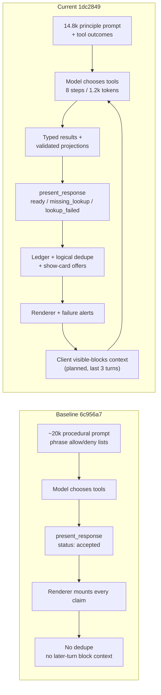

# What2Reg AI — V2.3.5-A Independent Implementation & Behavioral Acceptance Audit

| Field | Value |
|---|---|
| Audit date | 2026-10-26 |
| Repository | `/Users/thomaswu/workspace/next-web` |
| Branch | `feat/global-assistant-v2` |
| Audited HEAD | `1dc2849` (docs-only commit after `7376d14`) |
| Pre-milestone baseline | `6c956a7` |
| Milestone range | `6c956a7..1dc2849` — 27 commits, 66 files, +6,161 / −548 |
| Method | Source audit, diff and commit reconstruction, artifact forensics, fresh repository gates, independent reviewer reconciliation |
| Constraints honored | No application source, prompt, schema, fixture, grader, configuration, migration, or test was modified; no merge, push, PR, or later milestone work was started |
| **Verdict** | **CHANGES REQUIRED** |

---

## 1. Executive summary and verdict

V2.3.5-A is a substantial and, in several respects, well-designed milestone. It replaces the phrase-gated procedural prompt with a shorter principle-based one; introduces typed data failures instead of relying on empty lists; attaches rating scales, sample sizes, and explicit data gaps to assistant-facing projections; replaces the meaningless `accepted` presentation receipt with per-item eligibility; adds logical card deduplication, per-turn visible-block context, and manual show-card affordances; and adds a real-model evaluation harness with a holdout. Fresh gates at HEAD are green: **262 test files / 2,161 tests**, TypeScript **0 errors**, lint **0 warnings**, and a successful production build.

The milestone nevertheless fails acceptance on behavior and on evidence integrity:

- The preregistered development live score is **27/48 = 0.5625**, below the **0.85** floor. **A 27/48 live score against an 85% threshold is not a pass.** The holdout is **7/8**, but one holdout case (`holdout-evaluate-zh`) is structurally unpassable and the holdout contains no partial-failure case at all.
- The prompt rewrite removed the baseline's explicit “what-is / bare code / colloquial what” card exclusions while keeping a broad “exploring or weighing up one course” inclusion. Live evidence shows the result: **3/3** “What is GEST1004?” turns show a detail card, and **3/3** first turns of `journey_explore` do the same. This is a real card-flood regression, not a grader artifact.
- In the multi-turn explore journey, “Tell me more” **3/3** times produces a section card rather than the required course detail card. The single-turn `tell_more` case passes, so the scripted journey test does not cover the live failure.
- Difficulty handling is mostly correct, but one live case contains a genuine inversion: the reply states **“CHAN TAI MAN ranks noticeably easier on the difficulty score (2.58 vs 3.88)”**, contradicting its own table. The advertised **2/6** metric is nevertheless invalid: it counts whole-turn passes, so the real direction result is **5/6**, not 2/6.
- The reported **2** false-card-claim violations are both matches on prose (“the assessment details above…”), not claims that a card was displayed. The reported **1/3** partial-failure result is also invalid: all three replies are honest; two fail only a narrow `couldn't|could not|unable` phrase check. A charitable re-score that removes confirmed grading artifacts is still only **38/48 = 0.792**, below 0.85.
- The recorded evaluation is **not reproducible from HEAD**. Recorded `settings.eval` fingerprints (`e54391e9b352` dev, `5f01f303a2fa` holdout) match commit `ee3d17d`; HEAD hashes differently because `02e777f` changed the grader and `f15bc3f` changed the dev `compare_courses` case. Under HEAD's cases the same traces would score **25/48**, because `compare_courses` was changed from `card: "none"` to `card: "any"`, and `"any"` makes a card mandatory.
- Presentation truthfulness has real edge-case defects: the `lookup_failed` note promises “no card will appear” while claimed failed lookups still mount an error card; receipts are computed from raw model arguments while execution uses referent-bound arguments; and a claimed lookup with no result can mount a permanent loading block while suppressing the manual show offer.
- Academic data still has honesty holes: dropped section rows do not clear `sectionDataComplete`; an empty section list is mapped to `not_found` during timetable candidate resolution; and a partial `get_course` outage can return “Unknown Course” / “0” credits as a success and cache the failure for an hour.
- Authenticated browser acceptance is **UNVERIFIED**. No signed-in Clerk session was available in this audit, and jsdom is not a substitute.

The architecture is not the problem in the main. The validated projections, typed failures, receipt eligibility model, ledger, and dedupe are sound foundations and should be kept. The failure is a combination of one concentrated prompt-policy contradiction, a few renderer/receipt edge cases that break the honesty contract, data-adapter holes that undermine the new error taxonomy, and an evaluation harness whose metrics do not measure what they claim.

**Verdict: CHANGES REQUIRED.** The implementation is substantially complete, but confirmed in-scope defects and failed acceptance gates remain. Browser acceptance is a release condition, not the sole reason for the verdict.

---

## 2. Verified repository state and commit range

### 2.1 State

| Item | Verified value |
|---|---|
| Current branch | `feat/global-assistant-v2` |
| HEAD | `1dc2849` (`docs(assistant): record the V2.3.5-A gates on the typechecked tree`) |
| Baseline | `6c956a7` — confirmed ancestor of HEAD |
| Merge base with `main` | `0ff1e7abea13579155149ace5d75096985b416b1` (branch is 272 commits ahead of `main`; V2.3.5-A is the 27 commits after the baseline) |
| Commits in range | 27 |
| Diffstat | 66 files changed, 6,161 insertions, 548 deletions |
| Working tree | Modified: `.env.example`, `lib/database/get-course-info.ts`, `lib/rate-limit.ts`, `tests/rate-limit.test.ts`; untracked: `docs/superpowers/audits/` |
| Unrelated commits | None inside `6c956a7..1dc2849`; the working-tree modifications predate this audit and were not created by it |

The untracked `docs/superpowers/audits/` contains the earlier discovery audit and this report. No audit action changed tracked files.

### 2.2 Fresh gates at HEAD

All commands were run from the repository root on the current working tree.

| Gate | Command | Fresh result |
|---|---|---|
| Tests | `npx vitest run` | **PASS** — 262 files, 2,161 tests, exit 0 |
| Typecheck | `npx tsc --noEmit` | **PASS** — 0 errors |
| Lint | `npm run lint` | **PASS** — `eslint . --max-warnings=0`, no output |
| Build | `npm run build` | **PASS** — `next build` completed |
| Hygiene | `git status --short` | Expected pre-existing modifications + untracked audit docs only |

The reported gates at `7376d14` and the fresh gates at HEAD are consistent. `1dc2849` is documentation-only, so the code tested is the same code reported at `7376d14`. The four modified working-tree files do not affect the assistant test selection and were included in the fresh runs exactly as they exist; the modified `lib/rate-limit.ts` is discussed in §14.

---

## 3. Complete implementation inventory

| Component | Before (`6c956a7`) | After (`1dc2849`) | Why changed | User impact | Test evidence |
|---|---|---|---|---|---|
| Static prompt (`lib/assistant/prompt.ts`) | ~20,064 chars of procedural rules, including explicit card exclusions for what-is, bare code, and colloquial what | 14,784 chars, principle-oriented, with a broad card-inclusion sentence at `prompt.ts:22` | Reduce contradictions and phrase gating | Shorter and more coherent, but reintroduces card over-firing on what-is questions | Prompt policy tests; live `explain`/`journey_explore` |
| Tool descriptions and schemas (`lib/assistant/tools.ts`, `tool-schemas.ts`, `assistant-output-schemas.ts`) | Mixed error semantics; `get_instructor` threshold semantics undocumented | Typed outcomes; `notAvailableOnSite`; `sampleSize`, `ratingScale`; `minEase` documented | Make the model reason from outcomes | Better grounding; descriptions still do not expose `planComplete` | Tool schema tests; live evaluate |
| Academic projections (`lib/assistant/academic-facts.ts`) | Raw rows | Validated DTOs with `ratingScale`, `notAvailableOnSite`, sample size, zero-aggregate nulling | Prevent unsupported claims | Removes fabricated ratings and undisclosed gaps | `academic-facts` tests |
| Rating semantics (`lib/assistant/rating-semantics.ts`) | “Overall” gloss ambiguous; threshold implicit | Result gloss corrected; `SMALL_REVIEW_SAMPLE = 5`; difficulty gloss “1 Very hard, 5 Very easy; a higher number is easier” | Fix direction and sample-size interpretation | Correct direction in most replies; one live inversion remains | Unit tests; live `evaluate`, `instructor_easier` |
| Error taxonomy (`runReadOnlyTool`, `McpToolError`) | Search/data failures often surfaced as empty data | `invalid_request`, `not_found`, `temporarily_unavailable` distinguished at the wrapper | Honest failure prose | Live partial-failure replies are honest; adapters still leak in places | `tools` tests; live `partial_failure` |
| Presentation receipts (`lib/assistant/presentation.ts`) | `{ status: "accepted" }` | `{ status: "requested", items: [ready \| missing_lookup \| lookup_failed] }` | Stop treating a server action as proof of rendering | Truthful at the item level in common paths; edge cases in §8 | Presentation tests |
| Card dedupe and planning (`planRichBlocks`, `claimedLookupWinners`) | Every claimed call could render | Logical dedupe by canonical course / course+instructor; first successful result wins | Prevent duplicate cards | Duplicate suppression works in normal paths | `presentation` tests; integration |
| Frontend rendering (`components/assistant/assistant-chat-view.tsx`) | Cards rendered per tool result | Planned rich-block stack, claimed-card dedupe, failure alerts, show-card offers | Controlled presentation | Cards are stable; no-result claimed cards can stick in loading | Integration tests; no browser |
| Show-card affordances | None | “Show {code} details” / “Show {code} class times” when an unclaimed successful lookup exists | Recover from suppressed cards | Useful; expansions are per-turn local state | Integration tests; class-times button untested |
| Visible-block context (`lib/assistant/visible-blocks.ts`, `use-visible-blocks.tsx`) | None | Client publishes a 900-char, 3-turn summary of planned blocks | Let later turns refer to earlier cards | Helps continuity; summary is planned, not mounted, and includes the current turn | Unit tests; no browser |
| Conversation shaping (`lib/assistant/conversation.ts`) | Last 8 turns; tool stubs truncated | Unchanged caps: 8 prior turns, 200-char tool content in memory | Bounded context | Older evidence unavailable; document limit | Unit tests |
| Referent and scenario injection (`lib/assistant/agent.ts`, `course-referent.ts`, `timetable-scenario.ts`) | Course referent; timetable scenario | Same, plus ledger reset/seed and reply script | Keep follow-ups coherent | Good on referent flows; `visible-block` interaction is client-derived | Integration tests |
| Model/runtime (`lib/assistant/model.ts`, `agent.ts`) | DeepSeek Flash, thinking off, 1,200 output tokens, 8 steps | Unchanged | No provider change in scope | Budget still bounds multi-step recovery | Eval settings; config tests |
| Tests and evals (`tests/assistant`, `evals/assistant`) | Unit + V2.3 integration | V2.3.5-A journeys; live agent-behavior dev + holdout; scripted CopilotKit suite | Verify the milestone | Scripted tests green; live dev fails threshold; holdout weak in coverage | See §12 |
| Documentation (`docs/superpowers/specs|plans|verification`) | V2.3 reports | Spec, plan, verification report | Record decisions | Verification overstates several criteria | Reviewed in §4, §10 |

**Code present but not on the production behavior path**

- `planComplete` is produced by `check-plan-conflicts.ts:183` but is not named in the prompt or the tool description (`check-plan-conflicts.ts:22` mentions only `sectionListComplete` and per-section `complete`). The model can therefore say “no clash” without a signal that the saved plan itself was incomplete.
- The eval harness (`evals/assistant/*`) is development-only and skipped without `AI_API_KEY`; its fixtures and failing-query switch do not exist in production.
- Test-only environment values in `vitest.config.ts` (Supabase URL and secret) do not alter production configuration.

**Dependencies, migrations, configuration**

- No new runtime dependency, migration, or environment variable was introduced for behavior. CopilotKit remains `1.79.1`, Next `15.5.28`, TypeScript `5.2.2`, `@ai-sdk/deepseek` `2.0.76`.
- Runtime limits are unchanged: 30 user turns per conversation, 8 prior turns of history, 256 KB request body, 30 requests/hour and 80/day per user, 8 model steps, 1,200 output tokens.

---

## 4. Original plan versus actual implementation

### 4.1 Workstream status

| Workstream | Status | Evidence |
|---|---|---|
| A1 — principle prompt | **Fully implemented** | `f2e8ba5`; prompt 14,784 chars; policy tests |
| A2 — intent and referent handling | **Partially implemented** | Typed outcomes and referents in place, but the card policy contradicts the spec's what-is rule |
| A3 — truthful presentation receipts and dedupe | **Fully implemented, with edge-case defects** | `31da5d6`, `9ab6473`, `668c8a1`; §8 |
| A4 — error honesty | **Partially implemented** | Wrapper taxonomy correct; adapters still convert some failures to empty or placeholder success |
| A5 — academic correctness | **Fully implemented for semantics; partial for section completeness** | `77bd6d7`, `111b2eb`, `52969de`; §9 |
| A6 — tests, evals, docs | **Fully implemented; acceptance not met** | `f025c0c`…`1dc2849`; live dev 27/48 |

### 4.2 Classification

| Requirement | Classification | Note |
|---|---|---|
| Remove prompt contradictions (C1–C9) | **Partially implemented** | C5/C6 are only partially removed: the what-is exclusion is gone while the card-inclusion sentence remains; the receipt rule still speaks in absolute terms about cards. |
| Academic-focused, shorter prompt | **Fully implemented** | 20,064 → 14,784 chars. The reduction is real, not cosmetic. |
| Natural evaluation recognition | **Implemented but unverified for production quality** | Live `evaluate` texts are substantively correct; the case fails on grading mechanics. |
| Rich detail without trigger phrases | **Implemented incorrectly at the policy boundary** | “Tell me more” works single-turn; what-is over-fires; the multi-turn journey picks sections. |
| Simple facts concise | **Partially implemented** | `quick_fact` 3/3; `explain` 0/3 because a card is added to a what-is answer. |
| No false receipt-as-rendered | **Fully implemented in normal paths; edge cases remain** | Receipt is no longer `accepted`; `lookup_failed` note is false for claimed failures. |
| Cards use validated data | **Fully implemented** | `academic-facts.ts` projections and ledger eligibility. |
| Mixed success/failure truthful | **Implemented and behaviorally good; measurement invalid** | All three live partial replies are honest; the 1/3 metric is a phrase artifact. |
| Difficulty direction | **Partially implemented** | Data contract and prompt are correct; one live reply inverts. |
| Review sample size | **Fully implemented** | `sampleSizeOf` and `SMALL_REVIEW_SAMPLE`. |
| No unsupported verified exam claims | **Fully implemented** | `no_midterm` 6/6 and 0 certainty violations. |
| Timetable semantics | **Implemented; conversation threshold missed** | V2.3 suites pass; conversation 0.778 vs 0.90. |
| No planner mutation | **Fully implemented** | Read-only guards and integration tests. |
| Tests, lint, TS, build | **Fully implemented** | Fresh gates green. |
| Real-model eval completed | **Implemented; threshold failed** | Dev 0.5625 < 0.85. |
| Browser acceptance | **Not implemented / unverified** | No signed-in run. |

### 4.3 Plan tasks reported by the implementation

- **Task 7 (show-card affordances):** fully implemented. The class-times button has no automated test (noted by the verification report and confirmed here).
- **Task 8 (presentation policy tests):** implemented, but the tested policy conflicts with the spec's “What is …?” → concise explanation rule. The tests therefore lock in the regression.
- **Task 9 (student journeys):** 10/10 scripted CopilotKit tests pass. They use a scripted model and do not exercise the live multi-turn card-selection failure.
- **Task 10 (live evaluation):** implemented. Thresholds were preregistered but not met. The dev case file was edited **after** the recorded run (`f15bc3f`), invalidating reproducibility.
- **Task 11 (verification report):** exists, but its acceptance table marks several criteria “Yes” that the evidence does not support (§10, §18).

No in-scope requirement is entirely unimplemented. The failure is in behavior, edge-case correctness, and evaluation validity.

---

## 5. Before/after architecture diagram

### 5.1 Baseline versus current



### 5.2 Current execution sequence

```mermaid
sequenceDiagram
  autonumber
  participant S as Student
  participant UI as CopilotKit UI<br/>(tools, context, renderer)
  participant R as Next.js route<br/>auth / validation / quota
  participant A as BuiltInAgent<br/>middleware + ledger
  participant M as DeepSeek Flash
  participant T as 12 server tools
  participant D as MCP / Supabase

  S->>UI: message or show-card click
  UI->>R: POST /api/copilotkit/agent/:id/run
  Note over R: TRUST BOUNDARY 1<br/>Clerk auth, access check, 256 KB cap,<br/>30-turn cap, fail-closed rate limit
  R->>R: shapeConversation(history=8)
  R->>A: run with shaped messages
  Note over A: OWNERSHIP BOUNDARY<br/>server owns prompt, tools, ledger,<br/>referent, timetable digest
  A->>A: reset ledger; seed from messages;<br/>resolve course referent; inject script
  A->>M: prompt + tool descriptions +<br/>page/course/timetable/visible-block context
  M-->>A: tool calls (parallel or sequential)
  A->>T: execute read-only tool
  T->>D: cached query / MCP RPC
  D-->>T: data or McpToolError
  T-->>A: typed result; trackLookup(raw args)
  M-->>A: present_response(course_detail / course_sections)
  A->>A: await pending; compute item eligibility
  A-->>UI: receipt ready / missing_lookup / lookup_failed
  Note over UI: TRUST BOUNDARY 2<br/>client plans blocks, dedupes, mounts;<br/>client context is a UI hint, never authority
  UI->>UI: planRichBlocks + claimedLookupWinners<br/>+ failure alerts + show offers
  UI-->>S: reply + cards + affordances
  UI->>A: continuation after frontend tool;<br/>next run includes visible-block context
  Note over R,D: No write path to the planner.<br/>Frontend tools: navigate, filter_catalog_results.
```

**Runtime boundaries verified**

- Maximum steps: 8 (`agent.ts:26`). Output budget: 1,200 tokens. Thinking off.
- Request body: 256 KB (`conversation.ts:3`); 30 user turns; 8 history turns; 30/hour, 80/day.
- Server tools: 9 academic tools in `tools.ts`, `present_response`, `preview_timetable`, `check_plan_conflicts` — 12 total. Frontend tools: `navigate`, `filter_catalog_results`.
- Tool execution is read-only; the planner and saved timetable are not mutated.
- Server ledger is per-run and seeded from client-supplied messages; visible-block context is entirely client-supplied. Neither grants authority.

---

## 6. Effective prompt and instruction comparison

### 6.1 Measured size

| Component | Baseline | Current | Notes |
|---|---:|---:|---|
| Static prompt | 20,064 chars | 14,784 chars | −5,280 chars (−26.3%); the verification report's 20,066/20,319 figures differ by 2 chars / an older measurement and are immaterial |
| Tool descriptions | 9 academic tools | 12 server tools | Second-largest static component; not separately instrumented |
| Conversation history | 8 prior turns; 200-char tool stubs | Unchanged | Bound is structural, not prompt text |
| Visible blocks | none | ≤900 chars, 3 turns | Client-supplied; `visible-blocks.ts:18`, `:216` |
| Timetable digest | present | present, replaces raw client context | `agent.ts` middleware |
| Course referent / page context | present | present | Server-resolved referent is authoritative |

The static character count understates the instruction burden: tool descriptions, the dynamic timetable digest, page context, and visible blocks all compete for attention. The relevant improvement is not the 26% reduction; it is that the rules were re-expressed as outcomes (“what the data means”) rather than phrases.

### 6.2 What moved where

| Change | Kind | Assessment |
|---|---|---|
| Tool failure taxonomy | Prompt → tool results and wrapper | Genuine improvement; the model now sees `not_found` vs `temporarily_unavailable`. |
| Rating direction and sample size | Prompt prose → structured fields and glosses | Genuine improvement; one live inversion remains a model error, not a data-contract error. |
| Card eligibility | Prompt phrase lists → receipt statuses and ledger | Partially successful; the prompt still carries a broad card rule, and the receipt is not a render proof. |
| Review-before-recommendation | Kept in prompt, reinforced by tool guidance | Improved; `evaluate` replies use review data. |
| What-is card exclusion | **Removed** | **Regression.** This is the root cause of `explain` 0/3 and journey turn 1. |
| “Tell me more” inspection | Kept, but same-turn lookup constraint added | Creates the journey turn 3 failure: the model inspects sections instead of re-issuing `get_course` + detail card. |

### 6.3 Remaining contradictions

1. **Card on what-is vs concise explanation.** `prompt.ts:22` says a card helps when the student is “exploring or weighing up one course, or wants to know more about it.” The spec's required-intent table says “What is GEST1004?” → concise explanation. The baseline explicitly excluded what-is, bare-code, colloquial-what, and one-sentence explain requests; the rewrite deleted that exclusion. Live behavior follows the new sentence, not the spec.
2. **“Tell me more” vs same-turn lookup.** `prompt.ts:23` says a `missing_lookup` item should be looked up “in this turn first or answer in text.” In the multi-turn journey the model re-reads description/ILO/sections and claims sections rather than `course_detail`. The single-turn `tell_more` case passes because the lookup and claim occur in one turn.
3. **Visible blocks “actually displayed” vs planned blocks.** The context description claims blocks “the chat actually displayed” (`visible-blocks.ts:15-16`), but the summary is built with `planRichBlocks(..., false)` (`visible-blocks.ts:179`), includes the latest turn (`:215`), and omits manual expansions. The model can therefore make a true-sounding claim about a block the student never saw.
4. **Receipt truth vs renderer behavior.** The receipt note says `lookup_failed` means “no card will appear” (`presentation.ts:25-26`), but `planRichBlocks` pushes claimed calls without checking `lookupOk` (`presentation.ts:428-479`), so the renderer can show a failure card.

### 6.4 Reasoning latitude

| Capability | Assessment |
|---|---|
| Understand broader intention | Improved; `evaluate`, `alternatives`, and `workload` replies are substantively correct. |
| Choose academic evidence | Improved; reviews, ratings, sample sizes, and gaps are used. |
| Investigate without clarification | Mixed; multi-step recovery sometimes chooses the wrong tool family (sections vs detail). |
| Explain trade-offs | Improved; live prose compares instructors and courses usefully. |
| Choose rich UI when it helps | **Still rule-shaped**; over-fires on what-is, under-fires on multi-turn tell-more. |
| Communicate uncertainty | Good in partial failure and missing-data prose; one inversion in instructor comparison. |
| Use prior conversation context | Bounded by 8 turns and 200-char tool stubs; visible blocks help but are planned-state only. |

### 6.5 Required conclusion

1. **Meaningfully better structured?** Yes. The outcome-based error and data semantics are real architectural improvements.
2. **Merely shorter?** No. Moving error, rating, and completeness semantics into data contracts is substantive.
3. **Still overly procedural?** In the card layer, yes. The broad inclusion sentence is a policy rule wearing principle language, and it directly causes the what-is regression.
4. **Missing important academic-planning guidance?** Partially. It lacks a clear rule for inspection follow-ups that should reuse a successful lookup, and it does not surface `planComplete`.
5. **In conflict with tool descriptions or dynamic contexts?** Yes: the what-is rule conflicts with the spec and historical suite; the visible-block description conflicts with how the summary is computed; the `lookup_failed` note conflicts with renderer behavior.

---

## 7. Complete tool and error-contract analysis

### 7.1 Tool inventory

| Tool | Data source | Success / empty | Failure mapping | Notes |
|---|---|---|---|---|
| `search_catalog` | Catalog search RPC | Empty list is a valid zero-result search | `temporarily_unavailable` on RPC error; `invalid_request` on schema | Used by alternatives and discovery-like flows |
| `count_courses` | Catalog count | Zero is valid | Same | Count-only |
| `get_course` | `course_catalog` / `course_noporf` fallback | Returns course + instructors | `not_found` only when title is “Unknown Course” **and** no instructor rows; otherwise `temporarily_unavailable` | D9 remains: partial outage can be success with placeholders (§7.4) |
| `get_course_description` | Catalog text | Text up to 6,000 chars | `not_found` / `temporarily_unavailable` | Not a card trigger |
| `get_course_ilo` | Catalog ILO | List | Same | Not a card trigger |
| `get_instructor` | `prof_with_course` | Empty filtered list is an empty success; restrictive-filter fallback distinguishes true miss | `temporarily_unavailable` | `minEase` uses `.gte("hard", …)`; no equivalence merge |
| `get_course_reviews` | Mapping + review RPC | Empty array + `hasMore` | Mapping error / RPC error → `temporarily_unavailable`; no mapping → `not_found` | Non-array payload becomes empty success; `hasMore` computed after privacy filtering |
| `count_reviews` | Count RPC | Zero valid | Same | — |
| `get_course_sections` | Schedule RPC | Empty list means none listed for that instructor this term | `temporarily_unavailable` | `sectionDataComplete` misses dropped rows |
| `present_response` | Ledger | Per-item `ready` / `missing_lookup` / `lookup_failed` | Never throws for missing data | Receipt, not render proof |
| `preview_timetable` | Deterministic engine | Preview payload | Typed failure | No planner write |
| `check_plan_conflicts` | Deterministic engine | Conflict list + `planComplete` + `sectionListComplete` | Typed failure | `planComplete` undocumented to model |

Frontend tools: `navigate` (allowlisted internal routes) and `filter_catalog_results` (client-side catalog filtering).

### 7.2 Error path

```
adapter (MCP / Supabase)
  → McpToolError(code)
  → runReadOnlyTool: invalid_request | not_found | temporarily_unavailable
  → assistant projection (validated)
  → model-visible tool result
  → prose + tool activity card
```

| Outcome | Wrapper behavior | Student-facing expectation | Verified |
|---|---|---|---|
| Success with data | Pass through projection | Use it | Yes |
| Success with zero results | Pass through empty list | “Nothing matched that query” | Yes |
| `not_found` | Specific record absent | “That exact record is not on the site” | Yes |
| `invalid_request` | Malformed call | Correct and retry | Yes |
| `temporarily_unavailable` | Lookup failed | “I couldn’t check right now”; never “nothing exists” | Yes at wrapper; adapter leaks in §7.4 |
| Incomplete/truncated | `sectionDataComplete` / `complete` | Qualify | Partial; dropped rows not flagged |
| Authorization | Route-level 401/403 | Fail closed | Yes |
| Rate/step limit | 429 or budget exhaustion | Honest limit message | Yes |

### 7.3 Mixed-result behavior

- Prompt guidance is strong: `prompt.ts:16` explicitly says to answer from successes and name what could not be checked, and not to turn a failed lookup into “nothing exists.”
- Live behavior matches the guidance. In all three `partial_failure` traces the assistant preserves the successful results and names the failure. Representative text: “the GEST search failed three times… a service problem, not proof that no GEST courses exist.” The 1/3 score is a phrase-matching artifact (§10.3).
- The integration test J5 covers a failed lookup beside a populated list. That test uses a scripted model, so it verifies the plumbing, not model judgment.

### 7.4 Adapter and contract defects

| Defect | Evidence | Impact |
|---|---|---|
| `getCourseInfo` returns `{}` if both tables fail, cached 3,600 s | `lib/database/get-course-info.ts:66`; cache config | A partial outage can be cached as empty for an hour |
| `getProfListByCourse` returns `[]` on query error, cached 3,600 s | `lib/database/get-prof-info.ts:57-75` | Failure cached as “no instructors” |
| `getCourse` only throws `not_found` when title is “Unknown Course” **and** no instructors | `lib/mcp/data/get-course.ts:21-32`, `:128` | With instructor rows during a catalog failure, “Unknown Course” and credits `"0"` pass as success |
| Placeholder filter only removes literal `"Unknown"` | `get-course.ts:32` | “Unknown Course”, “0”, and “Unknown” field values can leak |
| `get_course` does not pass the request signal to `getCourse` | `lib/assistant/tools.ts:155-160` | A slow query can outlive the run |
| `get_instructor` queries by `prof_id` without course-equivalence merge | `lib/assistant/data/instructor.ts` | Renamed/alias courses can appear twice with split review counts |
| Non-array review payload becomes a successful empty page | `lib/mcp/data/get-course-reviews.ts:61-64` | A malformed response looks like “no reviews” |
| `hasMore` computed after privacy filtering | `get-course-reviews.ts:129` | Can report a false last page |
| `projectSection` drops non-object/unnamed rows without clearing completeness | `lib/mcp/data/get-course-sections.ts:101-106`, `:152`, `:155-162` | `sectionDataComplete` can be true despite dropped sections |
| `resolveCandidate` maps an empty section list to `not_found` | `lib/assistant/timetable-candidates.ts:73`, `:79` | An offering with no listed sections is reported as nonexistent |
| `planComplete` not referenced by prompt or description | `check-plan-conflicts.ts:183`; `:22` | “No clash” can ignore an incomplete saved plan |

These are in-scope because V2.3.5-A's central claim is that failures and incompleteness are surfaced honestly.

---

## 8. Rich UI presentation and visibility lifecycle

### 8.1 Receipt semantics

`executePresentResponse` waits for pending lookups (`presentation.ts:328`), then returns `{ status: "requested", items }` with `eligibilityForItem` (`:317-322`):

| Status | Derived from | What it guarantees | What it does **not** guarantee |
|---|---|---|---|
| `ready` | At least one successful recorded lookup for the item | A validated lookup exists and the client has enough data to plan a card | That React mounted it, that it is in view, or that the student saw it |
| `missing_lookup` | No recorded lookup matched | No same-turn lookup was recorded | That a card cannot appear (a later step may run the lookup first; see race below) |
| `lookup_failed` | Lookups matched but none succeeded | No successful data for the item | That no card will appear — the renderer still mounts a claimed failure card |

The server cannot verify mounting. The implementation correctly stopped using `accepted`, but the note at `presentation.ts:25-26` overpromises for `lookup_failed`.

### 8.2 Renderer lifecycle

| Scenario | Behavior | Assessment |
|---|---|---|
| Same-turn successful lookup + claim | Planned, deduped, mounted | Correct |
| Earlier-turn course inspection | New run must repeat the lookup to claim; otherwise text | Correct per contract, but hurts multi-turn “tell me more” |
| Multiple lookups for one course | `claimedLookupWinners` picks first successful logical key | Correct |
| Alias/canonical code | Dedupe by canonical identity when parseable | Correct for successful results; receipt uses raw args (§8.3) |
| Result arrives after `present_response` | Same-step race: receipt says `missing_lookup`, client may still mount | Minor inconsistency |
| Streaming | Shows planned card; show offers withheld until streaming ends (`assistant-chat-view.tsx`) | Reasonable |
| Missing lookup data | No card planned; show offer if a later lookup succeeds | Correct |
| Failed claimed lookup | Failure alert card mounts despite `lookup_failed` note | **Defect** |
| Superseded claims | Last non-empty valid claim wins; empty `show` preserves prior | Correct |
| Duplicate cards | Logical dedupe per turn and against mounted keys | Correct in normal paths |
| Claimed lookup with no result, `running=false` | Loading block mounts permanently; show offer suppressed | **Defect** |
| Component unmount/remount | Expanded cards reset only on panel close; normal navigation preserves | Partial |
| Sidebar close/reopen | `AssistantChat` unmounts after 300 ms (`assistant-panel.tsx:127-130`); expansions and draft reset | Acceptable UX, but undocumented |
| Page change | Contexts update; cards remain per message | No evidence of corruption |
| New chat | Conversation state clears | Correct by architecture; not browser-verified |
| User switch | New auth session; no cross-user cache | Correct; not browser-verified |

### 8.3 Receipt/argument mismatch

`trackLookup` records the **raw** model arguments (`presentation.ts:237`; called with `args` at `tools.ts:160`), while execution uses referent-bound arguments (`tools.ts:155-158`). If `bindCourseToolArgs` rewrites a code (referent or alias), the ledger can record a different code from the one queried. Consequences:

- A receipt can report `missing_lookup` even though a lookup ran, prompting an unnecessary duplicate call.
- A card can be planned under a raw argument while dedupe uses the canonical result, producing an inconsistent key.
- Confidence: high from code inspection; not observed in a live trace.

### 8.4 Visible-block feedback

Answers to the brief's nine questions:

1. **Where stored:** client-side, via `useAgentContext` (`use-visible-blocks.tsx`), recomputed from `agent.messages`.
2. **How computed:** `summarizeVisibleBlocks` (`visible-blocks.ts:196-226`) replays `get_course` / `get_course_sections` calls with `planRichBlocks(..., false)` (`:179`).
3. **Requested, eligible, mounted, or visible?** **Planned**, not mounted and not viewport-visible. The description says “actually displayed” (`:15-16`), which overclaims.
4. **Can the frontend publish false or stale state?** Yes — it is client-supplied and unrevalidated. It only affects the same user's model context, so it is not an authorization issue.
5. **Do mounted blocks outside the viewport count?** Yes; there is no viewport or interaction check.
6. **Survives close/reopen?** The messages survive, so the summary is recomputed after remount; per-turn expanded state does not.
7. **Reset on new chat/account switch?** Yes, because it derives from the new message list. Not browser-verified.
8. **Earlier-turn and expanded blocks?** Earlier-turn planned blocks yes, limited to the last 3 turns and 900 chars (`:216`, `:220`). Manual expansions are omitted entirely.
9. **Compatible with persistence?** Only if persistence retains raw tool calls/results. A summary-only history cannot reconstruct it. The current client-derived approach also lacks a server-issued turn identity (see §15).

Additional behavior: the latest turn is included in the summary (`latestTurn` at `:215`), so the model can be told about blocks from the turn it is currently answering; the prompt says to rely only on “an earlier turn” (`prompt.ts:23`). This is a contradiction between dynamic context and instruction.

### 8.5 Show-card expansion controls

The controls work for the normal case: an unclaimed successful lookup produces an offer, clicking expands the card into the rich-block stack, and subsequent turns still have the underlying tool result in message history. However:

- Expansions are stored in `expandedShowCards` local state (`assistant-chat-view.tsx:215`), are not published to visible blocks, and reset on panel close.
- In the brief's sequence — text answer, click “Show GELH1000 details,” then “What do you think about that information?” — the assistant can recover the data from the prior tool result if it is still inside the 8-turn/200-char window, but it cannot know the student expanded the card. If the tool result was truncated or aged out, the assistant may not know what was shown.
- This is a **genuine conversation-consistency problem**, but a bounded one. The minimum solution is to publish expanded card identities (not every toggle) into the same client context, or to treat “expanded” as equivalent to a claimed card for the turn summary. Full persistence belongs to V2.3.5-C.

### 8.6 Adaptive presentation

| Student phrasing | Expected | Observed / inferred | Classification |
|---|---|---|---|
| “I'm considering this course.” | Optional card | Card in live `journey_explore` turn 2 **not** shown, but case requires `any` | Case artifact; spec says optional |
| “How is GELH1000?” | Evaluation + optional detail | Live `evaluate` replies include course data; card not required by spec | Substantively good |
| “Would you recommend it?” | Advice grounded in reviews | `evaluate` uses reviews and counts | Good |
| “I'm choosing between these two.” | Comparison without card stack | `compare_courses` prose is good; one card allowed since `f15bc3f` | Good, but case was retroactively relaxed |
| “Tell me more about the course.” | Detail card | Single-turn passes; multi-turn journey claims sections | **Real failure** |
| “What does GEST1004 cover?” | Description, no card needed | Description tool used | Good |
| “How many credits?” | Text only | `quick_fact` 3/3 | Good |
| “When does it meet?” | Sections card/text | `sections` 3/3 | Good |

**Does V2.3.5-A fix the V2.2 phrase-gated presentation problem?** Partially. The model no longer waits for magic phrases for evaluation and comparison, which is a real gain. The limitation has moved rather than disappeared:

- **Prompt:** the broad inclusion sentence over-fires on what-is.
- **Tool call:** the model chooses `get_course_sections` for “tell me more” in the multi-turn journey.
- **Receipt:** edge cases misdescribe failure and race states.
- **Renderer:** claimed no-result lookups can stick.
- **Context:** visible blocks describe planned rather than mounted state.
- **Model:** one comparison inverts the scale.

---

## 9. Academic semantics and difficulty failures

### 9.1 Scale representation

| Surface | Representation | Verified |
|---|---|---|
| Course detail projection | `ratingScale` including difficulty “1 Very hard, 5 Very easy; higher is easier” | Yes (`academic-facts.ts:6`, `:71`) |
| Instructor detail | Same `ratingScale` | Yes (`:80`) |
| Instructor search | Same | Yes |
| Review aggregates | `withRatingSemantics` adds sample size and nulls zero aggregates | Yes (`:43`) |
| Tool outputs | Scale and `sampleSize` fields | Yes |
| UI renderers | Cards consume projected data | Yes |
| Model instructions | Difficulty gloss in prompt/tool descriptions | Yes |

The data contract is correct. The remaining difficulty failure is a model reasoning/inconsistency error, not a missing scale.

### 9.2 The six difficulty-graded turns

The grader's `DIFFICULTY_DIRECTION_CASES` are `evaluate` and `instructor_easier` (3 repetitions each = 6 turns). The metric counts **whole-turn pass** (`agent-behavior-grade.ts:182-184`), not whether the direction was correct.

| Case / repeat | Direction result | Other failing check | Classification |
|---|---|---|---|
| `evaluate` r0 | **Correct** (`forbid` true) | `mention` (counts in a table, not “N reviews”) | Grading artifact |
| `evaluate` r1 | **Correct** | `card` (case requires a card, spec does not) | Grading artifact |
| `evaluate` r2 | **Correct** | `card` + `mention` | Grading artifact |
| `instructor_easier` r0 | **Inverted** (`forbid` false) | — | **Real model failure** |
| `instructor_easier` r1 | Correct | — | Pass |
| `instructor_easier` r2 | Correct | — | Pass |

**Actual direction correctness: 5/6.** The reported 2/6 is not a direction measure.

The genuine inversion is specific and self-contradictory. The reply's table is correct:

```
| Difficulty (5 = easiest) | 2.58 | 3.88 |
```

It then says “So LEE MEI LING looks easier…” (correct), but later: **“CHAN TAI MAN ranks noticeably easier on the difficulty score (2.58 vs 3.88)”** (false), and ends by recommending CHAN for the “lower difficulty score.” Because 2.58 means harder on a scale where 5 is easiest, this is a real academic-advice error. It is not caused by missing metadata; the model used the gloss correctly earlier in the same reply.

### 9.3 Ratings and review samples

| Property | Implementation | Assessment |
|---|---|---|
| Sample count | `commentCount` + `sampleSize: none \| small \| adequate` | Correct |
| Small-sample warning | `< 5` is `small`; prompt says to hedge | Correct |
| Course-specific vs instructor-wide | Separate rows; prompt warns not to merge | Correct |
| No-review behavior | Zero aggregates nulled; `sampleSize: none` | Correct |
| Missing values | Nulls preserved; prompt forbids invented numbers | Correct |
| Historical relevance | Reviews are dated; historical tool retained | Correct, but no age filtering |
| Sort direction | `sortBy: ease` maps to `hard`; `minEase` uses `.gte("hard", …)` | Correct (`instructor.ts:96`) |
| Difficulty threshold | Higher minimum keeps easier courses | Correct |
| Overall rating | Gloss corrected to “higher is more positive” | Correct |

Schema compatibility: the new fields are additive at the assistant boundary. Public MCP DTOs were not broken. Older tests were aligned in `52969de`, and pre-existing test drift was repaired in `f025c0c` without relaxing assertions.

### 9.4 Midterm/final claims

- There is no structured official exam field in the site data. The prompt and `notAvailableOnSite` say assessment format is unavailable.
- Student-review anecdotes are allowed and must be qualified as such. Live `no_midterm` is 6/6 with **0** certainty violations.
- The inversion case above is a difficulty error, not an exam-policy fabrication.

### 9.5 Section completeness

| Property | Behavior | Assessment |
|---|---|---|
| Term echo | Output includes `term` | Correct |
| Per-section `complete` | Set false for malformed schedules and meeting caps | Correct for those cases |
| `sectionDataComplete` | False for `droppedData` and the 20-section cap | Correct for malformed schedules/caps |
| Dropped section rows | `projectSection` returns null for non-object/unnamed rows; filtered without setting completeness | **Defect** |
| Unsupported weekdays | Dropped as malformed schedule; sets `droppedData` | Correct |
| Empty offering | `resolveCandidate` → `not_found` | **Defect** for preview/conflict |
| Saved-plan completeness | `planComplete` returned but not surfaced to the model | **Gap** |
| Deterministic engine authority | Preview/conflict use the engine, not the model | Correct |

---

## 10. Live-model evaluation forensic analysis

### 10.1 Reconstruction

| Item | Value |
|---|---|
| Artifacts | `.eval-results/assistant/agent-behavior-v235a-dev.json`, `.eval-results/assistant/agent-behavior-v235a-holdout.json` |
| Dev suite | 12 cases, 16 turns per repeat, 3 repeats = 48 turns |
| Holdout | 8 cases, 8 turns, single run |
| Model | `deepseek-flash`, thinking off, `maxOutputTokens: 1200`, `maxSteps: 8` |
| Tool data | Harness catalog fixture (`AGENT_BEHAVIOR_CATALOG_FACTS`); `partial_failure` uses a failing-query switch |
| Model inference | Live |
| Thresholds | Dev pass ≥ 0.85; holdout ≥ 0.80; falseCardClaim 0; difficulty 1.00; no_midterm 0; partial_failure 1.00 |
| Recorded prompt fingerprint | `b7bca953977e` (matches HEAD) |
| Recorded eval fingerprints | dev `e54391e9b352`, holdout `5f01f303a2fa` |
| HEAD eval fingerprints | dev `523d73abeaf1`, holdout `497c42299028` |

The eval hash covers the grader, catalog, dev cases, and holdout cases (`agent-behavior.eval.ts:87-98`). Both recorded hashes match commit `ee3d17d`, and differ from HEAD because `02e777f` changed the grader and `f15bc3f` changed the dev cases. **The recorded runs cannot be reproduced from HEAD.**

### 10.2 Complete dev failure matrix

| Case | Pass | Failing checks | Verdict |
|---|---|---|---|
| `quick_fact` | 3/3 | — | Pass |
| `explain` | 0/3 | `card` 3 | **Real card-flood failure** |
| `evaluate` | 0/3 | `card` 2, `mention` 2 | Grading artifact; direction correct |
| `tell_more` | 3/3 | — | Pass |
| `journey_explore` | 0/9 | `card` 9 | Mixed: turn 1 real, turn 2 artifact, turn 3 real |
| `instructor_easier` | 2/3 | `forbid` 1 | **One real inversion** |
| `workload` | 2/3 | `falseCardClaim` 1 | Prose false positive |
| `no_midterm` | 6/6 | — | Pass |
| `alternatives` | 5/6 | `card` 1 | Case requires a card the spec calls optional |
| `sections` | 3/3 | — | Pass |
| `partial_failure` | 1/3 | `mention` 2 | All replies honest; phrase artifact |
| `compare_courses` | 2/3 | `falseCardClaim` 1 | Prose false positive |

Dev summary as recorded: `turns 48`, `passed 27`, `passRate 0.5625`, `falseCardClaim 2`, `difficulty 2/6`, `noMidterm 0`, `partial 1/3`.

### 10.3 Failure clusters and root causes

**Cluster 1 — What-is card flood (real).** `explain` 0/3 and journey turn 1 3/3 show a detail card on “What is X?”. The spec's intent table says concise explanation. The baseline explicitly excluded what-is. Root cause: prompt line 22. This is the clearest in-scope behavioral regression.

**Cluster 2 — Journey turn 2 (artifact).** “I'm considering taking it.” produces no card, and the case requires `card: "any"`. The spec says the detail card is optional. The case encodes a stronger requirement than the spec.

**Cluster 3 — Journey turn 3 (real).** “Tell me more.” produces a section card rather than `course_detail` 3/3. This is a wrong-intent/tool-selection failure. The single-turn `tell_more` case passes, which is why the scripted journey did not catch it.

**Cluster 4 — Evaluate (artifact).** All three replies compare the correct instructor direction. Two fail `mention` because the reply presents “Reviews | 31” in a table, and one fails `card` because the case requires a card. None is an academic failure.

**Cluster 5 — False card claims (artifact).** The two violations are prose references to review text:

- `workload` r0: “the exam/essay details above are only what a couple of reviewers said…”
- `compare_courses` r2: “the assessment details above come only from review text…”

The regex `FALSE_CARD_CLAIM` (`agent-behavior-grade.ts:41-42`) matches “details above” without requiring a card claim. In addition, `falseCardClaimCheck` returns true whenever any planned block exists (`:149-152`), so a real false claim accompanied by any card would be excused. This metric is not measuring the invariant.

**Cluster 6 — Partial failure (artifact).** All three replies are honest. Examples:

- r0: “couldn't check” → passes.
- r1: “the GEST search failed three times… a service problem, not proof that no GEST courses exist” → fails only because it lacks the literal `couldn't|could not|unable`.
- r2: “A keyword search for 'GEST' failed twice… checked by department instead” → same.

The `mention` regex is narrower than the behavior the spec requires.

**Cluster 7 — Instructor inversion (real).** One of three. The same reply contains both correct and inverted direction statements. This is a model consistency failure; the data contract supplied the correct gloss and table label.

### 10.4 Holdout

| Case | Result | Note |
|---|---|---|
| `holdout-evaluate` | Pass | Direction correct |
| `holdout-tell_more` | Pass | Single-turn |
| `holdout-quick_fact` | Pass | — |
| `holdout-instructor_easier` | Pass | — |
| `holdout-no_midterm` | Pass | — |
| `holdout-evaluate-zh` | **Fail** | Requires `/\d+ reviews?/i`; Chinese reply uses “24 則 / 31 則”. Structurally unpassable. Language check passes. |
| `holdout-alternatives` | Pass | — |
| `holdout-sections` | Pass | — |

The holdout is **substantively 8/8**, but its recorded 7/8 is not evidence of a real defect. More importantly, the holdout has **no partial-failure case** (the summary reports 0 cases, rate 1) and only 8 turns. It does not cover a key acceptance criterion.

### 10.5 Baseline comparison

| Area | V2.3 evidence | V2.3.5-A evidence | Assessment |
|---|---|---|---|
| Presentation | 29/39 vs 38/39 threshold | `explain`/`short`/`colloquial_what` card changes | **Regression at the policy boundary**, not a mere “policy conflict” |
| Presentation holdout | 9/10 | 9/10 holdout presentation | Comparable |
| Timetable conversation | 0.778 vs 0.90 | Unchanged suite | Below threshold |
| Timetable analysis / retrieval / safety | 0.933 / 1.00 / 1.00 | Unchanged | Good |
| Navigation semantic | 48/54 | Unchanged | Acceptable |
| Natural evaluation | Phrase-gated | Better live prose, but card policy over-fires | Partial improvement |
| Difficulty | Not separately measured | 5/6 direction, 1 inversion | Improved data contract, residual model error |
| Partial failure | Not covered equivalently | Honest prose | Improvement |
| Multilingual | Not in scope | zh case unpassable | Harness defect |

These suites use different fixtures and rubrics. They support directional statements, not a controlled before/after effect size. A fair comparison would run both prompts against the same frozen case set with the same model settings and multiple repeats.

### 10.6 Charitable re-score

Removing confirmed grading artifacts only (not real failures): `evaluate` +3, journey turn 2 +3, `alternatives` +1, `compare_courses` +1, `workload` +1, `partial_failure` +2 = +11, yielding **38/48 = 0.792**. This is a diagnostic bound, not a substitute for the registered metric. Even under the most charitable reading, the milestone is below 0.85 (41/48 needed). Under HEAD's changed cases, the same traces score **25/48** because `compare_courses` now requires a card.

### 10.7 Root-cause attribution

| Cause | Share of observed dev failures | Evidence |
|---|---|---|
| Conflicting/incomplete instructions | High | What-is card policy; same-turn lookup rule |
| Tool selection/ordering | Medium | Journey turn 3 sections instead of detail |
| Missing academic evidence | Low | Data present in all examined cases |
| Context shaping | Low–medium | 8-turn/200-char history; visible blocks planned-only |
| Semantic data interpretation | Low | One model inversion; scale metadata present |
| Presentation contract | Medium | Receipt edge cases; case policy |
| Model reasoning | Medium | One inversion; some tool-choice variability |
| Execution budget | Low | 8 steps sufficient in traces |
| Harness mismatch | High for the reported score | Metrics and cases |
| Incorrect grading | High for the reported score | §10.3 |

This is not “DeepSeek is the problem.” The architecture supplies correct data and scale semantics; the model still makes judgment errors, and the harness overstates them.

### 10.8 Live verification policy

No new live run was performed for this audit. The brief conditions live work on an authorized environment and a predefined call/cost budget; no such budget was agreed for this audit, and the existing artifacts plus the fingerprint check were sufficient to establish non-reproducibility and the failure clusters. **No number in this report is a new live observation.** A bounded diagnostic rerun is recommended in §17, with a fixed case set, fixed grader, 3 repeats, and a hard call cap, reported in full.

---

## 11. Student journey quality assessment

| Journey | Expected | Evidence | Rating (1–5) | In scope? |
|---|---|---|---|---|
| 1. Explore naturally (“I'm considering GELH1000. Is it good?” → “Tell me more.” → “Which professor is easier?”) | Evaluation, relevant card, grounded comparison, correct direction | Live: what-is first turn over-cards; turn 2 no card (allowed); “Tell me more” shows sections; instructor comparison mostly correct with one inversion in a sibling case | **2** | Yes — card policy and multi-turn recovery |
| 2. Compare instructors (“Which professor would you recommend?”) | Correct instructors, scale, review counts, conditional recommendation | `instructor_easier` 2/3 direction correct; table and review counts good; one reply self-contradicts | **3** | Yes — model consistency |
| 3. Respect a preference (“no midterm” → “What about this course?”) | Preference retained, evidence inspected, anecdotes vs policy | `no_midterm` 6/6; 0 certainty violations; review anecdotes qualified | **4** | Yes — short-session consistency |
| 4. Honest partial failure | Preserve success, name failure, no “all empty” | All three replies honest; grading artifact | **4** | Yes — behavior good, coverage weak |
| 5. Timetable continuity | Saved vs hypothetical, deterministic conflicts, preview, no writes | V2.3 suites pass; conversation 0.778 vs 0.90; no section-completeness flag in preview | **3** | Yes — validation gap |

Rubric detail:

| Dimension | Rating | Concrete evidence |
|---|---|---|
| Student-intent understanding | 3/5 | Evaluation/comparison good; what-is and multi-turn tell-more misread |
| Academic correctness | 3/5 | Correct in most traces; one real inversion |
| Grounding | 4/5 | Reviews, counts, samples, gaps used; no invented exam policy |
| Useful initiative | 4/5 | Proactively checks reviews and sections |
| Relevance | 4/5 | Replies are on-topic and concise |
| Clarification efficiency | 4/5 | Usually investigates without asking |
| Rich UI appropriateness | 2/5 | Over-cards what-is; wrong card on turn 3 |
| Conversational naturalness | 4/5 | Natural prose, good tables |
| Timetable reliability | 3/5 | Engine deterministic; conversation threshold missed |
| Error honesty | 4/5 | Honest prose; a few adapter holes and receipt edge cases |

Out of scope for V2.3.5-A: long-term preference storage (C), batch discovery (B), admin quotas (D), planner mutations and optimization (V2.4/V3).

---

## 12. Automated test and coverage review

### 12.1 Claims versus fresh evidence

| Claim | Fresh evidence | Verdict |
|---|---|---|
| 262 test files | 262 | Supported |
| 2,161 passing tests | 2,161 | Supported |
| TypeScript pass | 0 errors | Supported |
| Lint pass | 0 warnings | Supported |
| Build pass | `next build` completed | Supported |
| 10 CopilotKit journey tests | 10/10 in `assistant-v2-3-5.integration.test.tsx` | Supported |

### 12.2 What the tests actually exercise

- Integration tests mount the real `/api/copilotkit` route, real tools, real ledger, and real renderer with a **scripted** `MockLanguageModelV3`. They verify plumbing and deterministic intent, not live model judgment.
- The live eval is the only place where the model chooses tools and phrasing. It is skipped without `AI_API_KEY` and is not part of `vitest run`.
- jsdom cannot validate layout, viewport visibility, focus, or authenticated Clerk sessions.
- There is no automated test for the class-times show button (verification report notes this; confirmed).
- The read-only guard scans only `lib/assistant` and `components/assistant`, and compares hardcoded tool lists. A new mutator under `lib/mcp` or `lib/database` would pass. No mutation was found.

### 12.3 Why 2,161 passing tests coexist with 56.3%

The tests and the live eval measure different things. The tests assert that, given a scripted sequence, the route shapes messages, the ledger records lookups, the receipt returns the right status, and the renderer plans the right blocks. The live eval asks whether the model chooses those calls from natural language. Nearly all production behavior is in the model's choice, which the scripted tests replace with a fixture.

Missing quality assertions:

- “What is X?” must not mount a detail card.
- Multi-turn “Tell me more” must produce a detail card, not sections.
- `lookup_failed` must not mount a card if the receipt says it will not.
- A claimed lookup with no result must not mount a permanent loading card.
- Dropped section rows must clear `sectionDataComplete`.
- An empty section offering must not become `not_found`.
- A partial `get_course` outage must not return placeholder data as success.
- A forged visible-block hint must not change authorization or planner state (unit-level).
- Authenticated browser flows at 380 px and 800 px.

### 12.4 Determinism and test drift

- Unit and integration tests are deterministic because the model is scripted.
- The live eval is nondeterministic; 3 repeats are a reasonable minimum but the metric implementation is flawed.
- No old expectations were deleted or relaxed in product tests. `f025c0c` repaired pre-existing drift by adding fields such as `aka: []`; `52969de` aligned an eval fingerprint and fixture.
- `f15bc3f` changed the **eval** case `compare_courses` after the run. That is not a product-test relaxation, but it invalidates run reproducibility and encodes the wrong semantics (see §10).
- Prompt policy tests assert instruction text and policy outcomes; they do not constrain the live model. That is unavoidable but should be stated, not treated as behavioral proof.

---

## 13. Browser acceptance status

**Status: UNVERIFIED.** No signed-in Clerk session was available, and no `npm run dev` manual pass was performed. No browser observation in this report is fabricated; all rows below are code-path expectations, not observed behavior.

| Checklist item | 380 px | 800 px | Code path | Risk |
|---|---|---|---|---|
| Natural evaluation shows a useful card without a trigger phrase | UNVERIFIED | UNVERIFIED | Claimed `get_course` → planned card | Live what-is over-card suggests timing issues |
| Quick fact stays text-only | UNVERIFIED | UNVERIFIED | `quick_fact` scripted 3/3 | Low |
| “Show GELH1000 details” opens a card | UNVERIFIED | UNVERIFIED | Show offer for unclaimed lookup | Class-times button untested |
| Recovery from `missing_lookup` | UNVERIFIED | UNVERIFIED | Prompt says re-look-up; second run claims | Live journey turn 3 chooses sections |
| Instructor comparison + difficulty direction | UNVERIFIED | UNVERIFIED | Scale in projections | One live inversion |
| Mixed successful/failed lookups | UNVERIFIED | UNVERIFIED | Failure alerts + prose | Receipt/render mismatch |
| Timetable preview | UNVERIFIED | UNVERIFIED | Deterministic preview tool | No section-completeness flag |
| Sidebar close/reopen | UNVERIFIED | UNVERIFIED | `AssistantChat` unmounts after 300 ms; messages persist | Expansions reset |
| Streaming and loading | UNVERIFIED | UNVERIFIED | Streaming suppresses show offers | Partial unit coverage |
| Narrow and expanded widths | UNVERIFIED | UNVERIFIED | Responsive panel | No viewport test |
| No false card claims | UNVERIFIED | UNVERIFIED | Visible blocks + prompt | Planned-state summary can mislead |
| Visible-block context after expansion | UNVERIFIED | UNVERIFIED | Expansions not published | Known gap |
| Course card deduplication | UNVERIFIED | UNVERIFIED | Logical dedupe | Correct in unit tests |
| Delayed/missing tool results | UNVERIFIED | UNVERIFIED | Same-step race | Receipt may say `missing_lookup` while a card mounts |
| Card accessibility and focus | UNVERIFIED | UNVERIFIED | No explicit test | Unknown |
| New-chat reset | UNVERIFIED | UNVERIFIED | State derivation | Expected correct |
| Account-switch isolation | UNVERIFIED | UNVERIFIED | Route auth; no cross-user cache | Expected correct |

**Minimum manual procedure**

1. Sign in as an approved student with assistant access; open the panel at 380 px and 800 px.
2. Ask “What is GEST1004?” and confirm **no detail card**; ask “I'm considering GEST1004. Is it good?” and confirm a useful card or, if absent, that the text is sufficient.
3. Ask “Tell me more.” and confirm a **course detail** card, not sections.
4. Ask “Which professor is easier?” and compare the prose direction with the difficulty numbers in the card/table; verify 5 = easiest.
5. Force a mixed failure (authorized test toggle or network block) and confirm the successful data remains, the failure is named, and no “no courses exist” claim appears.
6. Ask “Show my timetable,” then “What if I take this section?”, then “Will that still clash?”; verify saved vs hypothetical, preview, and no planner write.
7. Click “Show … details” and “Show … class times”; then ask “What do you think about that information?” and check whether the assistant understands what was shown.
8. Close and reopen the sidebar, send another turn, and check cards/visible-block references.
9. Repeat at 380 px and 800 px, including keyboard focus and screen-reader labels.
10. Start a new chat and switch accounts; confirm no cards, drafts, or context leak.

---

## 14. Security and regression findings

**No P0 finding.** Authentication, access gating, read-only enforcement, server-side validation, navigation allowlisting, Supabase boundaries, and fail-closed rate limiting were not weakened.

| Boundary | Status | Evidence |
|---|---|---|
| Clerk authentication | Intact | `route.ts` auth on GET/POST before routing |
| Assistant access gating | Intact | `canUseAssistant` → 403 |
| Read-only tools | Intact | No mutators; read-only guard test |
| Server-side validation | Intact | Zod schemas at route and tool boundaries |
| Tool allowlist | Intact | 12 server tools; 2 frontend tools |
| Navigation restriction | Intact | Internal allowlist |
| Prompt-injection protection | Bounded | Page/visible-block context is data; no authority; model cannot mutate |
| Supabase server/client boundary | Intact | Service key only server-side |
| Rate limiting | Intact, fail-closed | `consumeAgentRateLimits`; 503 on limiter failure |
| Account isolation | Intact | User-scoped quota; no cross-user cache |
| Saved vs hypothetical timetable | Intact | Deterministic preview; no writes |
| Truncation/completeness caveats | Partial | Section drops and `planComplete` gaps (§7.4) |
| Course referent identity | Intact | Server-resolved referent |

**New client-trust surfaces**

- **Visible blocks:** client-supplied JSON. A forged hint can only mislead that user's model; it cannot create data access, bypass auth, or mutate the planner. The context description tells the model these are “data, not instructions,” and the model has no authority to act on them beyond prose. Residual risk: the model could repeat a forged block claim as fact. This is a P3 prompt-integrity risk, not an authorization defect.
- **Presentation receipts:** server-derived from the run ledger; the client cannot forge a `ready` receipt into a server action. The renderer decides mounting locally. No privilege escalation.
- **Show-card clicks:** client-only; they do not invoke server tools.

**Regressions caused by moving prompt rules**

- The card policy move removed the what-is exclusion (P1 behavior regression).
- The receipt note overpromises for `lookup_failed` (P2).
- No safety or read-only enforcement was weakened; the boundary is enforced in code, and this audit found no removed instruction that changes authorization or planner behavior. The prompt rewrite did remove academic-presentation guidance (the what-is exclusion), which is a behavior regression but not a security one.

**Inherited risks (not introduced by V2.3.5-A)**

- `readJsonBody` checks `content-length`, then buffers the body and only afterward enforces the byte cap (`lib/api-response.ts:35-43`; `route.ts:79`). A chunked request can exceed the cap in memory before rejection. P3 inherited.
- `/stop/:threadId` does not bind the thread to the authenticated user (`route.ts:62-66`). P3 inherited.
- `DISABLE_RATE_LIMIT` is guarded by `NODE_ENV !== "production"` (`lib/rate-limit.ts:20-22`); production builds inline `NODE_ENV`, so the bypass is dead in production. Risk only in a non-production deployment with the flag set. P3 inherited.
- Read-only guard scans a narrow tree and uses hardcoded lists. P3 test gap.

---

## 15. Compatibility with V2.3.5-B/C/D

| Milestone | What V2.3.5-A provides | Compatibility | What must change |
|---|---|---|---|
| **V2.3.5-B — Discovery** | Validated projections, rating semantics, typed failures, `sectionDataComplete`, receipt semantics | **Good** | Add batch candidate search/validation tools; fix dropped-row completeness; do not reuse `not_found` for empty offerings |
| **V2.3.5-C — Persistence** | Raw tool calls/results are recorded in the ledger and retained in messages | **Conditional** | Persist raw tool calls/results, not summary-only history; add server-issued turn/conversation identity; decide whether expansions persist; visible blocks must be derivable server-side or from stored raw messages |
| **V2.3.5-D — Admin/quotas** | Quota accounting unchanged; config env-driven | **Compatible** | No A-side change required; D can add admin settings without touching the ledger |
| **V2.4 / V3 — Planner actions/optimization** | Read-only boundaries; preview identity; deterministic conflict engine | **Compatible in principle** | Human-confirmed action design must add authorization and idempotency; 8-step/8-turn limits will constrain multi-step planning |

Specific interface notes:

- **B:** `academic-facts.ts` projections and `McpToolError` are the right reuse points. Batch validation must preserve per-item error types; the current `resolveCandidate` empty→`not_found` mapping is a trap.
- **C:** the run-scoped ledger seeded from client messages (`agent.ts:43`) is not a persistence model. It assumes the client sends the full prior raw history. A persisted conversation must store raw tool calls/results and derive visible blocks deterministically; client-supplied visible blocks should remain a hint, not the record.
- **C:** manual expansions are UI state. If product wants “what the student saw” across sessions, publish expansion identities into stored UI events, not every toggle.
- **D:** no quota change in A; the 30/hour and 80/day values are configuration, so D can adjust them without a code contract change. Do not couple quota to the ledger.
- **V2.4/V3:** preview identity and read-only guards are suitable. Planner mutations will need a different trust boundary; do not let the client-visible block context or receipts become an authorization signal.

---

## 16. Prioritized defects and risks

Type key: **CD** = confirmed code defect; **CL** = confirmed live-model behavior; **EA** = evaluation artifact; **PPM** = product-policy mismatch; **UR** = unverified risk; **FD** = future dependency.

| ID | Priority | Finding | Evidence | Root cause | User impact | Confidence | Recommended action |
|---|---|---|---|---|---|---|---|
| F-01 | **P1** | Detail card shown on “What is GEST1004?” 3/3 and on journey turn 1 3/3 | `prompt.ts:22`; dev artifact `explain` card 0/3, `journey_explore` card 9/9 | Baseline what-is exclusion deleted; broad inclusion retained | Unnecessary cards, violates spec's concise what-is rule | High (CL) | Restore explicit what-is/bare-code/one-sentence exclusion |
| F-02 | **P1** | Multi-turn “Tell me more” shows sections, not course detail, 3/3 | Dev artifact `journey_explore`; single-turn `tell_more` passes | Same-turn lookup rule + section-oriented tool choice | No detail card on the core inspection follow-up | High (CL) | Allow detail claim from a successful same-turn lookup; strengthen inspection intent |
| F-03 | **P1** | Difficulty inversion: “CHAN TAI MAN ranks noticeably easier… (2.58 vs 3.88)” | Dev trace `instructor_easier` r0 | Model self-contradiction; scale metadata was present | Misleading instructor recommendation | High (CL) | Add a direction-consistency instruction/check; verify with repeats |
| F-04 | **P1** | Dev gate 27/48 vs 0.85 failed; recorded run not reproducible at HEAD | Artifacts; fingerprints; `02e777f`, `f15bc3f` | Post-run grader/case edits; incomplete metric implementation | No valid current acceptance evidence | High (EA) | Freeze fixtures, fix metrics under approved protocol, rerun, report both scores |
| F-05 | **P1** | Historical presentation regression 29/39 vs 38/39 | Verification report; `explain`/`short`/`colloquial_what` card changes | Same card-policy change | Regression of a previously accepted behavior | High (PPM) | Treat as regression, not policy conflict; restore exclusion |
| F-06 | **P2** | `lookup_failed` says no card will appear, but a claimed failed lookup mounts an error card | `presentation.ts:25-26`, `:428-479` | Receipt note and renderer eligibility disagree | Student sees an error card after being told none would appear | High (CD) | Align note and renderer, or suppress claimed failure mounts |
| F-07 | **P2** | Receipt uses raw args while execution uses bound args | `presentation.ts:237`; `tools.ts:155-160` | Missing canonicalization at record time | False `missing_lookup`, duplicate calls | High (CD) | Record bound/canonical identity and raw args separately |
| F-08 | **P2** | Claimed lookup with no result at `running=false` mounts permanent loading; show offer suppressed | `assistant-chat-view.tsx:248-310`; `planRichBlocks` | Claimed calls pushed without success check | Stuck spinner; no manual recovery | High (CD; no browser) | Do not mount unfulfilled claims; offer a retry |
| F-09 | **P2** | Visible blocks describe planned blocks, include latest turn, drop oldest, omit expansions | `visible-blocks.ts:15-16`, `:179`, `:215-220` | Derived from plan, not mount; char cap | Model can misstate what the student saw | High (CD) | Publish mounted/expanded identities; exclude current turn or label it |
| F-10 | **P2** | Dropped section rows do not clear `sectionDataComplete` | `get-course-sections.ts:101-106`, `:152-162` | `null` projections filtered before completeness check | Unjustified “complete”/no-clash | High (CD) | Count dropped rows and set completeness false |
| F-11 | **P2** | Empty section list becomes `not_found` in candidate resolution | `timetable-candidates.ts:73`, `:79` | Conflates “none listed” with “no offering” | “Not found” for a real offering | High (CD) | Return a distinct empty/unknown status |
| F-12 | **P2** | Partial `get_course` outage returns “Unknown Course”/“0” as success; failures cached 1 h | `get-course-info.ts:66`; `get-prof-info.ts:57-75`; `get-course.ts:21-32`, `:128` | Fallback placeholders and cached errors | Fabricated course data | High (CD) | Propagate failure; do not cache error emptiness |
| F-13 | **P2** | `get_instructor` lacks course-equivalence merge | `lib/assistant/data/instructor.ts` | Query by `prof_id` only | Duplicate courses, split review counts | Medium (inherited CD) | Reuse equivalence mapping |
| F-14 | **P2** | Non-array review payload is empty success; `hasMore` after privacy filter | `get-course-reviews.ts:61-64`, `:129` | No shape validation; ordering | False “no reviews”/last page | High (CD) | Treat non-array as temporary failure; compute `hasMore` before filtering or refetch |
| F-15 | **P2** | `planComplete` not documented to model | `check-plan-conflicts.ts:22`, `:183` | Contract field added but not surfaced | “No clash” despite incomplete saved plan | High (CD) | Mention in description/prompt |
| F-16 | **P2** | Difficulty metric counts whole-turn pass, not direction | `agent-behavior-grade.ts:182-184` | Metric implementation | Understates 5/6 as 2/6 | High (EA) | Measure direction independently |
| F-17 | **P2** | False-card-claim metric matches prose and is excused by any block | `agent-behavior-grade.ts:41-42`, `:149-152` | Over-broad regex; weak predicate | 2 false violations | High (EA) | Require a card-specific claim and a claim/block mismatch |
| F-18 | **P2** | Partial-failure metric uses narrow phrase list and whole-turn pass | `agent-behavior-grade.ts:191-192`; dev traces | Metric implementation | Understates honest behavior | High (EA) | Grade the semantic requirements (no “all empty”, names failure) |
| F-19 | **P2** | Chinese holdout case is unpassable | `holdout-cases` `holdout-evaluate-zh`; artifact | English `\d+ reviews?` vs “24 則” | 7/8 understates 8/8 | High (EA) | Add localized patterns |
| F-20 | **P2** | Holdout lacks partial-failure coverage; 8 turns; 0/0 rate 1 | Artifact summary; case file | Suite design | Holdout cannot validate a key criterion | High (EA/FD) | Add holdout partial-failure and journey cases |
| F-21 | **P2** | `compare_courses` changed from `none` to `any` post-run; `any` requires a card | `f15bc3f`; `agent-behavior-cases.ts:158` | Case edit after recorded run; wrong enum for “allow one” | HEAD score becomes 25/48; run incomparable | High (EA) | Revert to `none_or_any`; freeze cases before runs |
| F-22 | **P2** | 2,161 tests do not exercise live judgment; no browser | §12; integration uses `MockLanguageModelV3` | Test architecture | Tests cannot catch the live regressions | High (UR) | Add live smoke + browser checklist |
| F-23 | **P3** | Same-step race can say `missing_lookup` while a card mounts | `presentation.ts` pending/claim order | Lookup after claim in same step | Confusing receipt | Medium (CD) | Recompute after step/tool completion |
| F-24 | **P3** | Multiple instructor sections can mount multiple cards; labels omit instructor | `assistant-chat-view.tsx:295-301` | Label/dedupe by course only | Duplicate-looking offers | High (CD) | Include instructor in labels/keys |
| F-25 | **P3** | Panel close resets expansions and draft | `assistant-panel.tsx:127-130` | `AssistantChat` unmount | Minor loss of UI state | High (CD) | Decide and document; persist if desired |
| F-26 | **P3** | `get_course` ignores abort signal | `tools.ts:155-160` | Signal not forwarded | Wasted work after abort | High (CD) | Pass the signal |
| F-27 | **P3** | Body is buffered before the byte cap is enforced | `lib/api-response.ts:35-43`; `route.ts:79` | Existing helper | Memory pressure on chunked requests | High (inherited) | Enforce while streaming |
| F-28 | **P3** | `/stop/:threadId` not owner-bound | `route.ts:62-66` | Existing runner design | Cross-thread stop by UUID | Medium (inherited) | Bind thread to user |
| F-29 | **P3** | `DISABLE_RATE_LIMIT` dead in production | `lib/rate-limit.ts:20-22` | `NODE_ENV` inline | None in production; risk in non-prod | High (inherited) | Remove or document |
| F-30 | **P3** | Read-only guard is narrow and hardcoded | `tests/assistant/read-only-planner.test.ts` | Test design | New mutator could slip through | High (test gap) | Scan all server data modules; derive allowlist |

No P0 finding was identified.

---

## 17. Bounded remediation recommendations

### Group 1 — Must fix before accepting V2.3.5-A

**R1. Restore the what-is card exclusion (root-cause prompt fix).**

- *What:* re-add the baseline rule that a what-is, bare-code, colloquial-what, or one-sentence explain request is answered in text; a card is for exploration/inspection where it adds value.
- *Why:* live 3/3 over-firing; spec intent table; historical regression.
- *Benefit:* removes the largest real behavioral regression without expanding the prompt.
- *Risk:* under-carding on genuine exploration; mitigate by keeping the “considering/weighing up” inclusion.
- *Scope:* one prompt clause and policy tests; no architecture change.
- *Verify:* dev `explain` and `journey_explore` turn 1 at 3 repeats; historical presentation subset; browser “What is X?”.

**R2. Fix multi-turn inspection recovery.**

- *What:* allow `course_detail` to be claimed from a successful `get_course` earlier in the same turn, and make “tell me more” resolve to the prior course detail even when the model also reads sections; add a positive instruction that inspection follow-ups use `get_course` + `course_detail`.
- *Why:* journey turn 3 is 3/3 wrong; single-turn coverage hides it.
- *Benefit:* the core “tell me more” journey works.
- *Risk:* duplicate cards suppressed by ledger/dedupe; low.
- *Scope:* prompt + tool description + one integration journey with a multi-turn scripted model; live subset.
- *Verify:* `journey_explore` turn 3 live 3/3; browser expansion.

**R3. Make receipts and renderer agree.**

- *What:* either suppress claimed failure cards or change the `lookup_failed` note to say a failure indicator may appear; record canonical lookup identity alongside raw args; do not mount unfulfilled claims at `running=false`.
- *Why:* truthfulness invariant and stuck-loading bug.
- *Benefit:* no contradiction between receipt and UI; manual recovery always available.
- *Risk:* low; behavior becomes stricter.
- *Scope:* `presentation.ts`, `assistant-chat-view.tsx`, unit tests.
- *Verify:* deterministic tests for failed/no-result claims; browser delayed/failed lookup.

**R4. Fix the difficulty inconsistency at the behavior boundary.**

- *What:* add a short, outcome-level instruction: before stating which instructor is easier, compare the numeric difficulty values under “higher = easier” and make the prose agree with the table; do not recommend an instructor for a “lower difficulty score” when the number is lower.
- *Why:* one confirmed inversion; tests do not catch it.
- *Benefit:* prevents misleading advice.
- *Risk:* minimal prompt growth; no schema change.
- *Scope:* one prompt clause; live repeats.
- *Verify:* `instructor_easier` and `holdout-instructor_easier` 3 repeats; add a direction-consistency assertion.

**R5. Repair evaluation validity without rewriting history.**

- *What:* keep the original 27/48 on record. Under an explicitly approved evaluation-change protocol, fix the metrics (direction independent of whole-turn pass; card-claim predicate; semantic partial-failure checks; localized patterns; partial-failure holdout case), freeze cases before the run, and rerun the full dev and holdout suites. Do not lower thresholds.
- *Why:* the current metric is not measuring the acceptance criteria, and the recorded run is not reproducible at HEAD.
- *Benefit:* a trustworthy acceptance signal; prevents both false failures and false passes.
- *Risk:* a corrected metric may still fail; that is the point.
- *Scope:* eval code and cases, approved separately; not product source.
- *Verify:* record both the original and corrected results; full run logs; fingerprint stability.

**R6. Complete authenticated browser acceptance.**

- *What:* execute the §13 procedure at 380 px and 800 px with a signed-in student.
- *Why:* required acceptance criterion; jsdom is insufficient.
- *Benefit:* validates mounting, streaming, focus, and panel lifecycle.
- *Risk:* may reveal additional P2 issues; that is desirable before release.
- *Scope:* manual/QA only.
- *Verify:* recorded pass/fail per row with screenshots or notes.

### Group 2 — Recommended hardening

**R7. Section completeness and candidate status.** Count dropped section rows toward `sectionDataComplete`; replace empty→`not_found` in `resolveCandidate` with a distinct empty/unknown status; surface `planComplete` in the tool description/prompt. *Benefit:* prevents unjustified no-clash claims. *Risk:* may change preview copy; low. *Verify:* unit tests with dropped rows and empty offerings.

**R8. `get_course` failure integrity.** Stop returning placeholder “Unknown Course”/“0” as success; propagate temporary failure; do not cache error emptiness for an hour. *Benefit:* no fabricated course data. *Risk:* more honest error cards; acceptable. *Verify:* adapter tests for both-table failure and one-table failure with instructor rows.

**R9. Review payload validation.** Treat a non-array payload as temporary failure; compute `hasMore` before privacy filtering or refetch. *Benefit:* no false “no reviews”/last page. *Verify:* unit tests.

**R10. Visible-block fidelity.** Publish mounted and manually expanded identities; exclude the current turn or label it; keep the char cap. *Benefit:* fewer false “shown above” statements. *Risk:* slightly larger context. *Verify:* unit tests + browser.

**R11. Instructor equivalence.** Merge aliases in `get_instructor` as `get_course` does. *Benefit:* accurate comparisons. *Risk:* query complexity. *Verify:* fixture with renamed course.

**R12. Renderer edge cases.** Include instructor in section offer labels; handle multiple instructor cards; fix same-step receipt race. *Benefit:* less confusion. *Verify:* integration tests.

**R13. Read-only guard breadth.** Scan `lib/mcp` and `lib/database` for mutators; derive the allowed tool list from the registry. *Benefit:* durable safety. *Verify:* guard test fails on a seeded mutator.

### Group 3 — Defer to V2.3.5-B/C/D

- **B:** batch discovery/validation tools, candidate ranking, relative alternatives engine. Use the A projections and typed errors; do not inherit empty→`not_found`.
- **C:** conversation persistence with raw tool calls/results and server-issued turn identity; decide expansion persistence; derive visible blocks from stored messages.
- **D:** admin settings and quota changes; keep quota out of the ledger contract.

### Group 4 — Defer to V2.4/V3

- Human-confirmed planner mutations (add/remove/swap) with authorization and idempotency.
- Timetable optimization and multi-section search; these need a new execution budget and should not be forced into the 8-step assistant loop.

---

## 18. Explicit acceptance criteria still unmet

| Criterion (spec §10 / brief) | Status | Evidence |
|---|---|---|
| Prompt contradictions removed | **Partial** | What-is exclusion removed; card policy still conflicts with spec |
| Prompt simpler and academic-focused | **Met** | 14,784 chars; policy tests |
| Natural course-evaluation recognition | **Partial** | Live prose good; dev gate failed; what-is over-cards |
| Rich details without trigger phrases | **Partial** | “Tell me more” multi-turn picks sections |
| Simple factual answers concise | **Partial** | `quick_fact` 3/3; `explain` 0/3 due to card |
| No false receipt-as-rendered | **Partial** | No `accepted`; `lookup_failed` note false for claimed failures |
| Cards use validated data | **Met** | Projections + ledger |
| Mixed success/failure truthful | **Met behaviorally; unverified by metric/holdout** | All three dev replies honest; no holdout case |
| Difficulty direction correct | **Not met** | One real inversion; 5/6 direction, metric 2/6 |
| Review sample size handled | **Met** | `sampleSize`, small-sample guidance |
| No unsupported verified exam claims | **Met** | `no_midterm` 6/6, 0 violations |
| Timetable semantics intact | **Partial** | Suites pass; conversation 0.778 < 0.90 |
| No planner mutation | **Met** | Read-only guards |
| Tests, lint, TS, build pass | **Met** | Fresh gates |
| Real-model evaluation completed | **Not met** | Dev 0.5625 < 0.85; run not reproducible |
| Browser acceptance | **Unverified** | No signed-in run |
| Limitations/dependencies documented | **Met** | Verification report + this audit |

---

## 19. Final milestone verdict

**CHANGES REQUIRED.**

Rationale:

- The architecture is substantially complete and genuinely better in its responsibility separation.
- Confirmed in-scope defects remain: what-is card flood, multi-turn inspection failure, one difficulty inversion, receipt/renderer honesty edge cases, section completeness holes, and `get_course` placeholder success.
- The preregistered live development gate failed at **27/48 = 0.5625 < 0.85**. This is not a pass.
- The evaluation evidence is not currently valid as an acceptance measurement: metrics misclassify, the holdout lacks partial-failure coverage, one holdout case is unpassable, and the recorded run is not reproducible at HEAD.
- Even the most charitable re-score of the recorded dev traces is **38/48 = 0.792**, still below 0.85.
- Browser acceptance is UNVERIFIED and is a release condition.

This is not BLOCKED/UNVERIFIED: the implementation and behavior were substantially verified from source, artifacts, and fresh gates. It is not PASS: the behavioral regressions and failed gate are confirmed.

**Conditions for re-review**

1. What-is/tell-more prompt and behavior fixed and demonstrated live at 3 repeats.
2. Receipt `lookup_failed` semantics truthful in the renderer, with tests.
3. Section completeness and `get_course` placeholder paths fixed.
4. A frozen, corrected evaluation protocol rerun in full; the original 27/48 retained in the record.
5. Authenticated browser checklist completed at 380 px and 800 px.

---

## 20. Open questions and evidence gaps

1. **Original end-to-end student transcript:** unavailable. This report does not fabricate one.
2. **Browser behavior:** no signed-in session; all browser claims are code-path expectations.
3. **Live diagnostic rerun:** not performed; no budget was agreed. A bounded protocol is proposed in §17/R5.
4. **Historical suite comparability:** V2.3 and V2.3.5-A use different fixtures/rubrics; the regression direction is supported, but the effect size is not.
5. **Production data shape:** the eval uses a catalog fixture; real Supabase anomalies (e.g., null section names, duplicate mappings) may be broader than the fixture.
6. **`visible-blocks` in production:** whether CopilotKit delivers the context before the first model step in all streaming paths was not live-verified.
7. **Model variance:** three repeats are a small sample; the one inversion may be more or less frequent at production temperature/settings.
8. **`planComplete` consumer:** no code reads it other than the tool result; whether users currently see “no clash” on incomplete plans requires a live scenario.
9. **Persistence contract:** V2.3.5-C must decide the authoritative record for visible blocks and expansions; this audit recommends raw tool/message persistence, not summaries.
10. **Account switching / new chat:** expected correct from state derivation; not browser-verified.

---

## Final questions — explicit answers

**1. What exactly changed between V2.3 and V2.3.5-A?**
The prompt was rewritten from ~20k procedural characters to 14.8k principle-based ones; typed tool failures were introduced; academic projections gained rating scales, sample sizes, zero-aggregate nulling, and `notAvailableOnSite`; the `accepted` receipt became per-item `ready`/`missing_lookup`/`lookup_failed`; logical card dedupe, visible-block context, and show-card affordances were added; `minEase` and section completeness metadata were added; and a live dev/holdout agent-behavior suite plus scripted CopilotKit journeys were added. No new provider, migration, or planner action was introduced.

**2. Is the new system prompt genuinely better structured?**
Yes. Moving error, rating, and completeness semantics into data contracts and tool outcomes is a real structural improvement. It is not merely shorter. The card policy, however, remains a procedural rule in principle clothing.

**3. What critical procedural or contradictory instructions remain?**
(a) The broad “exploring or weighing up” card inclusion conflicts with the spec's what-is rule. (b) “Tell me more” must re-look-up in the same turn, which drives the multi-turn failure. (c) Visible blocks are described as “actually displayed” but are planned, include the latest turn, and omit expansions. (d) `lookup_failed` says no card will appear while the renderer can mount one.

**4. Does the assistant now understand student course-evaluation intent more naturally?**
Partially. Evaluation, comparison, alternatives, and workload intents work substantially better than phrase gating. What-is and multi-turn inspection remain misread. The gain is real but uneven.

**5. Are rich cards displayed at appropriate moments?**
No, not consistently. They over-fire on what-is (3/3) and are wrong on multi-turn “Tell me more” (3/3). They work for single-turn tell-more, sections, and claimed evaluation cards. Manual show offers work for unclaimed lookups, with class-times labels untested.

**6. Can the model still falsely claim a card is visible?**
Yes, in a bounded way. The receipt is no longer treated as proof, but the visible-block context overclaims “actually displayed”, includes the current turn, and omits manual expansions. The model can also refer to an error card that the receipt said would not appear. The recorded “2 false card claims” are prose matches, not card claims, so that metric neither proves nor disproves the invariant.

**7. Do `ready`, `missing_lookup`, and `lookup_failed` accurately represent actual tool state?**
Mostly. `ready` means a successful lookup exists, not that a card mounted. `missing_lookup` means no recorded lookup in that step; a same-step race can make it stale. `lookup_failed` means no successful data, but its note (“no card will appear”) is false when a claimed failure mounts. Raw-vs-bound argument recording can also misclassify alias/referent lookups.

**8. Are manual show-card expansions reflected correctly in subsequent conversations?**
Not reliably. Expansions are local per-turn state, are not published to visible blocks, and reset on panel close. The underlying tool result may still be in history, so the model can sometimes recover the data, but it cannot know the student expanded the card. This is a genuine consistency problem; publish expansion identities, not every toggle.

**9. Why did academic difficulty interpretation fail four of six live cases?**
It did not. The metric counted whole-turn passes, and four of the six turns failed on unrelated card/mention checks. Actual direction correctness is 5/6. One case genuinely inverted: the reply says CHAN is easier at 2.58 vs 3.88 on a scale where higher is easier. That is a model self-contradiction, not missing scale metadata.

**10. Why did partial-failure honesty fail two of three live cases?**
It did not. All three replies preserved successful data and named the failure. Two failed only the narrow `couldn't|could not|unable` mention check; one said “the GEST search failed…” and another “A keyword search … failed twice.” The metric is the defect.

**11. Why did the development suite score only 56.3% while the holdout scored 7/8?**
The dev suite has broader, more adversarial cases (multi-turn journeys, what-is, compare, workload) and several flawed checks; the holdout is smaller, lacks partial-failure coverage, and its sole failure is an unpassable Chinese-pattern case. The two suites do not measure equivalent capability. The score gap is mostly case design and metric artifacts, plus three real behavior clusters.

**12. Did V2.3.5-A regress any V2.2 or V2.3 behavior?**
Yes. The what-is card exclusion was removed, producing cards on “What is …?” and regressing the historical presentation suite (29/39 vs 38/39). Multi-turn tell-more recovery is also worse than the single-turn behavior suggests. Timetable conversation remains below its 0.90 threshold (0.778). The verification report's “policy conflict” framing understates the what-is regression.

**13. Are 2,161 passing tests meaningful evidence of the intended student experience?**
They are meaningful evidence of plumbing and deterministic rendering, not of live model judgment. The integration tests script the model; the live failures are precisely in model tool selection and card policy. They cannot substitute for the live eval or browser acceptance.

**14. Which failures are due to DeepSeek, which to the prompt, and which to architecture?**
- **Prompt:** what-is over-carding; multi-turn tell-more tool choice is strongly shaped by the same-turn lookup rule.
- **Model:** one difficulty inversion; some variance in tool choice.
- **Architecture/contract:** receipt/renderer mismatch, no-result loading, planned-state visible blocks, dropped section rows, placeholder `get_course` success, review payload handling.
- **Harness:** most of the reported 27/48 gap (difficulty metric, false-claim regex, partial phrase check, Chinese case, post-run case edit).

**15. What must be fixed before V2.3.5-A is accepted?**
The Group 1 items: what-is exclusion, multi-turn tell-more recovery, receipt/renderer truthfulness, difficulty consistency, a frozen corrected evaluation rerun (with the original score retained), and authenticated browser acceptance. Section completeness and `get_course` placeholder success are also in scope because they undermine the milestone's honesty claim.

**16. Can we proceed with V2.3.5-B/C design without destabilizing A?**
Design yes; implementation should wait for Group 1. B can reuse the projections, typed errors, and receipts, but must not build on empty→`not_found` or dropped-row completeness. C must persist raw tool calls/results and server-issued turn identity; client-derived visible blocks are not a persistence model.

**17. Is an authenticated browser test essential before release?**
Yes. The milestone's core claims are about mounted cards, show offers, streaming, and panel lifecycle. jsdom cannot verify them. Release should not proceed on UNVERIFIED browser behavior.

**18. What would be the smallest effective remediation plan?**
Five bounded changes: (1) restore the what-is exclusion; (2) allow/steer detail-card recovery for inspection follow-ups; (3) align receipt and renderer for failed/no-result claims; (4) add a one-clause numeric direction check; (5) freeze and correct the evaluation metrics, rerun, and complete the browser checklist. Keep the architecture; do not expand the prompt into another rulebook.

---

## Appendix A — Commit-to-workstream map

| Commit | Subject | Workstream |
|---|---|---|
| `f025c0c` | test(assistant): repair pre-existing test drift and record baseline | A6 tests |
| `3e07942` | docs(assistant): record the baseline HEAD | A6 docs |
| `a3e76ec` | fix(assistant): distinguish data failures from empty and not-found | A2/A4 errors |
| `51552b5` | fix(assistant): flag incomplete section data | A4/A5 completeness |
| `77bd6d7` | feat(assistant): attach rating scale, sample size, gaps | A2/A5 academic |
| `52969de` | test(assistant): align eval fingerprint and clash fixture | A5/A6 tests |
| `111b2eb` | fix(assistant): null Unknown titles; describe minEase | A2/A5 academic |
| `31da5d6` | feat(assistant): truthful presentation receipt | A3 presentation |
| `9ab6473` | feat(assistant): dedupe cards and publish visible blocks | A3 presentation |
| `4e2f702` | fix(assistant): keep timetable scenario checks stable | A3/A6 |
| `668c8a1` | feat(assistant): show-card affordances | A3 frontend |
| `f2e8ba5` | feat(assistant): principle prompt core | A1 prompt |
| `65d16c6` | test(assistant): LoadSections and tool-factory types | A6 tests |
| `eb0cf97` | test(assistant): V2.3.5-A student journeys | A6 tests |
| `3e675a3` | test(assistant): new course card on tell-me-more recovery | A6 tests |
| `1491258` | test(assistant): section completeness in journey input | A6 tests |
| `370537b` | test(assistant): visible replies on referent/review-failure journeys | A6 tests |
| `38ca0a7` | test(assistant): get_course inputs on credit/comparison journeys | A6 tests |
| `4d6f110` | test(assistant): visible result on every journey | A6 tests |
| `b6aa285` | test(assistant): live agent-behavior suite and holdout | A6 eval |
| `5fc9bb7` | fix(assistant): toggle catalog search failures | A6 eval |
| `ee3d17d` | fix(assistant): import createHash | A6 eval |
| `02e777f` | fix(assistant): no-midterm certainty on every graded turn | A6 eval |
| `f15bc3f` | test(assistant): allow one detail card on compare-courses | A6 eval (post-run case change) |
| `d856217` | docs(assistant): verification report | A6 docs |
| `7376d14` | fix(assistant): typecheck fixture and journey query | A6 tests |
| `1dc2849` | docs(assistant): record gates on typechecked tree | A6 docs |

No commit in the range touches an unrelated feature. The working-tree modifications predate the milestone and are not part of the 27 commits.

## Appendix B — Evidence index

**Artifacts**

- `.eval-results/assistant/agent-behavior-v235a-dev.json` — 48 grades, 48 traces, summary 27/48; settings `prompt b7bca953977e`, `eval e54391e9b352`.
- `.eval-results/assistant/agent-behavior-v235a-holdout.json` — 8 grades, 8 traces, summary 7/8; `eval 5f01f303a2fa`; sole failure `holdout-evaluate-zh`.

**Primary source references**

- Prompt: `lib/assistant/prompt.ts:16`, `:22`, `:23`, `:39`.
- Receipts/ledger: `lib/assistant/presentation.ts:25-26`, `:237`, `:267-308`, `:317-322`, `:328`, `:345`, `:371-386`, `:428-479`.
- Agent: `lib/assistant/agent.ts:26`, `:36`, `:43`.
- Visible blocks: `lib/assistant/visible-blocks.ts:15-18`, `:170`, `:179`, `:196-226`; `components/assistant/use-visible-blocks.tsx`.
- Chat renderer: `components/assistant/assistant-chat-view.tsx:215`, `:248-310`, `:331-339`; `components/assistant/assistant-panel.tsx:127-130`, `:168-170`.
- Academic: `lib/assistant/academic-facts.ts:6`, `:32`, `:43`, `:71-81`; `lib/assistant/rating-semantics.ts:2-9`; `lib/assistant/data/instructor.ts:96`.
- Errors/data: `lib/assistant/tools.ts:150-160`, `:238`, `:256`; `lib/mcp/data/get-course.ts:21-32`, `:128`; `lib/database/get-course-info.ts:66`; `lib/database/get-prof-info.ts:57-75`; `lib/mcp/data/get-course-sections.ts:101-162`; `lib/mcp/data/get-course-reviews.ts:61-64`, `:129`; `lib/assistant/timetable-candidates.ts:73-79`; `lib/assistant/check-plan-conflicts.ts:22`, `:183-185`.
- Route/config: `app/api/copilotkit/[[...slug]]/route.ts:39`, `:62-66`, `:78-107`; `lib/assistant/conversation.ts:3`; `lib/assistant/config.ts:31-34`; `lib/api-response.ts:35-43`; `lib/rate-limit.ts:20-22`.
- Eval/grader: `evals/assistant/agent-behavior-grade.ts:41-42`, `:118-135`, `:149-152`, `:182-192`; `evals/assistant/agent-behavior-cases.ts:31`, `:60-61`, `:113`, `:158`; `evals/assistant/agent-behavior-holdout-cases.ts:79-89`; `evals/assistant/agent-behavior.eval.ts:87-98`, `:106-182`.

**Fresh gate commands**

```
npx vitest run
npx tsc --noEmit
npm run lint
npm run build
git status --short
```
