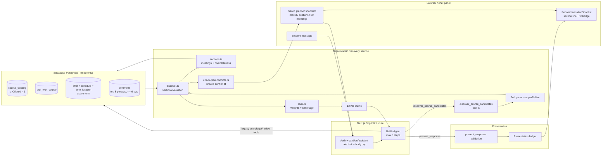
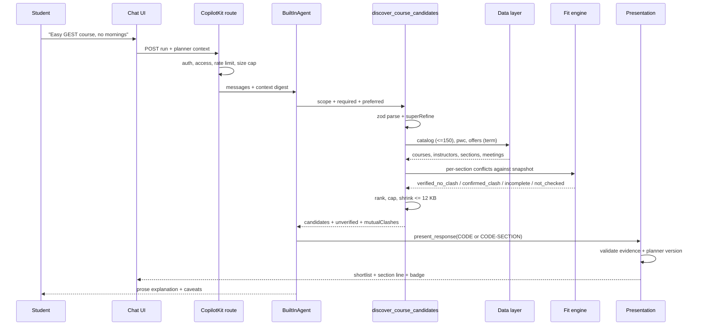

# What2Reg AI V2.3.5-B — Implementation and Product Acceptance Audit

- **Audit date:** 2026-10-26
- **Repository:** `/Users/thomaswu/workspace/next-web`
- **Branch:** `feat/assistant-v2-3-5-b-discovery`
- **HEAD:** `2b00f306f8600ee9de74a04c75a5a5c0d914ca61` (documentation); implementation gate HEAD `2aef5c0`
- **Merge base:** `221e73b`
- **Working tree at audit start:** clean
- **Spec:** `docs/superpowers/specs/2026-10-26-assistant-v2-3-5-b-intelligent-discovery.md`
- **Plan:** `docs/superpowers/plans/2026-10-26-assistant-v2-3-5-b-intelligent-discovery.md`
- **Implementation agent verification report:** `docs/superpowers/verification/2026-10-26-assistant-v2-3-5-b-intelligent-discovery.md`
- **Mode:** read-only independent audit. No production code, prompts, schemas, migrations, configuration, or tests were changed. The only repository change is this report.

---

## 1. Executive summary

V2.3.5-B adds a real deterministic discovery platform, not just another model-facing wrapper. The branch delivers:

- one read-only tool, `discover_course_candidates`;
- a bounded data layer that reads the active term's offered catalog, instructor rows, offers/schedules, and a small review sample;
- deterministic section assembly, conflict checking through the existing shared fit function, and preference-aware ranking;
- explicit presentation through `present_response`, with section-level shortlist evidence and planner-version-gated fit badges;
- no database migration, no planner write path, and no automatic rich-UI mounting.

The deterministic core is materially sound. The exact-overlap regression (GEGA1000-007 vs CISC1001-001, Monday/Thursday 14:30–15:45) is covered by the shared conflict engine and a regression test. Incomplete meetings and incomplete/truncated plans cannot receive `verified_no_clash`. The 173-test targeted deterministic suite passes, and the production build, typecheck, and lint pass.

The milestone is nevertheless **not acceptable as delivered**, for four independent reasons.

1. **The live-model discovery suite never exposed the discovery tool.** In every dev, holdout, and baseline artifact, the provider request tool list omits `discover_course_candidates`, even though the dev/holdout settings record `noDiscovery: false`. The conditional `vi.mock("@/lib/assistant/discovery/tool", ...)` in `evals/assistant/discovery.eval.ts:20-25` is hoisted by Vitest and applied regardless of the flag. Every observed dev/baseline attempt is an “unavailable tool” error, and there is **no successful discovery tool call in any recorded live artifact**. The verification report's conclusion that the model rarely chooses discovery — and its root-cause attribution to model orchestration — is therefore unsupported by its own artifacts.
2. **Unsupported constraint fields are silently stripped, not rejected.** `scope`, `required`, and `preferred` are plain Zod objects with no `.strict()`. A model that places `credits` in `required`, `timesToAvoid` in `preferred`, or `must` in `required` gets those fields removed, receives a successful result, and gets no `notApplied` entry. The tool can therefore return section-level `verified_no_clash` while a stated hard constraint was never applied. This violates the brief's non-negotiable “no incorrect hard-constraint satisfaction”.
3. **Alternate-section evidence is serialized inconsistently.** The producer joins other-section meetings with `", "` (`discover.ts:626`), while the evidence parser splits on `"; "` (`evidence.ts:25-31`). Multiple meetings collapse into one display line. The evidence test fixture uses `"; "`, masking the mismatch. Other sections also lose clash details, so a confirmed-clash alternate renders “Timetable changed” instead of “Clashes with X”.
4. **Safety and academic caveats are lossy.** The 12 KB shrink can drop `unverified`, `notApplied`, `mutualClashes`, and clash details while keeping `fit` and `score`, without a truncation marker. Soft preferences treat missing timetable data as fully satisfied. The discovery notes omit the spec-required “suggested year is not eligibility” caveat.

Automated evidence status:

| Evidence class | Result |
|---|---|
| Targeted deterministic unit/integration | **PASS** — 16 files, 173 tests |
| Full Vitest run | **2,313 pass / 1 fail**; failure is the 200 ms wall-clock performance assertion under full-suite load |
| `npx tsc --noEmit` | **PASS** |
| `npm run lint` | **PASS** |
| `npm run build` | **PASS** (exit 0) |
| Deterministic correctness fixtures (Cases A–G) | **PASS** in code/tests, with noted gaps |
| Real-data read-only smoke | **PASS** for six recorded scopes; 3–6 requests, 8–46 ms local |
| Live-model discovery evaluation | **INVALID** — discovery tool not registered in the discovery suite |
| Authenticated browser acceptance (380/450/800) | **UNVERIFIED** |
| End-to-end live student journeys | **UNVERIFIED** |

**Verdict: CHANGES REQUIRED.** The deterministic platform is a sound foundation, but confirmed in-scope defects, an invalid live-evaluation harness, and missing browser/live evidence preclude acceptance. Live product readiness is **UNVERIFIED**, not proven failed. V2.3.5-C must not start.

---

## 2. Overall verdict

### CHANGES REQUIRED

The implementation is materially complete and the deterministic core is credible. It does not meet acceptance because:

- a hard constraint can be silently ignored while a verified result is returned;
- the only live-model evidence for B is invalid because the tool was absent from the request;
- alternate-section display and clash evidence are wrong in confirmed cases;
- a spec-required academic caveat is missing;
- soft-preference and shrink behavior can misrepresent what was checked;
- browser acceptance has not been performed.

This is not **BLOCKED / UNVERIFIED** because the implementation can be inspected and specific defects are confirmed. It is also not **PASS**: a green build and deterministic tests do not substitute for a valid live run, and the confirmed contract/evidence defects require code changes.

Even after the code fixes, PASS requires a rerun of the live suite with the tool actually registered and a signed-in browser checklist at 380px, 450px, and 800px. If those remain unavailable, release readiness must stay **UNVERIFIED**.

---

## 3. Verified repository state and commit inventory

### 3.1 State

| Item | Value |
|---|---|
| Branch | `feat/assistant-v2-3-5-b-discovery` |
| HEAD | `2b00f30` — docs(assistant): V2.3.5-B verification report |
| Implementation gate HEAD | `2aef5c0` — fix(assistant): pass Task 14 gates for discovery branch |
| Merge base | `221e73b` |
| Commits since base | 16 |
| Diff | 62 files, +9,451 / −118 |
| Migrations | none |
| Planner writes | none |
| Working tree | clean at audit start and end (excluding this report) |

### 3.2 Commit inventory

| Commit | Purpose |
|---|---|
| `d1b04db` | Spec and plan |
| `ca9caef` | Only verify no-clash against a complete saved plan |
| `8234b64` | Discovery input contract and time-rule evaluation |
| `f320132` | Section-level candidate assembly |
| `8eee574` | Confidence-aware ranking |
| `a3f982b` | Batched discovery pool reads |
| `0a44f5a` | Ranked section-level discovery engine |
| `067d7e7` | Harden shrink and schema assertions |
| `092ad46` | Expose read-only discovery tool |
| `340a9fd` | Ground shortlists in discovery evidence with sections |
| `5252031` | Section fit badge gated on live planner version |
| `b5c9eb7` | Prompt guidance for goal-based discovery |
| `8fd1c66` | CopilotKit discovery journeys (scripted) |
| `c9b2912` | Live discovery eval suite |
| `4c4c6b1` | Read-only real-data performance smoke |
| `2aef5c0` | Task 14 gate fixes |
| `2b00f30` | Verification report |

### 3.3 Requirement-to-change inventory

| B requirement | Delivered artifact | Status |
|---|---|---|
| One goal-based discovery tool | `lib/assistant/discovery/tool.ts`, registered at `lib/assistant/tools.ts:256` | Completed |
| Typed, validated input contract | `lib/assistant/discovery/schema.ts` | Partial — unknown fields are stripped; tool-facing schema is unrefined |
| Active-term, offered-only catalog retrieval | `lib/assistant/data/discovery.ts:128-223` | Completed |
| Instructor and offer retrieval with section data | `lib/assistant/data/discovery.ts:225-281` | Completed |
| Section assembly, completeness flags | `lib/assistant/discovery/sections.ts` | Completed |
| Deterministic conflict fit | `lib/assistant/discovery/discover.ts:164-183`, shared `lib/assistant/check-plan-conflicts.ts:26-34` | Completed |
| Preference-aware ranking | `lib/assistant/discovery/rank.ts` | Completed, with soft-unknown and topic-substring defects |
| Bounded reviews and review evidence | `lib/assistant/data/discovery.ts:330-346`, `discover.ts:725-753` | Completed |
| Result-size bound | `lib/assistant/discovery/discover.ts:30,309-451` | Completed, but lossy |
| Explicit presentation decoupling | `lib/assistant/presentation.ts:372-387,768-857` | Completed |
| Section-level shortlist evidence | `lib/assistant/discovery/evidence.ts`, `components/assistant/recommendation-section-line.tsx` | Partial — alternate-section serialization bug |
| Planner-version-gated fit badge | `lib/assistant/discovery/fit-badge.ts`, `components/assistant/planner-version-context.tsx` | Completed |
| Prompt guidance | `lib/assistant/prompt.ts:11` | Completed (one bullet, no rewrite) |
| Integration journeys | `tests/components/assistant-v2-3-5-b.integration.test.tsx` | Completed with a scripted model |
| Live evaluation | `evals/assistant/discovery.eval.ts` | Invalid — tool not registered in suite runs |
| Real-data smoke | `evals/assistant/discovery-real-data.eval.ts` | Completed, read-only |
| Browser acceptance | verification report §11 | Unverified |
| No migration / no planner writes | repo-wide | Completed |

---

## 4. Original specification versus delivered functionality

| Spec area | Delivered | Status | Notes |
|---|---|---|---|
| Approach A: one tool, batched reads, pure TS engine | Yes | Completed | Three core reads; no combination optimizer |
| Tool scope anchors and time rules | Yes | Partial | Zod shape correct, but plain objects strip unknown fields |
| Active term, offered-only, plan exclusion | Yes | Completed | Equivalent codes mapped to primary |
| Section-level best section plus alternatives | Yes | Partial | Best section correct; alternate meetings/clashes lossy |
| Shared deterministic fit | Yes | Completed | Reuses `conflictsForCandidate` and `conflictFitForSection` |
| Complete candidate + complete plan + not truncated gate | Yes | Completed | `discover.ts:159`, `check-plan-conflicts.ts:26-34` |
| Planner version and stale evidence | Yes | Partial | Client-side gate works; client snapshot is trusted |
| Hard vs soft constraints | Yes | Partial | Unknown fields ignored; soft unknowns treated as met |
| Ranking policy and sample-size shrinkage | Yes | Completed | Documented weights; topic matching is raw substring |
| Eval harness and preregistered thresholds | Yes | Invalid | Tool absent from discovery-suite runs |
| Suggested-year caveat | Required by spec §4 | Omitted | `DISCOVERY_NOTES` lacks it |
| Individual vs combined compatibility | Yes | Partial | `mutualClashes` exists; shrink can drop it |
| Explicit presentation | Yes | Completed | Discovery never mounts UI |
| No DB migration / no writes | Yes | Completed | Read-only |
| Browser acceptance | Required by plan Task 11 | Unverified | No signed-in browser run |

---

## 5. End-to-end discovery architecture

### 5.1 Component diagram



### 5.2 Sequence diagram



### 5.3 Responsibility split

| Responsibility | Owner | Evidence |
|---|---|---|
| Understand goal and language | Model | `prompt.ts` |
| Choose discovery vs fine-grained tools | Model | `prompt.ts:11`, tool description |
| Structure scope and constraints | Model, validated by Zod | `schema.ts` |
| Catalog filtering | Deterministic | `data/discovery.ts:128-150` |
| Active term / offered-only | Deterministic | `data/discovery.ts:129,254-281` |
| Section assembly and completeness | Deterministic | `sections.ts` |
| Conflict fit | Deterministic | `check-plan-conflicts.ts:26-34,131-149` |
| Ranking | Deterministic | `rank.ts` |
| Evidence excerpts | Deterministic | `discover.ts:238-286` |
| Presentation decision | Model | `present_response` tool |
| Presentation validation | Deterministic | `presentation.ts:518-528,768-857` |
| Prose truthfulness | Model, partly graded | Prompt + eval grader |

### 5.4 Central architectural question

**Did B genuinely introduce efficient, deterministic course discovery, or merely wrap the previous fine-grained workflow?**

It genuinely moved the expensive and safety-critical work into deterministic services. A single tool invocation replaces repeated catalog, instructor, section, and review lookups with three batched reads (six for a broad non-GE pool), computes section-level fits with the existing conflict engine, ranks with a documented formula, and returns a bounded JSON result. The model still chooses the tool and writes the explanation, but it no longer has to assemble sections or verify clashes itself.

The qualification is that this architecture has not been demonstrated through a live model run: the discovery-suite harness removed the tool. The design claim is supported by code and deterministic tests; the behavioral claim is not supported by the existing live artifacts.

---

## 6. Discovery tool and data contracts

### 6.1 Tool record

| Field | Value |
|---|---|
| Name | `discover_course_candidates` (`schema.ts:5`) |
| Registration | `tools.ts:256` via `createDiscoveryTools` |
| Model-facing description | `tool.ts:16-17` |
| Input schema exposed to model | `discoverCourseCandidatesParameters` (`schema.ts:221-268`) — unrefined plain object |
| Input schema used by executor | `discoverCourseCandidatesInputSchema` (`schema.ts:270-305`) — `superRefine` + transform |
| Output schema | `discoverResultSchema` (`schema.ts:398-448`), strict |
| Authentication | Route-level Clerk auth before the agent (`route.ts:148-156`) |
| Authorization | `canUseAssistant(userId)` before run (`route.ts:151-153`) |
| Validation | Zod parse; failure returns `{ error: "invalid_request" }` |
| Defaults | `limit` 5; priorities default to `better_rated` at ranking time |
| Query bounds | 150 catalog courses; 200-value chunks; 3 other sections; 6 pwc review reads; 8 reviews each; 12 KB result |
| Error semantics | `invalid_request` or `temporarily_unavailable` only |
| Response-size bound | `MAX_DISCOVERY_RESULT_CHARS = 12_000` |
| Data provenance | `course_catalog`, `prof_with_course`, `offer`/`schedule`/`time_location`, `comment` |
| Planner input | Client-supplied `TIMETABLE_CONTEXT_DESCRIPTION` payload |
| Read-only | No writes; no planner mutators; `tests/assistant/read-only-planner.test.ts` |

### 6.2 Supported filters

| Filter | Type | Data source | Implementation | Limitation |
|---|---|---|---|---|
| Active term | Always | App config + offer year/sem | `loadCatalogTerm`, offer equality | No user-selected term parameter; term switch is inferred |
| Offered-only | Always | `course_catalog.Is_Offered` | `eq("Is_Offered", 1)` | Catalog flag, not seat availability |
| GE / Non-GE | Scope | `courseType` | `eq` | No GE-area classification |
| Code prefix | Scope | `New_code` | `ilike prefix%` | Prefix only |
| Faculty | Scope | `Offering_Unit` | `eq` | Exact code |
| Department | Scope | `Offering_Department` | `eq` | Exact code |
| Topics | Scope | title/description/ILO | `ilike` OR filter | Substring matching; no stemming/synonyms |
| Max suggested year | Scope | `suggestedYearOfStudy` | `lte` | Not eligibility; caveat missing from notes |
| Credits | Scope | `Credits` text | `in` with numeric variants | Exact value only |
| Exclude codes | Scope | `New_code` | `not in` | Manual string interpolation; primary codes only |
| Start-after / end-before | Required/preferred | Section meetings | Pure TS | Unknown meetings cannot satisfy |
| Avoid days | Required/preferred | Section meetings | Pure TS | MON–SAT only |
| Avoid windows | Required/preferred | Section meetings | Strict overlap | No hardcoded lunch window |
| Fewer days | Preferred | Section meetings | <= 2 distinct days | Soft only |
| No clash | Required | Saved plan | Shared fit | Hard only when plan is ready/complete |
| Ease/grades/rating/usefulness | Ranking | `prof_with_course` | Weighted, shrunk | Course-specific pwc rows |
| Review terms | Enrichment | `comment` | Substring excerpts | Bounded; not an official fact |
| Limit | Output | — | 1–8 | Distinct courses |

### 6.3 Critical review of the contract

| Criterion | Assessment |
|---|---|
| Expressive enough for realistic requests | Mostly yes: scope anchors, hard/soft time rules, priorities, review terms |
| Small enough for reliable model calling | Yes in field count, but the nested structure is easy to misuse (observed live attempts) |
| Properly validated | **No** — plain Zod objects strip unknown fields; tool-facing schema lacks refinements |
| Consistent with database capabilities | Yes; no exam/prereq/seat fields are exposed |
| Resistant to ambiguous or unsupported filters | **No** — unsupported keys disappear silently |
| Suitable for V3 reuse | Yes for retrieval/fit primitives; schemas need hardening first |

**Unsupported fields are silently ignored.** `discoveryScopeParameters` (`schema.ts:172-219`), `required` (`schema.ts:225-238`), and `preferred` (`schema.ts:239-250`) are plain `z.object` values. Zod's default behavior is to strip unknown keys. For example:

```json
{
  "scope": { "courseType": "GE" },
  "required": { "credits": "3" }
}
```

parses successfully; `required` becomes `{}`; no section is eliminated for credits; `notApplied` remains empty. The result can still carry `fit: "verified_no_clash"` and a high score. This is the single most important contract defect in B.

The same applies to plausible model keys seen in the recorded attempts: `required.must`, `required.faculty`, `preferred.timesToAvoid`, `preferred.noClassBefore`, `preferred.timeWindow`, `preferred.note`. None is recognized by the schema; all would be stripped if a valid scope anchor were present.

**Tool-facing versus executor schema.** `createDiscoveryTools` exposes the unrefined `discoverCourseCandidatesParameters` to the model (`tool.ts:28`). The executor re-parses with the refined schema (`discover.ts:639`). The model therefore never sees the anchor/time-rule refinements as JSON Schema constraints; it only sees descriptions. This increases the chance of malformed calls and makes `invalid_request` the only feedback.

**Read-only wrapper inconsistency.** Other tools use `runReadOnlyTool` for uniform validation/error mapping. Discovery calls `runDiscoverCourseCandidates` directly (`tool.ts:33-38`). There is no write path, but the tool bypasses the shared wrapper convention (P3).

---

## 7. Catalog and offered-course correctness

### 7.1 Required checks

| # | Check | Evidence | Status |
|---|---|---|---|
| 1 | Courses from authoritative data | `course_catalog` view | Pass |
| 2 | Active-term filtering | `loadCatalogTerm` + offer year/sem equality | Pass |
| 3 | Offered-only | `Is_Offered = 1` | Pass |
| 4 | Search terms consistent | `sanitizeSearchTerm`; OR over title/description/ILO | Pass with substring limits |
| 5 | Category/department filters | exact equality | Pass |
| 6 | Course identity normalized | `normalizeCourseCode`; `equivalent_codes` mapped to primary | Pass |
| 7 | Duplicate results removed | one candidate per course; section grouping | Pass |
| 8 | Pool limits | 150 courses; `truncated` from exact count | Pass, with alphabetical bias |
| 9 | Already-selected exclusion | primary and aka codes | Pass |
| 10 | Pagination/truncation honesty | `totalMatchingCourses`, `truncated` | Pass |

### 7.2 Data flow

`loadDiscoveryPool` (`data/discovery.ts:292-323`):

1. `readCatalog` selects `Is_Offered = 1`, applies scope filters, orders by `New_code`, and reads 0–149 with an exact count.
2. `readInstructorRows` reads `prof_with_course` in chunks of 200, including equivalent-code lookup.
3. `readOffers` reads `offer` + embedded `schedule(time_location(...))` for the active term in chunks of 200.
4. Review reads are separate and only when `reviewTerms` is supplied.

### 7.3 Academic classification

GE classification comes from `courseType` in `course_catalog`, not from course names. A history course is not represented as GE unless the catalog says GE. This satisfies the brief's classification concern.

The `suggestedYearOfStudy` filter is a catalog hint, not eligibility. The spec explicitly requires the notes to say so (`spec §4`). `DISCOVERY_NOTES` (`discover.ts:68-72`) does not. This is a confirmed academic-honesty omission (F-05).

### 7.4 Broad versus narrow searches

| Risk | Behavior | Assessment |
|---|---|---|
| Excessively narrow keyword matching | `ilike` substring on chosen fields | Real but expected; no stemming |
| Pool cutoff | First 150 by code | Relevant courses can be missed; `truncated` is honest |
| Ordering before filtering | Filter first, then order by code | No false exclusion; alphabetical bias remains |
| Pagination | One page only | Flagged, not silently presented as complete |
| Misclassification | Catalog courseType | Correct |
| Premature truncation | Exact count + `truncated` | Correct |
| Overly strict defaults | No default scope anchor | Anchor required; credits not an anchor |

Real-data evidence (`.eval-results/assistant/discovery-real-data-task14.json`):

| Scenario | Requests | ms | Chars | Courses examined | Total matching | Truncated |
|---|---:|---:|---:|---:|---:|---|
| gest-easy | 3 | 45.7 | 5,052 | 19 | 19 | no |
| ge-topics-macao-history | 3 | 38.8 | 5,069 | 15 | 15 | no |
| cisc-first-year | 3 | 8.0 | 2,350 | 4 | 4 | no |
| cis-dept-3-credits | 3 | 8.5 | 4,636 | 20 | 20 | no |
| ge-required-schedule | 4 | 13.0 | 1,347 | 56 | 56 | no |
| non-ge-truncation | 6 | 22.3 | 5,150 | 150 | 514 | **yes** |

The non-GE case demonstrates the honest truncation behavior and the alphabetical cap. A “no suitable course” answer over a truncated pool must be qualified; the tool exposes `examined.truncated`, and the description says the search was bounded, but the prompt does not add a discovery-specific “qualify no-match when truncated” instruction. This is a product risk, not a code correctness failure.

---

## 8. Section-level candidate correctness

### 8.1 Coverage matrix

| Case | Behavior | Evidence | Status |
|---|---|---|---|
| One course, multiple sections | Each section built; best per course; up to 3 alternates | `sections.ts`; `discover.test.ts:298` | Pass |
| One section, multiple meetings | `meetingLines` array; `planSection` includes all slots | `sections.ts:94-124` | Pass for fit/best section |
| Multiple instructors, different sections | Offers grouped by section; instructors per section | `sections.ts:73-107` | Pass |
| Co-taught section | pwc offers merged; instructors deduped; meetings unioned | `discover.test.ts:319` | Pass |
| Course with no sections | Added to `noListedSections` (max 10) | `discover.ts:719-723` | Pass |
| Incomplete section data | `meetingsComplete = false`; fit `incomplete` | `sections.ts:115-117`; `discover.test.ts:155-197` | Pass |
| Identical meeting times | `slotByLine` dedupes identical lines; conflicts still checked | `sections.ts:75-113` | Pass |
| Different terms | Offers filtered to active term; plan mismatch → `term_mismatch` | `data/discovery.ts:254-281`; `discover.test.ts:240` | Pass |
| Boundary-adjacent | `aStart < bEnd && bStart < aEnd`; touching allowed | `timetable/conflicts.ts:22-30`; `discover.test.ts:140` | Pass |
| Missing/malformed meeting | Parse failure → `droppedMeeting` → incomplete | `sections.ts:94-117` | Pass |
| Weekend-only offering | SAT/SUN → `plannerSupported = false` → incomplete | `sections.ts:54,100,116` | Pass |
| Actual section ranked, not whole course | Section scores; best section per course | `discover.ts:690-717` | Pass |
| All meetings checked, not first only | `planSection.schedules` contains all slots; shared conflict engine | `sections.ts:121-129`; `check-plan-conflicts.ts:131-149` | Pass |
| Alternate section display | Joined with `", "`; parser splits on `"; "` | `discover.ts:626`; `evidence.ts:25-31` | **Fail** |
| Alternate section clash badge | `clashWith` not passed for alternates | `evidence.ts:94`; `fit-badge.ts:30-35` | **Fail** |

### 8.2 Confirmed alternate-section defects

**Meeting serialization.** `buildCandidate` writes:

```ts
otherSections: alternates.slice(0, MAX_OTHER_SECTIONS).map((row) => ({
  section: row.section.section,
  meetings: row.section.meetingLines.join(", "),
  fit: row.fit,
}))
```

`meetingLines` entries are full lines such as `MON 09:00-10:15 E11`. `splitMeetings` in `evidence.ts` splits on `"; "`. A two-meeting alternate therefore becomes one string and one displayed meeting. `formatMeetingSummary` then matches only the first day/time and drops the rest.

The evidence test fixture uses the opposite separator:

```ts
{ section: "001", meetings: "MON 09:00-10:15; WED 09:00-10:15", fit: "confirmed_clash" }
```

(`tests/assistant/discovery-evidence.test.ts:51`), and the test title says “splits other-section meetings on semicolons”. This masks the producer mismatch. The discovery test at `discovery.test.ts:314-316` checks only `section` and `fit`, not `meetings`.

**Clash evidence.** `sectionEvidenceFromCandidate` receives `undefined` for alternate clashes (`evidence.ts:94`). `fitBadge` for `confirmed_clash` with no `clashWith` returns “Timetable changed – ask me to re-check” (`fit-badge.ts:30-34`), not “Clashes with X”. The alternate's fit is correct, but the student-facing reason is wrong.

**Invariant status.** The best section for each course is a real, actual section; the tool does not claim course-level compatibility merely because some section exists. The invariant holds for the best section and for fits. It is weakened only in presentation of alternates.

---

## 9. Timetable verification and planner freshness

### 9.1 Source of truth

| Question | Answer |
|---|---|
| Where does the snapshot come from? | Client planner, serialized into `TIMETABLE_CONTEXT_DESCRIPTION` (`timetable-context.ts:102-146`) |
| Is it server-owned? | No. It is local-first client state, trusted after schema validation |
| How is version computed? | `timetableVersion(payload.plan.sections)` over the supplied sections (`timetable-context.ts:194`) |
| Does version reflect selections/meetings? | Yes, over the sections the client supplied |
| How does discovery receive it? | `TimetableSlot` populated in the agent run from context (`agent.ts`) |
| Is it validated? | Shape-validated; `truncated` is trusted from the client |
| How are candidates checked? | `conflictsForCandidate(plan, candidate)` + `conflictFitForSection` |
| Are existing functions reused? | Yes, shared with `check_plan_conflicts` |
| What happens when planner changes? | New version; ledger marks old fits stale; UI badge warns |
| Is compatibility revalidated before presentation? | Client badge compares evidence version to live planner version |

### 9.2 Status semantics

| Status | Meaning | Implemented |
|---|---|---|
| `verified_no_clash` | Complete candidate, complete non-truncated plan, no conflicts | Yes |
| `confirmed_clash` | At least one known overlap | Yes |
| `incomplete` | Candidate or plan incomplete/truncated, no known overlap | Yes |
| `not_checked` | No usable plan (`no_plan`, `loading`, `unavailable`, term mismatch) | Yes |
| Stale verification | Evidence planner version differs from current | Ledger `stale`; UI badge |
| Verification unavailable | Timetable unavailable | `not_checked` + `notApplied` |

The status concepts are distinguishable in tool output and UI. `not_checked` is omitted from the conflict-verification ledger, so the model does not see it as evidence either way.

### 9.3 Fit function

```ts
if (conflicts.length > 0) return "confirmed_clash";
if (!section.complete || !section.planComplete) return "incomplete";
return "verified_no_clash";
```

`planCompleteForFit = analysis.complete && !state.truncated` (`discover.ts:159`). Candidate completeness requires at least one meeting, no dropped meeting, no empty offer, and no SAT/SUN meeting (`sections.ts:115-117`). This is the correct conservative ordering.

### 9.4 Adversarial correctness matrix

| Case | Scenario | Expected | Evidence | Status |
|---|---|---|---|---|
| A | GEGA1000-007 vs CISC1001-001, MON/THU 14:30–15:45 | Confirmed clash | `check-plan-conflicts.test.ts:76-137` asserts two conflicts with exact overlap; discovery reuses the same function | **Pass** |
| B | One ends 14:15, another starts 14:15 | Follow boundary policy | `schedulesOverlap` uses strict inequalities; `discovery.test.ts:140` expects `verified_no_clash` for touching | **Pass** |
| C | Main lecture fits, tutorial overlaps | Clash | All `planSection.schedules` checked; hidden additional meeting is included | **Pass in code/tests**, no dedicated multi-meeting adversarial title |
| D | Section lacks a required meeting block | No verified claim | `meetingsComplete=false` → `incomplete`; `check-plan-conflicts.test.ts:70-73`; `discovery.test.ts:155-197` | **Pass** |
| E | Planner modified after verification | Stale evidence invalidated | `fit-badge.test.ts:25-70`; `conflict-verification.test.ts:144`; J2 journey | **Pass for client-visible path** |
| F | Already selected course | No duplicate enrollment recommendation | `discover.test.ts:384`; primary + aka exclusion | **Pass** |
| G | A and B fit individually but clash with each other | Individual fits allowed; combined not claimed | `mutualClashes` (`discover.ts:288-307`); `discover.test.ts:539`; prompt says individual fits do not combine | **Pass, conditional on shrink** |

### 9.5 Remaining paths to a false compatibility claim

The deterministic fit itself is sound when used. False compatibility can still arise through:

1. **Model prose without a tool call.** The prompt is the only guard against a clash-free sentence when no verified evidence exists. There is no keyword policing by design (spec §7). The live false-fit metric is intended to catch this, but its grader has false positives (F-12) and the live suite never ran the tool (F-02).
2. **Individual versus combined.** `mutualClashes` covers only the returned best sections, not all alternates, and can be dropped by the shrink (F-07). A model that ignores it can present three individually verified courses as a combined schedule. The prompt tells it not to; nothing deterministic prevents it.
3. **Client snapshot trust.** The server recomputes the version from the sections it receives. A client that supplies a subset while omitting `truncated` gets a “complete” plan and a current-looking version. This is a local-first consistency issue, not an authorization boundary; normal client construction sets `truncated`.
4. **Truncated plan version mismatch.** The UI computes the live version over the full active plan (`assistant-panel.tsx:86-93`), while the server computes it over the capped snapshot. For plans over 30 sections or 80 meetings, every fit badge can show “Timetable changed” even though the snapshot is current (F-10). This is a false stale warning, not a false verified claim.
5. **History reuse.** Older tool results are squeezed to 200 characters in model input (`conversation.ts:60-75`), so a discovery JSON result cannot be fully reparsed later; a model may still remember a phrase like “verified”. The ledger marks stale rows, but prose reuse remains possible.
6. **Alternate badge reason.** A confirmed-clash alternate can show “Timetable changed” instead of a clash reason (F-04), which may lead a student to re-check rather than avoid.

**Critical invariant verdict:** no confirmed path produces `verified_no_clash` from incomplete or stale deterministic evidence when the tool is used. The invariant is not proven end-to-end because the live tool path was never exercised.

---

## 10. Hard/soft constraint semantics

### 10.1 Field semantics

| Field | Class | Behavior | Missing data |
|---|---|---|---|
| `scope.courseType` | Hard pool filter | `eq` | N/A |
| `scope.codePrefix` | Hard pool filter | `ilike prefix%` | N/A |
| `scope.faculty` | Hard pool filter | `eq` | N/A |
| `scope.department` | Hard pool filter | `eq` | N/A |
| `scope.topics` | Hard pool filter | OR `ilike` | N/A |
| `scope.maxSuggestedYear` | Hard pool filter | `lte` | N/A; caveat missing |
| `scope.credits` | Hard pool filter | exact variants | N/A |
| `scope.excludeCodes` | Hard pool filter | `not in` | N/A |
| `required.startAfter` | Hard | Eliminate if any known meeting violates | Unknown → `unverified` and eliminate |
| `required.endBefore` | Hard | Same | Same |
| `required.avoidDays` | Hard | Eliminate if any meeting on avoided day | Unknown → `unverified` |
| `required.avoidWindows` | Hard | Eliminate on strict overlap | Unknown → `unverified` |
| `required.noClash` | Hard | Eliminate confirmed clash; eliminate incomplete with `unverified`; `not_checked` → `notApplied` but keep | Plan incomplete/truncated → no verified fit |
| `preferred.startAfter` / `endBefore` | Soft | Score; violated tradeoff | Unknown gets full credit (defect) |
| `preferred.avoidDays` / `avoidWindows` | Soft | Score; violated tradeoff | Unknown gets full credit (defect) |
| `preferred.fewerDays` | Soft | <= 2 distinct days | Unknown gets full credit (defect) |
| `priorities` | Ranking | Ordered weights | Default `better_rated` |
| `reviewTerms` | Enrichment | Excerpts/mentions | Missing reviews → no evidence |

### 10.2 Hard requirements

Hard rules are enforced deterministically per section. The first violated required rule eliminates the section and increments one counter (`discover.ts:502-509`). If no rule is violated but a rule outcome is `unknown`, the section is eliminated and recorded in `unverified` (`discover.ts:529-543`). This is conservative and correct.

`required.noClash` is enforced against the fit: confirmed clash eliminates; incomplete eliminates and records `clash_check_incomplete`; `not_checked` does not eliminate but records `notApplied` (`discover.ts:511-527,575-577`). The last case is an honest “could not check”, not a silent satisfaction.

### 10.3 Soft preferences

Soft preferences affect score:

```
s_pref = 1 − violatedPreferred / totalPreferred
```

Each of `startAfter`, `endBefore`, `avoidDays`, and `fewerDays` counts as one rule; each avoid window counts as one (`rank.ts:106-110`). Violations add tradeoffs. Met rules add matched labels.

**Defect:** `unknown` outcomes are neither violated nor met, but `schedulePreferenceScore` counts only violations, so unknown gets full credit. `collectScheduleOutcomes` adds neither a matched nor a tradeoff for unknown. A section with no known meeting times can therefore receive a perfect schedule-preference score and no caveat. This contradicts the brief's “missing information does not count as satisfying a requirement” principle for soft preferences (F-06).

### 10.4 Lunchtime and assumptions

There is no universal lunch window. The model must supply `avoidWindows` and state the assumed window. The prompt says: “vague times in preferred, name the window” (`prompt.ts:11`). The tool description says: “state any time window you assume if the student did not give one” (`tool.ts:16-17`). This is transparent by design. It is model-dependent in practice.

### 10.5 Conflicting constraints

If required rules are mutually impossible (for example `startAfter: "14:00"` and `endBefore: "10:00"`), every section is eliminated and the result has empty `candidates`, with `excluded.required` counts. There is no explicit “your constraints conflict” diagnosis. The model can infer it from the empty result and counts, but the tool does not say it. This is a product-explainability limitation (P3), not a safety failure.

### 10.6 Current-turn override

The prompt says earlier goals and preferences still apply until changed, and current-turn text is the current instruction. There is no deterministic preference state, so override is model behavior. This is acceptable for B; durable preference memory belongs to V2.3.5-C.

---

## 11. Ranking methodology and worked examples

### 11.1 Algorithm

| Stage | Implementation |
|---|---|
| Inputs | Section, instructors (pwc rows), preferred outcomes, topic score, fit, weights |
| Hard filters | Required rules, noClash elimination |
| Rating signals | Review-weighted mean per metric, shrunk to neutral prior |
| Normalization | `(adjusted − 1) / 4`; no reviews → 0.5 |
| Schedule | `1 − violated / totalPreferred` |
| Topics | `min(1, Σ (title 1 / body 0.5) / topics)` |
| Weights | Priorities 0.40/0.25/0.15/0.10; schedule 0.35; topic 0.20; normalized to 1 |
| Fit adjustment | Confirmed clash ×0.5; incomplete ×0.9 |
| Score | `round(100 × Σ w·s)` |
| Order | Score desc, reviews desc, course code asc, section asc |
| Dedupe | One best section per course; up to 3 alternates |

Code: `rank.ts:7-9,46-69,75-104,106-110,132-150,152-209,211-216`.

### 11.2 Sample-size shrinkage

`adjusted = (n·mean + 5·3) / (n + 5)`; `n = Σ reviews`, prior 3, `SMALL_REVIEW_SAMPLE = 5`.

| Candidate | Raw ease | Reviews | Adjusted | Normalized |
|---|---:|---:|---:|---:|
| A | 5.0 | 1 | (1×5 + 15) / 6 = 3.333 | 0.583 |
| B | 4.0 | 100 | (100×4 + 15) / 105 = 3.952 | 0.738 |

This directly addresses the brief's A/B example. B's larger sample outranks A despite A's higher raw score. With no reviews, the component is 0.5 and the tradeoff “no reviews” is added (`rank.ts:112-120,189-191`).

### 11.3 Worked example

Assume `priorities: ["easier"]`, one preferred rule `startAfter 10:00`, and `topics: ["history"]`.

Weights before normalization: easier 0.40, schedule 0.35, topic 0.20 → total 0.95 → normalized 0.4211, 0.3684, 0.2105.

Section A:

- ease adjusted 3.333 → 0.5833;
- meets 08:30 → schedule score 0;
- title contains “history” → topic 1.0;
- score = 100 × (0.4211×0.5833 + 0.3684×0 + 0.2105×1.0) = 45.6 → **46**.

Section B:

- ease adjusted 3.952 → 0.7381;
- meets 11:00 → schedule score 1;
- body contains “history” → topic 0.5;
- score = 100 × (0.4211×0.7381 + 0.3684×1 + 0.2105×0.5) = 78.4 → **78**.

B ranks above A. If A had a confirmed clash, its score would be halved to 23; if incomplete, 41. The ranking is deterministic and explainable through `matched`, `tradeoffs`, and signals.

### 11.4 Assessment of weights

The weights are product choices, documented in the spec and `RANKING_NOTE`. They are not empirically tuned, and the spec does not require tuning. The ranking is deterministic and reproducible. Fragilities:

- topic matching is raw substring, not word-boundary or semantic;
- soft unknown gets full credit;
- the schedule weight applies only when preferred rules exist;
- default `better_rated` means a request with no priorities and no preferences ranks purely by overall rating.

None of these is an inversion of the difficulty scale. The difficulty direction is correct throughout: `difficulty` is used as `ease`, and higher is easier (`rank.ts:19`, `rating-semantics.ts`).

---

## 12. Review evidence and uncertainty

### 12.1 Evidence categories

| Category | Source | Confidence | Delivered caveat |
|---|---|---|---|
| Verified catalog facts | `course_catalog` | High | Titles, credits, courseType, suggestedYear |
| Structured section data | `offer`/`schedule` | High when complete | `meetingsComplete` |
| Student-review anecdotes | `comment` | Low/medium | Excerpts, counts; prompt says anecdotes |
| Derived ratings/ranking | pwc aggregates + weights | Medium | Shrinkage, sample counts, `sampleSize` |
| Unknown information | Absent fields | None | Notes: no official exam/prereq/seat/workload |

### 12.2 Review retrieval

Only when `reviewTerms` is supplied. Up to 3 candidates × up to 6 pwc ids; each pwc reads at most 8 newest top-level, non-hidden reviews (`data/discovery.ts:330-346`). Excerpts are capped at 2 × 120 code points. This is bounded and meaningful, not a mass scan.

### 12.3 “No midterm” scenario

The tool notes say: “The site has no official exam format, prerequisite, seat or workload data.” The prompt says reviews may mention them but must be reported as what some reviewers said, not current policy. The tool exposes `reviewEvidence.mentions` and excerpts, not an official field. This is the correct design. The live eval's `no_midterm` certainty metric had zero violations in the recorded (invalid) runs; the deterministic prompt/notes support the requirement.

### 12.4 Suggested year

`Candidate.suggestedYear` is returned without the spec-required caveat. A student or model can read “suggested year 1” as “eligible for year 1”. `DISCOVERY_NOTES` should say it is a catalog hint, not eligibility. This is F-05.

### 12.5 Failure conditions audit

| Failure condition | Result | Evidence |
|---|---|---|
| Unknown prerequisite treated as satisfied | No; no prerequisite field or claim | Notes/prompt |
| Missing exam data treated as no exams | No official claim; review anecdotes only | Notes/prompt |
| Missing rating treated as high rating | No; neutral 0.5 + “no reviews” | `rank.ts:61-63,112-120` |
| Incomplete section treated as conflict-free | No; `incomplete` | `sections.ts:115-117`; fit function |
| Historical offering treated as current | No; offers filtered by active term | `data/discovery.ts:254-281` |
| Review anecdote presented as policy | Prompt forbids; model-dependent | `prompt.ts` |
| Suggested year presented as eligibility | **Risk**; caveat missing | F-05 |

---

## 13. Retrieval efficiency and scalability

### 13.1 Query behavior

| Workload | Requests | What happens |
|---|---:|---|
| Narrow scope (CISC, 4 courses) | 3 | catalog + pwc + offers |
| Typical GE scope (19 courses) | 3 | catalog + pwc + offers |
| GE with required schedule | 4 | additional read path in the smoke harness |
| Broad non-GE (514 matching, 150 kept) | 6 | chunked pwc/offers |
| With review terms | +1 per up to 6 pwc (parallel) | reviews |

No per-course N+1 loop in the core path. Reviews are the only per-pwc fan-out, capped at 6 concurrent reads of 8 rows.

### 13.2 Bounds

| Bound | Value | Source |
|---|---:|---|
| Catalog pool | 150 | `data/discovery.ts:8` |
| IN chunk | 200 | `data/discovery.ts:9` |
| Other sections per candidate | 3 | `discover.ts:33` |
| Review candidates | 3 | `discover.ts:36` |
| Review pwc ids | 6 | `discover.ts:37` |
| Reviews per pwc | 8 | `data/discovery.ts:338` |
| Unverified entries | 5 | `discover.ts:35` |
| No-listed sections | 10 | `discover.ts:34` |
| Result size | 12,000 chars | `discover.ts:30` |
| Tool timeout | `MCP_TOOL_TIMEOUT_MS` | `tool.ts:36` |
| Agent steps | 8 | `agent.ts:3` |

### 13.3 Scalability assessment

- Work is proportional to the bounded pool (150), not total catalog size, for catalog/instructor/offer reads.
- Offers are unbounded in row count within the 150-course pool; a course with many sections/meetings increases rows. Chunking bounds request count but not total rows.
- Reviews are bounded by 6 × 8.
- There is no cache. Repeated runs repeat the same reads.
- The 12 KB shrink bounds model input, but it can drop safety context.

### 13.4 Agent efficiency

**Cannot be measured from the existing live artifacts.** In dev, holdout, and baseline runs the discovery tool was not registered. Median tool calls of 14–16.5 reflect the legacy fine-grained workflow in all arms. The only registered discovery call (agent-behavior `alternatives`) returned `temporarily_unavailable`.

By design, one discovery call replaces a chain of `search_catalog` + `get_course` + `get_course_sections` + `get_course_reviews` calls and performs 3–6 batched reads. That is materially more efficient if adopted. Whether the model adopts it is unverified.

**Required conclusion:** the deterministic service is bounded and materially more efficient than the fine-grained workflow in code, but B's agent-efficiency claim is **not demonstrated** by live evidence. The baseline comparison is invalid because both arms lacked the tool.

---

## 14. AI tool-calling behavior

### 14.1 Exposure

- The tool is registered unconditionally in `tools.ts:256`.
- The prompt contains one discovery bullet (`prompt.ts:11`): call once for goal-based searches without codes; must/cannot only in required; vague times in preferred and name the window; explain top options and tradeoffs; clash-free only for `verified_no_clash` this turn; individual fits do not combine; follow-ups use course tools.
- Legacy tools remain available (`search_catalog`, `get_course`, `get_course_sections`, `get_course_reviews`, etc.).

### 14.2 What the live runs actually did

The decisive artifact evidence:

| Artifact | `settings.noDiscovery` | `discover_course_candidates` in request tools | Discovery calls | Successful |
|---|---|---|---|---:|
| `discovery-b-dev.json` | false | **No** | 3 | 0 |
| `discovery-b-holdout.json` | false | **No** | 0 | 0 |
| `discovery-b-baseline.json` | true | No | 3 | 0 |
| `agent-behavior-v235b-regression.json` | absent | **Yes** | 1 | 0 (`temporarily_unavailable`) |

The three dev calls and three baseline calls all have the result:

```
Error: Model tried to call unavailable tool 'discover_course_candidates'.
Available tools: navigate, search_catalog, count_courses, get_course, get_course_descr...
```

This is not a model preference for legacy tools. The tool was not offered.

### 14.3 Root cause of the invalid live suite

`evals/assistant/discovery.eval.ts:13-25`:

```ts
const noDiscovery = process.env.ASSISTANT_EVAL_NO_DISCOVERY === "1";
...
if (noDiscovery) {
  vi.mock("@/lib/assistant/discovery/tool", () => ({
    DISCOVER_COURSE_CANDIDATES_DESCRIPTION: "",
    createDiscoveryTools: () => [],
  }));
}
```

Vitest hoists `vi.mock` calls to the top of the file, so the conditional mock is applied regardless of the flag. The observed request tool lists confirm it: dev and holdout settings say `noDiscovery: false`, yet the tool is absent. The agent-behavior eval, which uses a different file, includes the tool.

Consequences:

- the dev/holdout pass rates, discovery-use rates, false-fit rates, and tool-call medians do not measure B;
- the “baseline” did not remove a tool that was already absent;
- the verification report's root cause (“model orchestration, not fixture grader bugs”) is contradicted by its own artifacts;
- there is no successful end-to-end live discovery call anywhere in the recorded evidence.

### 14.4 Model argument shapes (risk evidence)

The model attempted calls even without the tool. The shapes are informative:

```json
{"required":{"credits":"3"},"preferred":{"timesToAvoid":"MON 08:00-12:15; WED 08:00-12:15"}}
{"required":{"faculty":"GECOURSE","offeredOnly":true,"searchIn":"code_title","query":"GE"},"preferred":{"noClassBefore":"10:00","noClash":true}}
{"required":{"must":["general education","GE"]},"preferred":{"note":"easy grading and light workload","timeWindow":"afternoon only, no morning classes"}}
```

None matches the documented nested structure. All lack `scope`. If the tool had been registered, the first/second/third would fail or, with a valid `scope` added, send unsupported keys into the silent-strip path. This is a schema-discoverability and strictness problem, not proof that the model cannot use the tool.

### 14.5 Other behavior

- **Stale evidence reuse:** older results are squeezed to 200 chars; the conflict ledger marks stale rows. No live evidence of correct reuse.
- **Zero-result recovery:** the tool returns an empty candidate list, `examined` counts, `truncated`, and `noListedSections`; the model must explain. No valid live evidence.
- **Clarifying questions:** the prompt says act when a reasonable reading exists. No valid live evidence.
- **Execution budget:** max 8 steps. The recorded live runs hit 14 median tool calls and up to 63 calls, often without a final answer, but this is the legacy workflow without discovery. It cannot be attributed to B.

### 14.6 Answer to the “did it reduce fine-grained calls” question

**Unverified.** The design should reduce them; the live evidence cannot show it because the tool was absent from every graded discovery-suite run. The only valid statement is that the deterministic service consolidates reads and that the eval harness must be fixed before any adoption claim.

---

## 15. Rich UI integration

### 15.1 Decoupling

Discovery never mounts UI. `trackDiscovery` only records section evidence in the presentation ledger (`presentation.ts:372-387`). The model must call `present_response`. The presentation validator then checks:

- every requested code appears in current-turn evidence;
- for `CODE-SECTION`, the code and section appear in a discovery result;
- the planner version matches the live planner for fit badges;
- all requested courses validate, or no recommendation block is mounted (`presentation.ts:768-857`).

### 15.2 State distinctions

| State | Meaning | Evidence |
|---|---|---|
| Discovered | Tool returned a candidate | `discoverResultSchema` |
| Recommended | Model requested it via `present_response` | `parsePresentRecommendations` |
| Presentation requested | Request parsed | `present_response` call |
| Presentation eligible | Code/section grounded in evidence | `activeRecommendationCourses` |
| Actually mounted | `planRichBlocks` returned a recommendations block and React rendered it | `recommendation-shortlist.tsx` |

These are not conflated in code.

### 15.3 UI checks

| Check | Status | Evidence |
|---|---|---|
| Discovery does not auto-mount | Pass | `trackDiscovery` only records |
| `present_response` is intentional | Pass | Tool description and validation |
| Shortlist represents discovered candidates | Pass | `discoveryEvidenceFromCalls` |
| Course/section identity validated | Pass | `recommendationEligibilityForCode` |
| Fit badge depends on verified evidence | Pass | `fitBadge` |
| Cards do not exaggerate incomplete | Pass | `incomplete` badge |
| Narrow panel readable | Partial | `min-w-0 truncate` + test; browser unverified |
| Activity compact | Pass | `ToolTrace`; “Finding courses”/“Found courses” |
| Large raw results do not flood | Pass | Tool results are JSON; no auto-list |
| Duplicate entries suppressed | Pass | `dedupeCalls`, recommendation dedupe |
| Loading/streaming stable | Pass | J1–J5 scripted journeys |
| No detached “Show details” | Pass | No such control |
| Alternate section line | **Fail** | F-03 |
| Alternate clash badge | **Fail** | F-04 |

### 15.4 Responsive UI

`RecommendationSectionLine` uses a single-line `truncate` container (`recommendation-section-line.tsx:20-31`). A long meeting summary is cut at narrow widths rather than wrapped. The test asserts the classes, not the rendered result. Authenticated browser checks at 380px, 450px, and 800px were not performed. Mark **UNVERIFIED**.

### 15.5 Student-visible referents

Same-turn recommendations are stable: `activeRecommendationCourses` reads the current turn's `present_response` and discovery evidence. Cross-turn discovery-only ordinals are not deterministically represented (F-11), discussed in §16.

---

## 16. Conversation context and follow-ups

### 16.1 Context pieces

| Piece | Behavior | Evidence |
|---|---|---|
| Recent conversation | Last 8 user turns; older tool results squeezed to 200 chars | `conversation.ts:60-75`; `run-messages.ts:15-32` |
| Planner digest | Serialized snapshot with version and truncation | `timetable-context.ts:148-150` |
| Conflict ledger | Last 12 fits, 1200 chars, stale flag | `conflict-verification.ts` |
| Course referents | Discussed codes, newest turn first | `discussed-courses.ts` |
| Recommendation ordinals | `activeRecommendationCourses` for the latest turn | `discussed-courses.ts:135-168` |
| Page context | Current page description | `agent.ts` |
| Saved vs hypothetical | Timetable scenario context | `agent.ts` |

### 16.2 Required scenarios

| # | Scenario | Status | Evidence |
|---|---|---|---|
| 1 | Time preferences, then narrow subject | Partial | Prompt says earlier preferences apply; model-dependent; no deterministic preference state |
| 2 | Easy courses, then add hard cutoff | Partial | Model must move the cutoff to `required`; schema supports it |
| 3 | “Second one” | Same-turn pass; cross-turn discovery-only **gap** | J3 uses `get_course`; discussed-courses validates only `get_course` |
| 4 | Saved timetable changes | Pass | J2; ledger stale; badge warns |
| 5 | Revisit earlier recommendation after tool-heavy turns | Partial | Older discovery results squeezed; ledger current-turn only |
| 6 | History compaction removes results | Unverified | J5 checks bytes only; no ordinal assertion after compaction |
| 7 | Switch active timetable/term | Partial | Term mismatch returns `no_plan`/`term_mismatch`; no dedicated live journey |

### 16.3 Cross-turn ordinal gap

`recommendationOrderForLatestTurn` calls `activeRecommendationCourses` over the latest turn only (`discussed-courses.ts:135-168`). When the student asks “the second one” in a new turn, the latest turn has no `present_response` yet, so it returns empty. The fallback `summarizeDiscussedCourses` builds turn order from `validatedCodesForTurn`, which validates only `get_course` results (`discussed-courses.ts:69-107`). Discovery-only turn codes are not included. `seedLedgerFromMessages` starts at the last user message, so prior-turn discoveries are not seeded (`presentation.ts:419-437`).

J3 passes because the scripted model calls `get_course` for GESB1013; the test name overstates what it proves. A student who receives a discovery-only shortlist and then asks “the second one” is relying on model reasoning over raw history, not on the deterministic referent.

### 16.4 What genuinely needs V2.3.5-C

Durable preferences, persisted discovery results, and long-session memory belong to C. B's short-session gap is narrower: discovery codes should participate in the existing referent/ordinal machinery. That is in scope and should be fixed (F-11).

---

## 17. Student journey evaluations

| Journey | Expected | Deterministic/scripted evidence | Live evidence | Verdict |
|---|---|---|---|---|
| A — Easy GEST | Relevant offered sections; ease; preferences; current fit | `easy_gest` case (5 turns); discovery tests; J1 | Invalid — tool absent | **Unverified live** |
| B — Chinese/Macao history GE | Relevant GE; classification; reviews; sections | `history_ge`; real-data topics | Invalid | **Unverified live** |
| C — First-year CS | Introductory courses; level caveat; sections | `first_year_cs`; `maxSuggestedYear` | Invalid | **Unverified live** |
| D — Planner changes | New results use new plan; old evidence not reused | J2; `fit-badge`; ledger tests | Invalid | **Pass deterministic; live invalid** |
| E — Fill credits | Remaining-credit math; suitable courses; no false combined schedule | `fill_credits`; `mutualClashes` | Invalid | **Partial**: tool does not compute credits |
| F — Conflicting requirements | Recognize tradeoffs; do not blindly rank ease | `preference_conflict` | Invalid | **Partial**; empty result has no conflict diagnosis |
| G — Unsupported requirements | No official “no midterm” guarantee | `no_midterm`; notes/prompt | Invalid | **Pass deterministic** |
| H — No suitable match | Honest empty result; scope caveat | `no_candidates`; empty-result test | Invalid | **Partial**; truncation caveat model-dependent |

The recorded live replies show the legacy workflow, not B:

- holdout `easy_ge` used 23 tool calls and ended with “I'll search for GEST courses…” without a final answer.
- holdout `constraints_zh` used 60+ tool calls.
- dev `fill_credits` produced a correct 9→18 calculation and individually checked sections, but used `search_catalog` + `get_course` + `check_plan_conflicts`, not discovery.

These are useful baseline observations of the current model, but they do not evaluate the B tool.

---

## 18. Regression testing

### 18.1 Checklist

| Area | Status | Evidence |
|---|---|---|
| V1/V2 read-only authorization | Pass | `read-only-planner.test.ts`; no mutators |
| Catalog search | Pass | existing tests in targeted suite |
| Course details | Pass | targeted suite |
| Instructor lookup | Pass | targeted suite |
| Course reviews | Pass | targeted suite |
| Difficulty scale | Pass | `academic-facts.test.ts` |
| Section cards | Pass | presentation tests |
| Rich recommendation presentation | Pass | `presentation.test.ts`, shortlist tests |
| Explicit presentation receipts | Pass | presentation tests |
| Hidden research vs visible UI | Pass | `planRichBlocks` tests |
| Timetable previews | Pass | existing tests |
| Deterministic conflict engine | Pass | `check-plan-conflicts.test.ts` |
| Planner-version ledger | Pass | `conflict-verification.test.ts`; J2 |
| Saved/hypothetical referents | Partial | no new regression; discovery-only ordinal gap |
| Navigation safety | Pass | existing tests |
| Payload compaction | Pass | J5; `run-messages` tests |
| Quotas/rate limits | Pass | route tests (existing) |
| Authentication/account isolation | Pass | route auth; no cross-user reads |
| Tool error honesty | Pass | failure envelope; J4 |
| Language/script behavior | Partial | holdout includes Chinese; live invalid |

### 18.2 Gate results

- Targeted deterministic suite: **16 files, 173 tests pass**.
- Full Vitest run during this audit: **2,313 pass, 1 fail** — `tests/assistant/discovery-performance.test.ts` took 212.5 ms against a 200 ms wall-clock assertion under full-suite load. Standalone reruns passed (52–87 ms). This is a flaky test, not a product regression, but the verification report's “2314 pass” is not reproducible under load.
- `npx tsc --noEmit`: pass.
- `npm run lint`: pass.
- `npm run build`: exit 0.

No confirmed regression to V2.3 or V2.3.5-A behavior was found. The live behavioral regression claim remains unverified because the live suite is invalid.

---

## 19. Automated test quality

### 19.1 Inventory

| Class | What it actually verifies | Mocks | Gaps |
|---|---|---|---|
| Unit (`tests/assistant/discovery*.test.ts`) | Fit ordering, rules, ranking, sections, schema, exclusions, reviews, shrink | DB deps; deterministic fixtures | No unknown-field test, no alternate meetings test, no soft-unknown test, no excludeCodes test |
| Integration (`assistant-v2-3-5-b.integration.test.tsx`) | CopilotKit runtime path, present_response, badges, failure envelope, compaction bytes | Model is a scripted brain; data mocked | Not live; J3 uses `get_course`; J5 checks bytes only |
| Deterministic correctness fixtures | Exact overlap, adjacency, incomplete plan/section | Real TS engine, fixture data | Case C has no dedicated multi-meeting adversarial title; Case G conditional |
| Performance (`discovery-performance.test.ts`) | 200 ms wall-clock and 12 KB cap | Fixture engine | Flaky under load |
| Real-data smoke (`discovery-real-data.eval.ts`) | Six read-only live-data scopes | Real Supabase; no model | One term; no 100+ course scale test; no latency distribution |
| Live-model (`discovery.eval.ts`) | Intended model behavior and thresholds | Model live; data fixture | **Invalid** — tool mocked away |
| Grader unit (`eval-discovery.test.ts`) | False-fit and discovery-use logic | Synthetic traces | No code-only `check_plan_conflicts` case; `discoveryUsed` counts rejected calls |
| Browser | None | — | **Unverified** |
| End-to-end live journeys | None | — | **Unverified** |

### 19.2 Specific test defects

1. **Conditional mock hoisting** (F-02). The suite never registered the tool. No assertion checks `requests[].tools` contains `discover_course_candidates`.
2. **Discovery-use metric counts attempted calls** (`discovery-grade.ts:60-62`). A call that returns “unavailable tool” counts as use. It should require a successful result.
3. **False-fit grader false positives** (F-12). `newestFitsFromTrace` keys `check_plan_conflicts` fits only by code+section (`discovery-grade.ts:123-134`), while `discovery` also sets a code-level key (`:111-120`). A legitimate sentence naming a verified section is flagged because the code-only lookup is missing.
4. **Evidence fixture masks separator mismatch** (F-03). The fixture uses `"; "`, the producer uses `", "`.
5. **Performance test uses wall-clock** and fails under full-suite load.
6. **J5 is a byte test, not a continuity test.** It asserts the run body stays under the cap, not that ordinals or fits survive compaction.
7. **No negative test for unsupported fields.** A test should pass `required.credits` and assert rejection or `notApplied`.

### 19.3 Required separation of evidence

| Category | Result |
|---|---|
| Unit tests | PASS (173 targeted) |
| Integration tests | PASS (scripted model) |
| Deterministic correctness fixtures | PASS, with gaps |
| Performance measurements | Flaky; standalone pass, full-suite fail |
| Live-model evaluations | INVALID |
| Authenticated browser acceptance | UNVERIFIED |
| End-to-end student journey tests | UNVERIFIED |

Vitest passing does not imply browser or model acceptance.

---

## 20. Live-model and browser verification

### 20.1 Recorded live metrics (as artifacts stand)

| Metric | Dev | Holdout | Baseline | Preregistered threshold |
|---|---:|---:|---:|---:|
| Turn pass rate | 15/48 = 0.313 | 0/18 = 0 | 15/48 = 0.313 | dev ≥0.80; holdout ≥0.75 |
| Discovery use | 1/26 = 0.038 | 0/18 = 0 | 2/26 = 0.077 | ≥0.90 |
| False fit claims | 4 | 0 | 9 | 0 |
| Difficulty-direction errors | 0/3 | 0/3 | 0/3 | 0 |
| No-midterm certainty violations | 0 | 0 | 0 | 0 |
| Median tool calls | 14 | 14 | 16.5 | ≤2 |

Run completeness: dev and baseline stopped at the 200-step budget (48/54 expected turns); holdout complete (18/18).

These numbers look like a live failure, but they are **not a measurement of B**:

- the tool was absent from all three discovery-suite arms;
- the “discovery use” hits are rejected calls;
- the baseline is not a contrast because the tool was absent there too;
- the false-fit hits are grader false positives, traced to code-only claims backed by `check_plan_conflicts`.

### 20.2 Agent-behavior regression artifact

One repeat, 16 turns:

- pass rate 10/16 = 0.625;
- `falseCardClaim` 0;
- difficulty direction 1/2;
- `no_midterm` 0;
- `partial_failure` 1/1.

The only discovery call in this artifact was valid in shape but returned `temporarily_unavailable` because the eval environment does not wire the live data layer. This does not demonstrate adoption or end-to-end success.

### 20.3 Browser acceptance

Not performed. There was no signed-in Clerk session and no authenticated `npm run dev` browser pass. All items in verification report §11 remain **UNVERIFIED**, including:

- discovery turn → shortlist with section line and fit badge;
- no catalog flood;
- planner edit → re-check badge;
- ordinal follow-up;
- failure envelope;
- activity labels;
- 380px truncation.

jsdom journeys cover the logic, not the rendered authenticated experience. Browser acceptance is essential for release, but it cannot rescue the confirmed code defects.

### 20.4 What valid evidence would look like

1. The discovery eval asserts the tool is present in `requests[].tools` and that at least one call returns a parsed `status: "ok"` result.
2. Dev and holdout runs complete within budget; dev ≥0.80, holdout ≥0.75; successful discovery use ≥0.90; median discovery-turn tool calls ≤2; false-fit 0 after the grader is corrected; difficulty 1; no-midterm 0.
3. A signed-in browser run at 380px, 450px, and 800px exercises the seven checklist items.
4. Artifacts are committed or linked, with prompt/eval fingerprints and tool lists.

---

## 21. Security and operational considerations

| Area | Assessment | Evidence |
|---|---|---|
| Authentication before expensive discovery | Pass | `route.ts:148-150` |
| Server-side authorization | Pass | `canUseAssistant` at `route.ts:151-153` |
| Client planner data validation | Shape-validated; `truncated` trusted | `timetable-context.ts:57-72,167-195` |
| Read-only tool boundary | Pass | No writes; `read-only-planner.test.ts` |
| SQL injection resistance | Parameterized filters except `excludeCodes` manual interpolation | `data/discovery.ts:145-147`; F-09 |
| Input-size validation | Run body 256 KiB after shaping; wire 512 KiB | `run-messages.ts`, `route.ts:80-124` |
| Safe time/window filters | Regex/refinement; no raw query interpolation | `schema.ts:270-305` |
| Query limits | Pool 150; chunks 200; reviews 6×8 | `data/discovery.ts` |
| Response-size limits | 12 KB | `discover.ts:30` |
| Rate limits | Per-user hourly/daily | `route.ts:92-107` |
| Abuse from broad searches | Bounded pool but offers rows unbounded | F-17/F-18 |
| Resource exhaustion | AbortSignal timeout; no cache | `tool.ts:36` |
| Sensitive timetable context | Sent to model within authenticated run; not persisted | `agent.ts` |
| Prompt injection from reviews | Prompt says data not instructions; no structural delimiters | F-15 |
| Cross-user isolation | Catalog/reviews public; plan is client-owned; no user data in discovery queries | Data layer |
| Tool-result serialization | JSON, zod strict output; 12 KB cap | `schema.ts:398-448` |

No P0 security defect was found. The most relevant hardening items are `excludeCodes` grammar validation (F-09), planner snapshot trust (F-10), and review-text delimiters (F-15). None enables a planner write or cross-user data access.

---

## 22. Future architecture compatibility

| Milestone | Compatibility | Notes |
|---|---|---|
| V2.3.5-C — Persistent Conversations | Good foundation, not ready | Discovery results are serializable; preferences and verification evidence need a durable schema; current design recomputes per turn and persists nothing |
| V2.3.5-D — Admin and Usage Controls | Partial | Bounds are constants; no config or per-user discovery metrics; step logs exist but no discovery-specific cost telemetry |
| V2.4 — Approval-Based Planner Actions | Good | Candidate identity (`courseCode`, `section`, instructor(s), plannerVersion) is precise enough for a future validated add/swap; no writes exist now |
| V3 — Timetable Optimization | Good | Section candidates, meetings, fit, score, and `mutualClashes` are reusable; no design assumes only one candidate; no combination optimizer |

What to persist versus recompute for C:

- persist: student preferences with provenance, selected candidate identities, verification evidence with planner version, and whether the student saw a recommendation;
- recompute: section times, clashes, ratings, and rankings, because offerings and reviews change;
- do not persist: raw 12 KB discovery payloads as authoritative facts.

B does not introduce a design that assumes one candidate only. `mutualClashes` explicitly reasons about pairs. The shrink that can drop it is a defect, not an architectural constraint.

---

## 23. Prioritized findings

| ID | Severity | Type | Finding | Evidence | Root cause | Student impact | Confidence | Recommendation |
|---|---|---|---|---|---|---|---|---|
| F-01 | **P1** | Confirmed defect | Unsupported constraint fields are silently stripped; a hard constraint can be ignored while `verified_no_clash` is returned | `schema.ts:172-250` plain `z.object`; `discover.ts:639-640`; no unknown-field `notApplied`; observed model keys | Schema uses strip-by-default and no unsupported-field reporting | Student believes “must be 3 credits / no Friday / must be GE” was applied when it was not | High | Make nested schemas strict or explicitly reject/report unsupported keys; add tests |
| F-02 | **P2** | Confirmed test defect | Discovery live suite never registered the tool; all live metrics and the verification report's adoption conclusion are invalid | `discovery.eval.ts:13-25`; dev/holdout `settings.noDiscovery=false` but `requests[].tools` lacks the tool; 0 successful calls | Conditional `vi.mock` is hoisted and applied unconditionally | Acceptance evidence is invalid; real adoption unknown | High | Use `vi.doMock` or separate eval files; assert tool presence and successful result |
| F-03 | **P2** | Confirmed defect | Alternate-section meetings are joined with `", "` but parsed with `"; "`; multiple meetings collapse to one display line | `discover.ts:626`; `evidence.ts:25-31`; `discovery-evidence.test.ts:51` masks it | Producer/consumer separator mismatch | Student sees an incomplete meeting pattern for an alternate section | High | Use a single array or join `"; "`; add multi-meeting alternate test |
| F-04 | **P2** | Confirmed defect | Alternate sections lose clash details; confirmed-clash alternate shows “Timetable changed” not “Clashes with X” | `evidence.ts:94`; `fit-badge.ts:30-35` | `clashWith` not passed for `otherSections` | Misleading badge; student may re-check instead of avoid | High | Carry `clashes` for alternates or derive from fit/reason |
| F-05 | **P2** | Confirmed spec deviation | “Suggested year is not eligibility” caveat is missing from discovery notes | `discover.ts:68-72`; spec §4 | Note list omitted the caveat | Student/model may treat suggested year as eligibility | High | Add the caveat to `DISCOVERY_NOTES` and tests |
| F-06 | **P2** | Confirmed defect | Soft preferences treat unknown meeting data as fully satisfied | `rank.ts:106-110,122-130`; `constraints.ts:17-25` | Score counts only violations; unknown gets full credit and no tradeoff | Incomplete sections can outrank known-good sections on “no mornings” | High | Penalize unknown or exclude it from the denominator; add tradeoff |
| F-07 | **P2** | Confirmed defect | 12 KB shrink can drop `unverified`, `notApplied`, `mutualClashes`, and clash details while keeping fit/score; no truncation marker | `discover.ts:309-451` | Shrink prioritizes size over safety context | Model/UI may lose combined-clash and uncertainty warnings | High (low trigger) | Preserve safety fields or add explicit `truncated`/`dropped` markers; test |
| F-08 | **P2** | Confirmed defect | Topic matching is raw substring without word boundaries | `rank.ts:132-150` | `String.includes` | Short topics like “AI” match unrelated words; irrelevant candidates rank higher | High | Tokenize/word-boundary match; test |
| F-09 | **P2** | Confirmed defect / hardening | `excludeCodes` is manually interpolated into a PostgREST `not in` filter; no code regex; only primary codes excluded; count is requested not matched | `schema.ts:24-29`; `data/discovery.ts:145-147,778` | Trusting model-supplied code strings in filter grammar | Filter can error or be bypassed; exclusion count misleading | Medium-high | Validate code pattern; use parameterized/escaped construction; count matches |
| F-10 | **P3** | Architectural limitation | Server trusts client `truncated` and recomputes version over supplied sections; UI uses full-plan version | `timetable-context.ts:81-100,167-195`; `assistant-panel.tsx:86-93` | Local-first snapshot, no server-owned version | >30-section plans can show false “Timetable changed”; a lying client can look current | High | Server-provided snapshot hash/truncation; UI compare to snapshot version |
| F-11 | **P2** | Confirmed behavioral gap | Cross-turn discovery-only ordinals are not deterministic; discussed-courses validates only `get_course`; ledger seeds current turn only | `discussed-courses.ts:69-107,135-168`; `presentation.ts:419-437`; J3 uses `get_course` | Discovery codes not included in referent validation | “Second one” after a discovery-only shortlist may resolve wrong or not at all | Medium-high | Include discovery codes/sections in discussed-courses; add test without `get_course` |
| F-12 | **P2** | Confirmed test defect | False-fit grader flags legitimate code-only claims backed by `check_plan_conflicts` | `discovery-grade.ts:123-134`; dev falseFit cases | `check_plan_conflicts` fits lack a code-level key | Zero-tolerance metric is unreliable; 4 dev hits are false positives | High | Add code-level key when unambiguous or parse section from sentence; test |
| F-13 | **P2** | Confirmed test defect | 200 ms wall-clock performance test is flaky under full-suite load | Full run 212.5 ms vs 200 ms; standalone 52 ms | Load-sensitive microbenchmark | False gate failure; “2314 pass” not reproducible | High | Use deterministic budget or separate perf suite; report distribution |
| F-14 | **P3** | Maintainability | Discovery bypasses `runReadOnlyTool` | `tool.ts:33-38` vs other tools | Direct call | Uniform validation/error conventions not applied; no write path | High | Wrap or document the exception |
| F-15 | **P3** | Unverified risk | Review text enters model context without structural delimiters | `discover.ts` review evidence; prompt says data not instructions | Prompt-only defense | Prompt injection via student reviews remains possible | Medium | Delimit/escape review text; test adversarial review |
| F-16 | **P3** | Product-policy | No explicit constraint-conflict diagnosis; impossible hard rules yield empty candidates | `discover.ts:502-543`; result has counts only | Tool returns data, not a conflict explanation | Student may not understand why nothing matched | High | Add a conflict code/message when required rules are mutually impossible |
| F-17 | **P2** | Architectural limitation | Broad searches are capped at 150 by code order; relevant courses can be missed | `data/discovery.ts:205-207`; non-GE 150/514 | Fixed pool + code ordering | “No suitable course” may be wrong for broad topics | High | Improve ordering or sample by relevance; surface stronger caveat |
| F-18 | **P3** | Architectural limitation | Offers query has no row cap; only request chunking | `data/discovery.ts:254-281` | Bounded courses, unbounded rows per course | Wide scopes can produce large payloads/latency | Medium | Add total-row/section budget; test dense fixture |

Severity summary: **P0: 0; P1: 1; P2: 10; P3: 7.**

No finding meets the P0 definition (security, authorization, or major data-integrity defect). F-01 is P1 because it can violate a stated hard constraint while returning a verified fit.

---

## 24. Bounded remediation recommendations

### Group A — Must fix before V2.3.5-B acceptance

| ID | Required change | Root cause addressed | Student benefit | Dependencies | Complexity | Regression risk | Verification |
|---|---|---|---|---|---|---|---|
| A1 | Make `scope`, `required`, `preferred`, and nested rule objects strict, or explicitly detect unknown keys and add `notApplied` entries. Add tests for `required.credits`, `preferred.timesToAvoid`, `required.must`. | F-01 | Hard constraints cannot be silently ignored | None | S | Medium: model must adapt to rejection; add retry guidance in description | Unit tests: parse fails or result reports notApplied; no verified result |
| A2 | Fix the eval harness: remove the conditional `vi.mock` hoisting; assert `discover_course_candidates` is in `requests[].tools`; count only successful discovery calls; correct the code/section fit map. | F-02, F-12 | Accurate adoption and safety metrics | A1 not required | S–M | Low | Rerun dev/holdout/baseline; artifacts show tool present and successful calls |
| A3 | Fix alternate-section serialization: use an array of meeting strings or join `"; "`; pass `clashes` through; add multi-meeting and confirmed-clash alternate tests. | F-03, F-04 | Correct alternate section line and reason | Output schema may change | S–M | Low: presentation/test fixtures update | Unit + component tests for two-meeting alternate and clash label |
| A4 | Add “suggested year is not eligibility” to `DISCOVERY_NOTES` and relevant model-facing text. | F-05 | Prevents eligibility misread | None | XS | Low | Note assertion test |
| A5 | Treat soft-rule `unknown` as not satisfied: penalize or exclude from denominator; add a “could not verify” tradeoff. | F-06 | Ranking reflects missing data | None | S | Medium: ranking changes | Rank tests with incomplete meetings |
| A6 | Preserve safety fields in shrink (or add explicit `truncated`/`dropped` markers); never drop `mutualClashes`, `clashes`, `unverified`, and `notApplied` before fit/score details. | F-07 | Model/UI retain combined-clash and uncertainty context | Output schema | S–M | Medium: size cap may require more aggressive detail trimming | Shrink test with >12 KB fixture asserts safety fields or marker |
| A7 | Include discovery codes and sections in discussed-courses/referent validation; seed from `present_response` args across turns; add a discovery-only ordinal test. | F-11 | “Second one” works after a discovery-only shortlist | None | M | Medium: referent ordering | Integration test with no `get_course` |

### Group B — Important hardening

| ID | Required change | Root cause | Benefit | Complexity | Verification |
|---|---|---|---|---|---|
| B1 | Word-boundary/tokenized topic matching | F-08 | Better relevance | S | Rank tests with “AI” vs “daily” |
| B2 | Validate `excludeCodes` pattern and count matched exclusions | F-09 | Safer filter grammar; honest counts | XS | Data-layer tests including quotes/parens |
| B3 | Make planner snapshot/truncation server-verifiable or compare UI badge to the snapshot version | F-10 | Fewer false stale badges; clearer local-first semantics | M | Timetable-context and UI tests with >30 sections |
| B4 | Add total offer/section row budget and a dense-scope fixture | F-17, F-18 | Predictable latency/memory | S–M | Performance test with 150 courses/hundreds of sections |
| B5 | Replace or isolate the wall-clock test; report a distribution under controlled load | F-13 | Stable gate | XS | Full-suite run |
| B6 | Route discovery through `runReadOnlyTool` or document the exception | F-14 | Consistent validation/error handling | XS | Unit test |
| B7 | Delimit/escape review excerpts and add an adversarial review test | F-15 | Reduced prompt-injection risk | XS–S | Prompt-injection test |
| B8 | Add a deterministic conflict code/message for impossible required rules | F-16 | Explainable empty results | S | Empty-result test |

### Group C — Defer to V2.3.5-C/D

- Durable preference memory with provenance.
- Persisted discovery/verification evidence with planner version.
- Configurable discovery bounds and per-user cost telemetry.
- Admin controls for quotas and discovery usage.

### Group D — Defer to V2.4/V3

- Approval-based add/swap using candidate identity and fresh verification.
- Combined timetable optimization over candidate sections.
- No write capability should be added before the approval model exists.

**Do not** rewrite the system prompt wholesale or change the model on the basis of the current live artifacts; those artifacts do not measure B. Fix the harness and the contract first.

---

## 25. Outstanding acceptance criteria

B can be accepted only when all of the following are true:

- [ ] F-01 fixed: unsupported hard fields are rejected or reported; no verified result ignores a stated constraint.
- [ ] F-02 fixed: every discovery eval run proves the tool is registered and at least one call succeeds.
- [ ] F-03/F-04 fixed: alternate sections show all meetings and the correct clash reason.
- [ ] F-05 fixed: suggested-year caveat present and tested.
- [ ] F-06 fixed: soft unknown is not scored as satisfied.
- [ ] F-07 fixed: shrink preserves safety context or marks loss explicitly.
- [ ] F-11 fixed: discovery-only cross-turn ordinals resolve deterministically.
- [ ] F-09 hardened: exclude-code filter cannot break the query grammar.
- [ ] Live dev: pass rate ≥0.80, successful discovery use ≥0.90, false-fit 0, difficulty direction 1, no-midterm 0, median discovery-turn tool calls ≤2, run complete.
- [ ] Live holdout: pass rate ≥0.75, successful discovery use ≥0.90, false-fit 0, difficulty direction 1, no-midterm 0, median ≤2, run complete.
- [ ] Baseline: rerun with the tool genuinely absent and compare under equivalent fixtures.
- [ ] Agent-behavior regression: no new safety regression; pass rate assessed against an explicit B threshold.
- [ ] Browser: signed-in 380px, 450px, 800px checklist passes for all seven items.
- [ ] Full suite stable, including performance; tsc, lint, build green.
- [ ] Independent review of the fixes; no new P1/P2 findings.
- [ ] Verification report corrected to describe what the artifacts actually prove.
- [ ] V2.3.5-C not started.

---

## 26. Open questions and evidence gaps

1. **Why did the conditional mock apply?** The observed tool lists prove it did; confirm with a minimal Vitest reproduction and document the hoisting behavior in the eval file.
2. **What does the model do when the tool is actually registered?** Unknown. All recorded discovery-suite runs lack the tool.
3. **Will the model use the documented nested shape?** The recorded attempts suggest discoverability risk; test after A1/A2.
4. **Does discovery reduce tool calls and latency in a real run?** Unmeasured; the baseline is invalid.
5. **Are 380/450/800 layouts acceptable?** Browser unverified; section lines truncate rather than wrap.
6. **How often do plans exceed 30 sections/80 meetings?** Unknown; determines F-10 impact.
7. **Is the 150-course alphabetical cap adequate for broad topics?** Real-data non-GE 150/514; no relevance-ordered sampling.
8. **Does the catalog's suggested-year semantics vary by department?** Not documented; caveat still required.
9. **Can review text inject instructions?** No adversarial test; prompt-only defense.
10. **What are production latency and error rates?** No telemetry; local smoke only.
11. **Does the model correctly explain individual vs combined compatibility in prose?** No valid live evidence.
12. **Do discovery-only ordinals survive compaction?** J5 checks bytes only.
13. **Are there hidden section-data gaps in the live DB?** Real-data smoke cross-checked offers for six scopes; not exhaustive.
14. **Should the tool compute remaining credits for Journey E?** Currently the model does it; product decision.

---

## Answers to the 25 required questions

1. **What exactly was implemented in V2.3.5-B?** A read-only `discover_course_candidates` tool, a batched active-term data layer, deterministic section assembly and shared conflict fit, preference-aware ranking, bounded review evidence, explicit `present_response` shortlist integration with section lines and planner-version-gated badges, a one-bullet prompt addition, eval suites, and a real-data smoke. No migration, no planner writes.

2. **Did it genuinely reduce reliance on repeated fine-grained LLM tool calls?** Unverified. The design consolidates 3–6 reads and one tool call, but every graded discovery-suite run lacked the tool (`requests[].tools`), so no successful adoption was measured. The baseline is also invalid because the tool was absent in both arms.

3. **Can the AI discover suitable courses without provided course codes?** The deterministic service can: scope anchors, topics, filters, sections, and ranking work without codes. Whether the live model uses it is unverified.

4. **Does it search real offered sections rather than merely course titles?** Yes. It reads `offer` + `schedule`/`time_location` for the active term, builds actual sections with instructors and meetings, and cross-checks in the real-data smoke.

5. **Are academic terms and GE classifications correct?** Yes. Active term comes from app config and offer year/sem; GE/Non-GE comes from catalog `courseType`, not names. No GE-area classification exists.

6. **Are multiple section meetings checked completely?** Yes for fit and the best section: `planSection.schedules` includes all slots and the shared conflict engine checks all. Alternate-section display has a separator bug that shows only the first meeting.

7. **Does it reliably differentiate hard requirements from soft preferences?** The schema and engine do; the model's structuring is unverified, and unsupported fields are silently stripped. Soft unknowns are incorrectly scored as satisfied.

8. **Does the recommendation engine rank according to student preferences?** Yes, with documented weights, schedule score, topic score, and rating shrinkage. Topic matching is substring-only, and soft unknown is mishandled.

9. **Is the ease/difficulty scale interpreted correctly throughout?** Yes. 1 = very hard, 5 = very easy; higher is easier; normalization and tests agree.

10. **Is review sample size accounted for appropriately?** Yes. `(n·mean + 5·3)/(n+5)`; no reviews → neutral 0.5 with a tradeoff; 1-review 5.0 ranks below 100-review 4.0 under `easier`.

11. **Does the service provide explainable candidate rankings?** Yes: `matched`, `tradeoffs`, signals, score, and a ranking note. Shrink can remove some of this, and the shortlist itself shows only the section line/badge; the prose explanation is the model's.

12. **Are section-level clash results deterministic and planner-version-aware?** Yes. The shared conflict function is deterministic; every fit carries the planner version; the ledger and UI badge mark stale evidence.

13. **Can a stale result ever be misrepresented as verified current fit?** In the normal client path, no: the badge checks the live planner version and the ledger marks stale. The server trusts the client snapshot, and a truncated snapshot can produce a false “Timetable changed” (not a false verified) in the UI. A lying client is a local-first limitation, not an authorization boundary.

14. **Can two individually compatible candidates still clash when combined, and does the AI explain that?** Yes, `mutualClashes` computes pairs among returned best sections, and the prompt tells the model individual fits do not combine. The shrink can drop `mutualClashes` at the 12 KB limit, and the model can still ignore it.

15. **Does the AI distinguish conflict-free from personally suitable?** The data does: fit, schedule score, matched/tradeoffs, and ranking are separate. The model's prose is unverified; soft unknown can blur suitability.

16. **Can unsupported academic requirements be misrepresented as verified?** The notes deny official exam/prereq/seat/workload data, but the missing suggested-year caveat and silent field stripping create risk. No official eligibility claim is generated by the tool.

17. **Are database access and discovery execution efficiently bounded?** Yes for the core: 150 courses, 200-value chunks, 6×8 reviews, 12 KB result, timeout, 3–6 requests. Offers rows are not explicitly capped, and there is no production telemetry.

18. **Does the AI still provide clean, selectively rendered interactive UI?** Yes by design and scripted integration: discovery never mounts UI; `present_response` validates codes/sections; badges are version-gated. Alternate-section display is defective, and browser rendering is unverified.

19. **Are student-visible recommendation references stable across turns?** Same-turn yes. Cross-turn discovery-only ordinals are not deterministic; the referent logic validates only `get_course`, and J3 uses `get_course`.

20. **Does history compaction affect discovery follow-ups?** Older tool results are squeezed to 200 chars, so discovery JSON cannot be fully reparsed later. J5 proves only that the run body stays under the cap, not that ordinals or fits survive. Unverified.

21. **Did B introduce regressions in V2.3 or V2.3.5-A?** No confirmed regression. Targeted tests, tsc, lint, and build pass; the full suite has one flaky performance failure. Live regression status is unverified because the live suite is invalid.

22. **What did live-model and authenticated browser evaluations actually demonstrate?** Live-model runs demonstrated only that the discovery tool was absent: 0 successful discovery calls in all artifacts, 3 rejected attempts in dev, 0 calls in holdout, 1 failed call in agent-behavior. Browser evaluation was not performed. Neither demonstrates B's student-facing behavior.

23. **What issues must be fixed before acceptance?** F-01 (silent hard-field stripping), F-02/F-12 (eval harness and grader), F-03/F-04 (alternate section display/clash), F-05 (suggested-year caveat), F-06 (soft unknown), F-07 (shrink safety), F-11 (cross-turn ordinals), plus a valid live run and browser checklist.

24. **What is safe to reuse for V2.3.5-C and V3?** The batched retrieval, section assembly, shared deterministic fit, planner-version gating, ranking primitives, explicit presentation, and read-only boundary. Harden the schemas and persistence before C; reuse candidate identity and `mutualClashes` for V3.

25. **Is V2.3.5-B ready to accept, or are changes required?** **Changes are required.** The deterministic platform is credible, but confirmed in-scope defects and invalid live evidence block acceptance. Live product readiness remains **UNVERIFIED**; do not start V2.3.5-C.

---

## Final verdict

**CHANGES REQUIRED.**

The B implementation is a genuine deterministic discovery platform with a sound read-only boundary, correct active-term retrieval, real section-level fit, and documented ranking. It is not merely a wrapper. However, it cannot be accepted on the current evidence: the live evaluation never registered the tool, the contract can silently ignore hard constraints, alternate-section evidence is wrong in confirmed cases, and required academic caveats and cross-turn continuity are incomplete.

Fix Group A, rerun the live suite with proof that the tool is registered, complete the signed-in browser checklist, and correct the verification report. Until then, do not treat B as product-ready and do not begin V2.3.5-C.
