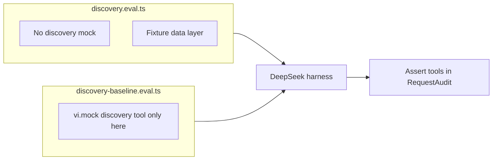

# V2.3.5-B Discovery Stabilization & Acceptance — Remediation Plan

> **For agentic workers:** REQUIRED SUB-SKILL: Use [subagent-driven-development](file:///Users/thomaswu/.cursor/plugins/cache/cursor-public/superpowers/d884ae04edebef577e82ff7c4e143debd0bbec99/skills/subagent-driven-development/SKILL.md) (recommended) or [executing-plans](file:///Users/thomaswu/.cursor/plugins/cache/cursor-public/superpowers/d884ae04edebef577e82ff7c4e143debd0bbec99/skills/executing-plans/SKILL.md). Steps use checkbox syntax.

**Goal:** Make V2.3.5-B correct, verifiable, and evaluable for real students by fixing audit findings F-01–F-18 (in scope), repairing the live discovery eval harness, and rerunning acceptance with valid evidence.

**Architecture (preserve):** Single read-only `discover_course_candidates` → batched reads in [`lib/assistant/data/discovery.ts`](lib/assistant/data/discovery.ts) → pure engine in [`lib/assistant/discovery/`](lib/assistant/discovery/) → explicit `present_response` only. No migrations, planner writes, or V2.3.5-C work.

**Tech stack:** TypeScript, Zod v3, Vitest, CopilotKit eval harness in [`evals/assistant/`](evals/assistant/), DeepSeek live evals.

**Baseline (verified):** Branch `feat/assistant-v2-3-5-b-discovery`, HEAD `2b00f30`, implementation gate `2aef5c0`. Working tree: only untracked [`docs/superpowers/audits/2026-10-26-assistant-v2-3-5-b-implementation-audit.md`](docs/superpowers/audits/2026-10-26-assistant-v2-3-5-b-implementation-audit.md). Spec/plan/verification unchanged on branch.

**Plan artifact path (save on approval):** [`docs/superpowers/plans/2026-10-26-assistant-v2-3-5-b-remediation.md`](docs/superpowers/plans/2026-10-26-assistant-v2-3-5-b-remediation.md)

## Global constraints (from B spec — do not regress)

- Read-only; difficulty 1=hard / 5=easy; fit semantics unchanged; `MAX_POOL_COURSES=150`, `MAX_DISCOVERY_RESULT_CHARS=12_000`; discovery never mounts rich UI; preregistered live thresholds unchanged unless methodologically invalid (then document + propose revision, do not silently relax).

---

## Finding resolution matrix (target state after remediation)

| ID | Planned disposition | Primary files |
|---|---|---|
| **F-01** | **Fixed** — strict nested schemas + actionable `invalid_request` details; regression tests for stripped-field cases | [`schema.ts`](lib/assistant/discovery/schema.ts), [`discover.ts`](lib/assistant/discovery/discover.ts), [`tool.ts`](lib/assistant/discovery/tool.ts) |
| **F-02** | **Fixed** — split baseline eval file; harness asserts tool in `requests[].tools`; successful vs attempted discovery | [`discovery.eval.ts`](evals/assistant/discovery.eval.ts), new `discovery-baseline.eval.ts`, [`discovery-grade.ts`](evals/assistant/discovery-grade.ts) |
| **F-03** | **Fixed** — `otherSections.meetings` as `string[]` (or consistent `"; "` join); tests use producer output | [`discover.ts`](lib/assistant/discovery/discover.ts), [`schema.ts`](lib/assistant/discovery/schema.ts), [`evidence.ts`](lib/assistant/discovery/evidence.ts) |
| **F-04** | **Fixed** — pass `clashes` on alternates into evidence / fit badge | [`discover.ts`](lib/assistant/discovery/discover.ts), [`evidence.ts`](lib/assistant/discovery/evidence.ts) |
| **F-05** | **Fixed** — suggested-year caveat in `DISCOVERY_NOTES` + tool description | [`discover.ts`](lib/assistant/discovery/discover.ts), [`tool.ts`](lib/assistant/discovery/tool.ts) |
| **F-06** | **Fixed** — soft `unknown` excluded from “satisfied” schedule score + tradeoff | [`rank.ts`](lib/assistant/discovery/rank.ts), [`constraints.ts`](lib/assistant/discovery/constraints.ts) |
| **F-07** | **Fixed** — shrink preserves safety fields or sets explicit compaction marker | [`discover.ts`](lib/assistant/discovery/discover.ts) (`shrinkDiscoverResult`) |
| **F-08** | **Fixed** — word/phrase-aware topic match (no bare `includes` for short tokens) | [`rank.ts`](lib/assistant/discovery/rank.ts) |
| **F-09** | **Fixed** — validate exclude codes; safe filter construction; count matched exclusions | [`schema.ts`](lib/assistant/discovery/schema.ts), [`data/discovery.ts`](lib/assistant/data/discovery.ts) |
| **F-10** | **Deferred (P3)** — server/UI planner-version mismatch for >30 sections; document in verification; smallest safe doc-only caveat in prompt if needed | — |
| **F-11** | **Fixed** — cross-turn ordinals from discovery + `present_response` without `get_course` | [`discussed-courses.ts`](lib/assistant/discussed-courses.ts), [`course-referent.ts`](lib/assistant/course-referent.ts), integration test |
| **F-12** | **Fixed** — code-level fit key for `check_plan_conflicts`; grader tests | [`discovery-grade.ts`](evals/assistant/discovery-grade.ts), [`eval-discovery.test.ts`](tests/assistant/eval-discovery.test.ts) |
| **F-13** | **Fixed** — remove/replace 200ms wall-clock gate in correctness suite | [`discovery-performance.test.ts`](tests/assistant/discovery-performance.test.ts) |
| **F-14** | **Deferred (P3)** — optional `runReadOnlyTool` wrap or documented exception in `tool.ts` | [`tool.ts`](lib/assistant/discovery/tool.ts) |
| **F-15** | **Accepted limitation (minimal)** — bracket review excerpts in discovery JSON; no prompt rewrite; note in verification | [`discover.ts`](lib/assistant/discovery/discover.ts) |
| **F-16** | **Fixed (minimal)** — detect mutually impossible required time rules → `notApplied` / note (no broad UX) | [`constraints.ts`](lib/assistant/discovery/constraints.ts) or [`discover.ts`](lib/assistant/discovery/discover.ts) |
| **F-17** | **Partial fix** — when `scope.topics` set, rank pool by topic score before 150 cap; strengthen truncated no-match honesty in notes | [`data/discovery.ts`](lib/assistant/data/discovery.ts), [`discover.ts`](lib/assistant/discovery/discover.ts) |
| **F-18** | **Partial fix** — cap total offer rows or sections processed per pool; dense fixture test | [`data/discovery.ts`](lib/assistant/data/discovery.ts) |

---

## Phase 0 — Baseline & branch hygiene

- Confirm HEAD, clean unrelated edits; commit audit doc only if requested (currently untracked).
- Snapshot “before” metrics: run targeted discovery tests, note full-suite perf failure, copy existing `.eval-results` paths from verification report if present locally.

---

## Phase 1 — Live eval harness (F-02, F-12) — **first priority**

**1.1 Split baseline configuration**

- Remove conditional `vi.mock` from [`evals/assistant/discovery.eval.ts`](evals/assistant/discovery.eval.ts) (lines 20–25); dev/holdout always register real `createDiscoveryTools`.
- Add [`evals/assistant/discovery-baseline.eval.ts`](evals/assistant/discovery-baseline.eval.ts): copy harness, **unconditional** mock returning empty discovery tools; set `settings.noDiscovery: true`; npm script or env `ASSISTANT_EVAL_NO_DISCOVERY=1` points at baseline file only.

**1.2 Grader corrections** ([`evals/assistant/discovery-grade.ts`](evals/assistant/discovery-grade.ts))

- `discoveryUsed` → require successful parse (`status: "ok"` via `parseDiscoverResult`), not name match alone.
- Add `discoveryAttempted` metric for diagnostics (optional in artifact).
- `newestFitsFromTrace`: for `check_plan_conflicts`, call `pushFit(..., primary: true)` when a single section or unambiguous primary section—mirror discovery’s code-level key (F-12).
- Extend [`tests/assistant/eval-discovery.test.ts`](tests/assistant/eval-discovery.test.ts): code-only verified claim + `check_plan_conflicts`; rejected unavailable tool does **not** count as use.

**1.3 Harness assertions**

- After each run, scan `trace.runs[].requests` (or equivalent in [`evals/assistant/grade.ts`](evals/assistant/grade.ts)) via [`request-audit.ts`](evals/assistant/request-audit.ts):
  - **Discovery-enabled:** every chat request’s `tools` includes `discover_course_candidates`.
  - **Baseline file:** `tools` must **not** include it.
- Fail fast in eval if violated (before threshold assertions).

**1.4 Diagnostic live eval (before full suite)**

- Add [`evals/assistant/discovery-diagnostic.eval.ts`](evals/assistant/discovery-diagnostic.eval.ts) (1–2 turns): e.g. easy GEST + `scope.courseType: "GE"`, assert tool present, ≥1 successful `ok` result, log parsed `args` to artifact for schema review.
- Command: `ASSISTANT_EVAL=1 ASSISTANT_EVAL_SUITE=dev ASSISTANT_EVAL_CASES=<one-id> ASSISTANT_EVAL_REPEATS=1 npm run eval:assistant -- evals/assistant/discovery-diagnostic.eval.ts`

**1.5 Full live rerun** (after code fixes in Phase 2–3)

- Dev: `ASSISTANT_EVAL_LABEL=b-dev` → `.eval-results/assistant/discovery-b-dev.json`
- Holdout: `ASSISTANT_EVAL_SUITE=holdout ASSISTANT_EVAL_LABEL=b-holdout`
- Baseline: run **baseline eval file** with label `b-baseline`
- Preserve thresholds from audit §20.1 unchanged.

---

## Phase 2 — Contract & correctness (F-01, F-05, F-06, F-08, F-09, F-16)

**2.1 F-01 — Silent constraint stripping**

- Apply `.strict()` to `discoveryScopeParameters`, `required`, `preferred`, and nested rule objects in [`schema.ts`](lib/assistant/discovery/schema.ts).
- Expose **executor-aligned** parameters to the model: use `discoverCourseCandidatesInputSchema` (or shared base + same refinements) in [`tool.ts`](lib/assistant/discovery/tool.ts) `parameters` so JSON Schema reflects anchor requirement.
- Extend failure envelope (strict) with optional `issues: { path: string; message: string }[]` from `ZodError`; map common mistakes in description (e.g. `credits` belongs in `scope`, not `required`; `timesToAvoid` → `avoidWindows` in `preferred`).
- Tests in [`tests/assistant/discovery-schema.test.ts`](tests/assistant/discovery-schema.test.ts) (or extend existing): `required.credits`, `required.must`, `preferred.timesToAvoid`, `preferred.noClassBefore`, missing/invalid `scope` → parse failure or explicit issues; assert no `verified_no_clash` path on stripped hard constraints.

**2.2 F-05 — Suggested-year caveat**

- Add to `DISCOVERY_NOTES` in [`discover.ts`](lib/assistant/discovery/discover.ts): catalog suggested year is not registration eligibility.
- Assert in discovery unit test on `notes`.

**2.3 F-06 — Soft unknown preferences**

- Update `schedulePreferenceScore` in [`rank.ts`](lib/assistant/discovery/rank.ts): denominator = rules with known outcome only; `unknown` adds tradeoff (e.g. “schedule preference could not be verified”).
- Test: incomplete meetings + `preferred.startAfter` → not perfect schedule score.

**2.4 F-08 — Topic matching**

- Replace `topicScore` `includes` with token/word-boundary helper (split on non-alphanumeric; for short tokens ≥3 chars or require boundary regex).
- Test: topic `"AI"` does not match `"daily"`.

**2.5 F-09 — excludeCodes**

- Tighten `courseCodeField` / array validation; build PostgREST `not.in` via validated list (no raw injection); set `excluded.excludedCodes` to **matched** primary codes excluded from pool ([`discover.ts`](lib/assistant/discovery/discover.ts) + data layer).
- Tests: malicious/quote characters rejected; happy path excludes.

**2.6 F-16 — Impossible required rules (minimal)**

- Before section loop, if required `startAfter`/`endBefore` impossible globally, add `notApplied` entry and optional note (empty candidates still valid).

---

## Phase 3 — Evidence, shrink, alternates (F-03, F-04, F-07)

**3.1 Structured meetings for alternates (F-03/F-04)**

- Change `candidateSchema.otherSections`: `meetings: z.array(z.string())` (best section already uses array).
- [`buildCandidate`](lib/assistant/discovery/discover.ts): `meetings: row.section.meetingLines` (no `join(", ")`); include `clashes: row.clashes` on alternates when schema extended.
- [`evidence.ts`](lib/assistant/discovery/evidence.ts): pass alternate `clashes` into `sectionEvidenceFromCandidate`.
- Fix [`tests/assistant/discovery-evidence.test.ts`](tests/assistant/discovery-evidence.test.ts) to use **producer-shaped** multi-meeting alternates; component test for clash badge text on alternate.

**3.2 Shrink safety (F-07)**

- Refactor `shrinkDiscoverResult`:
  - Trim order: review excerpts → titles → `matched`/`tradeoffs` → alternates count → **last** candidate count.
  - Never remove `mutualClashes`, `unverified`, `notApplied`, or per-candidate `clashes`/`fit` without setting top-level `compaction: { truncated: true, dropped: string[] }` (extend `discoverResultSchema` strictly).
  - If fit remains `verified_no_clash`, must retain qualifiers that justify it (plan complete, clashes empty).
- Add oversized fixture test in [`tests/assistant/discovery.test.ts`](tests/assistant/discovery.test.ts) asserting safety fields or compaction marker.

---

## Phase 4 — Referents & integration (F-11)

**4.1 Cross-turn discovery ordinals**

- [`discussed-courses.ts`](lib/assistant/discussed-courses.ts):
  - Extend turn validation: codes from successful `discover_course_candidates` + order from `present_response` in that turn (reuse [`activeRecommendationCourses`](lib/assistant/presentation.ts)).
  - For **active** ordinal context: if latest user turn has no new recommendations, use most recent prior turn’s recommendation order (discovery-grounded).
- [`course-referent.ts`](lib/assistant/course-referent.ts): ensure ordinal resolution uses updated `active` payload.
- **Integration test** in [`tests/components/assistant-v2-3-5-b.integration.test.tsx`](tests/components/assistant-v2-3-5-b.integration.test.tsx): discovery returns 3 candidates → present → user “second one” **without** `get_course`; repeat after compaction journey (extend J5 with ordinal assertion).

---

## Phase 5 — Hardening & perf (F-13, F-17, F-18)

**5.1 F-13** — In [`discovery-performance.test.ts`](tests/assistant/discovery-performance.test.ts): assert deterministic budgets (e.g. examined courses ≤150, JSON length ≤12_000, optional operation count) instead of `expect(ms).toBeLessThan(200)` in default suite; move wall-clock check to separate `discovery-performance-live.test.ts` or skip under `CI_FULL_SUITE`.

**5.2 F-17** — In [`readCatalog`](lib/assistant/data/discovery.ts): when `topics` present and count > 150, score all matches (or fetch count + score page) and keep top 150 by topic score then `New_code`; ensure `examined.truncated` true and notes remind model not to claim exhaustive search.

**5.3 F-18** — Add `MAX_OFFER_ROWS` (constant near pool limits); stop reading offers when exceeded; set flag in examined metadata if needed; dense fixture test.

---

## Phase 6 — Verification & deliverables

**6.1 Automated gates (after all code changes)**

| Gate | Command |
|---|---|
| Targeted discovery | `npx vitest run tests/assistant/discovery*.test.ts tests/assistant/eval-discovery.test.ts tests/assistant/discovery-evidence.test.ts tests/assistant/check-plan-conflicts.test.ts` |
| CopilotKit B journeys | `npx vitest run tests/components/assistant-v2-3-5-b.integration.test.tsx` |
| Full suite | `npx vitest run` |
| Types | `npx tsc --noEmit` |
| Lint | `npm run lint` |
| Build | `npm run build` |
| Controlled perf | standalone `discovery-performance` + real-data smoke eval |

**6.2 Live eval sequence**

1. Diagnostic eval (Phase 1.4)
2. Dev / holdout / baseline artifacts with tool-list proof
3. Before/after table: pass rate, discovery success rate, false-fit, median tool calls, steps used (compare to audit §20.1 invalid run)

**6.3 Browser acceptance**

- If Clerk + `npm run dev` available: 380px / 450px / 800px scenario from mission §7; record in [`docs/superpowers/verification/2026-10-26-assistant-v2-3-5-b-remediation-acceptance.md`](docs/superpowers/verification/2026-10-26-assistant-v2-3-5-b-remediation-acceptance.md) (new).
- If unavailable: section **UNVERIFIED — release blocker** (do not claim product acceptance).

**6.4 Documentation outputs**

1. This remediation plan (saved path above)
2. Updated verification report: [`docs/superpowers/verification/2026-10-26-assistant-v2-3-5-b-intelligent-discovery.md`](docs/superpowers/verification/2026-10-26-assistant-v2-3-5-b-intelligent-discovery.md) — correct invalid live claims; link new artifacts
3. Finding matrix (final statuses: fixed / verified nonissue / accepted limitation / deferred)
4. Independent final review: use [requesting-code-review](file:///Users/thomaswu/.cursor/plugins/cache/cursor-public/superpowers/d884ae04edebef577e82ff7c4e143debd0bbec99/skills/requesting-code-review/SKILL.md) or fresh read-only audit pass on remediation diff

**6.5 Completion gate (acceptance)**

All audit §25 checkboxes satisfied; live metrics valid or explicitly reported as blocked; browser done or marked blocker; no new P1/P2 in independent review. **Stop** — no merge, no V2.3.5-C.

---

## Risk notes

- **Schema strictness** may increase `invalid_request` until model adapts; diagnostic eval + enriched `issues` mitigate (no benchmark-specific prompt patches).
- **`otherSections.meetings` shape change** affects model JSON; update tool description and fixture evals together.
- **Live thresholds** may still fail after valid harness; report failure taxonomy (schema / data / ranking / model / orchestration / presentation) without relaxing gates.

## Self-review (spec coverage)

- Audit Group A (A1–A7): Phases 2–4
- Group B (B1–B8): Phases 2, 3, 5 + matrix deferrals
- Mission §2–§8 deliverables: Phase 6
- Architecture preservation: no new tools, no planner writes, no auto UI
