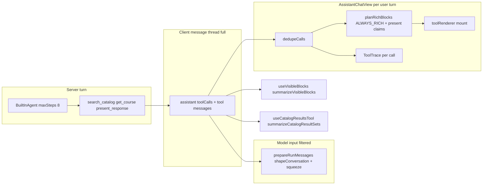

# V2.3.5 UX Stabilization: Intelligent Search Presentation

> **For agentic workers:** REQUIRED SUB-SKILL: Use superpowers:subagent-driven-development (recommended) or superpowers:executing-plans to implement this plan task-by-task.

**Goal:** Separate catalog **research execution** from **student-facing presentation** so multi-search turns stay compact while explicit browsing, curated cards, and inspectable evidence remain available.

**Architecture:** Extend [`lib/assistant/presentation.ts`](lib/assistant/presentation.ts) (same ledger/receipt pattern as course cards) with catalog presentation claims on `present_response`. Remove `search_catalog` / `filter_catalog_results` from unconditional rich mounting in [`lib/assistant/rich-tools.ts`](lib/assistant/rich-tools.ts). Enforce claims in `planRichBlocks` + [`components/assistant/assistant-chat-view.tsx`](components/assistant/assistant-chat-view.tsx), defer catalog list mounting until the turn is not streaming (except compact activity), and add client-only expansion for hidden turn research. Align agent context (`visible-blocks`, `catalog-result-sets`, ordinals) with **actually mounted** lists only.

**Tech stack:** Next.js, CopilotKit v2 (`useRenderTool`, `messageFilter`, `AssistantChatView`), existing parsers in `search-catalog-ui` / `catalog-result-sets`, Vitest + existing `assistant-v2-3-5.integration.test.tsx` harness.

## Global Constraints

- Do not cap `search_catalog` tool results or max research calls for UI reasons.
- Do not implement V2.3.5-B/C/D, V2.4 planner mutations, or new agent frameworks.
- Preserve P1 stabilization: [`prepareRunMessages`](lib/assistant/run-messages.ts) via [`messageFilter`](components/assistant/assistant-panel.tsx), conflict-verification ledger, course/section card semantics, timetable previews, academic facts.
- Frontend owns mounting; `present_response` receipt ≠ visible UI.
- Smallest diff: one presentation framework, no second workflow engine.

---

## 1. Baseline: search-to-render pipeline (HEAD)



| Question | Answer at HEAD |
|----------|----------------|
| Why does every `search_catalog` produce rich UI? | [`ALWAYS_RICH_TOOL_NAMES`](lib/assistant/rich-tools.ts) includes `search_catalog` and `filter_catalog_results`. [`planRichBlocks`](lib/assistant/presentation.ts) mounts any always-rich tool when `hasResult \|\| running`. |
| Can results stay in thread but not render? | Yes—tool messages remain in `agent.messages`; only `AssistantTurn` gates `toolRenderer.render`. Today nothing is hidden. |
| Turn grouping? | [`buildTurns`](components/assistant/assistant-chat-view.tsx) groups by `user` messages; `AssistantTurn` aggregates all assistant parts in that turn. |
| Streaming behavior? | `streamingHere = isRunning && isLast` passes `running=true` into `planRichBlocks`, mounting always-rich tools early (loading, then full list per completed search). |
| Wait for presentation decision? | Only for `get_course` / sections via `present_response`; **not** for catalog. |
| Result-set IDs / filters? | `resultSetId = toolCallId`; [`catalog-filter-store`](components/assistant/catalog-filter-store.tsx); [`collectCatalogResultSets`](lib/assistant/catalog-result-sets.ts) scans **all** searches in thread. |
| Presentation receipt vs search? | Receipt covers course/section cards only; search bypasses receipt. |
| Inspect hidden without new run? | Not supported today—must add client expansion over existing tool messages. |
| Other floods? | `preview_timetable` is always-rich (usually one block). Multiple `get_course` lookups are suppressed unless claimed. |

**Root cause (flooding):** unconditional always-rich catalog mounting × N searches per turn × immediate mount on each tool result during streaming × no dedupe across lists in UI.

**Prompt conflict to fix:** [`prompt.ts`](lib/assistant/prompt.ts) line ~21 still says course search results **always** appear as an interactive list (V2.3.5-A C8)—this task reverses that for research-shaped turns while keeping browse explicit.

---

## 2. Architectural choice

### Selected: **Hybrid A + B (minimal)**

| Piece | Source |
|-------|--------|
| Model semantic intent for browse / recommendations | **Option A** — extend `present_response` |
| Default hide multi-search lists, streaming deferral, deduped research panel, row caps | **Option B** — turn-level policy in `planRichBlocks` + chat view |

### Rejected

| Alternative | Why not |
|-------------|---------|
| Turn heuristics only (keyword “show all”) | Recreates phrase-gating failure mode. |
| Hide all catalog UI always | Breaks Mode C explicit browsing. |
| Separate `present_catalog` tool | Second presentation framework; more prompt surface. |
| Frontend-only hide without model claims | Browse mode becomes unreachable unless heuristics guess wrong. |

### Presentation contract (extend `present_response`)

Add optional fields alongside existing `show` (keep backward compatible: `{ show: [] }` still valid).

```ts
// lib/assistant/presentation.ts (conceptual)
type PresentCatalog =
  | { mode: "browse"; resultSetId?: string } // default: newest successful course search in this turn
  | { mode: "hidden" }; // optional explicit; default when omitted

type PresentRecommendations = { courses: string[] }; // max 5, unique, validated codes

type PresentRequest = {
  show?: PresentShow[];
  catalog?: PresentCatalog;
  recommendations?: PresentRecommendations;
};
```

**Receipt extensions** (mirror card eligibility):

- `catalog`: `ready | missing_search | lookup_failed` (+ `resultSetId` resolved)
- `recommendations.items[]`: `{ course, eligibility: ready | not_in_turn_evidence }`

**Frontend mounting rules** (`planRichBlocks`):

| Mode | Mount |
|------|--------|
| Research (default) | No per-search lists; optional turn-level **CatalogResearchSummary** (compact + expandable). |
| `catalog.mode === "browse"` | One `search_catalog` rich block (claimed `resultSetId` or newest course search in turn). |
| `recommendations.courses` | Do **not** auto-mount full lists; use for **ordinal / discussed context**; optional compact rows only if also claimed via `show` course_detail (existing, max 3—bump to **5** only for `course_detail` if needed for Mode B). |
| `filter_catalog_results` | Rich block only when its `resultSetId`’s catalog list is mounted (or user expanded research panel targeting that set). |
| `preview_timetable` | Unchanged (stay always-rich). |
| Streaming last turn | No catalog **list** mounts until `!streamingHere`; show grouped activity + in-progress labels. |

**Progressive disclosure (client-only):**

- Turn state: `expandedResearch: boolean` (per turn in `AssistantTurn` or small store keyed by turn id).
- “View catalog research” reveals deduped merged courses from **all successful `search_catalog` course results in that turn** (by canonical `courseCode`), preserving per-set metadata internally for filters—not a new agent run.
- Browse list: initial **15** rows in [`SearchCatalogCoursesResult`](components/assistant/search-catalog-tool-render.tsx), “Show more loaded courses” grows within loaded page only; honest `totalCount` / `hasMore` copy unchanged.

---

## 3. Context and referent alignment

| Context | Change |
|---------|--------|
| [`summarizeCatalogResultSets`](lib/assistant/catalog-result-sets.ts) | Build from **visible** result sets only (same `planRichBlocks` plan as UI, `running=false`). Hidden research: omit from ordinal/filter context; optional separate compact JSON field `hiddenSearchCount` for model honesty (“I searched N times”). |
| [`summarizeVisibleBlocks`](lib/assistant/visible-blocks.ts) | `course_list` only when catalog browse mounted; add `research_summary` block `{ searchCount }` when turn had hidden searches. |
| [`summarizeDiscussedCourses`](lib/assistant/discussed-courses.ts) / [`course-referent.ts`](lib/assistant/course-referent.ts) | When `present_response.recommendations` validates, expose ordered list with `newerThanCatalog: true` so “second recommendation” resolves to **visible recommendation order**, not hidden search row 2. |
| Tool thread / compaction | No change to full client messages; `prepareRunMessages` unchanged. |

Update [`prompt.ts`](lib/assistant/prompt.ts) rich-content bullets (~3–5 lines): research searches stay compact; call `present_response` with `catalog.browse` for list browsing; use `recommendations` when answering with a shortlist; summarize hidden research in prose; keep filter_catalog_results scoped to **shown** result sets.

Update `present_response` description in [`tools.ts`](lib/assistant/tools.ts) (not a large prompt rewrite).

---

## 4. UI components

| Component | Responsibility |
|-----------|----------------|
| **New** [`components/assistant/catalog-research-summary.tsx`](components/assistant/catalog-research-summary.tsx) | Compact line: “Catalog research completed · N searches”; expandable details (per-search query + status, no 50-row lists until expanded); merged deduped list when expanded. |
| [`assistant-chat-view.tsx`](components/assistant/assistant-chat-view.tsx) | Insert summary above rich blocks; collapse `ToolTrace` search rows when `search_catalog` count ≥ 2 (optional [`tool.tsx`](components/ai-elements/tool.tsx) `CatalogSearchActivity` grouped row); wire expansion. |
| [`search-catalog-tool-render.tsx`](components/assistant/search-catalog-tool-render.tsx) | Row cap + expand; support `variant="browse"`. |

Sidebar QA: manual check at 380 / 450 / 800px (`panel-width` / resize handle)—no new nested scroll unless required.

---

## 5. Implementation tasks (ordered)

### Task 1 — Baseline doc + failing tests

- Add [`docs/superpowers/plans/2026-10-26-assistant-v2-3-5-search-presentation.md`](docs/superpowers/plans/2026-10-26-assistant-v2-3-5-search-presentation.md) (this plan, synced on implementation start).
- Add [`tests/assistant/catalog-presentation.test.ts`](tests/assistant/catalog-presentation.test.ts): parse/validate `present_response` catalog + recommendations; `planRichBlocks` scenarios (5 searches → 0 list blocks; browse claim → 1; streaming → defer).
- Extend [`tests/components/assistant-chat-view.test.tsx`](tests/components/assistant-chat-view.test.tsx): replace “two rich search blocks” expectations with research summary + zero lists unless `present_response` browse present.
- Add integration scenario file or section in [`tests/components/assistant-v2-3-5.integration.test.tsx`](tests/components/assistant-v2-3-5.integration.test.tsx) for Scenarios 1–7 (deterministic mock tool sequence).

### Task 2 — Presentation schema + planner

- Extend [`presentation.ts`](lib/assistant/presentation.ts): types, `parsePresentRequest`, `activePresent` (last valid catalog/recommendations), `executePresentResponse` validation against turn searches (pass messages or precomputed search index into execute—minimal: validate `resultSetId` exists in ledger populated by new `trackCatalogSearch` records).
- Update `planRichBlocks`: remove dependence on always-rich for catalog; implement catalog winners + streaming gate.
- Adjust [`rich-tools.ts`](lib/assistant/rich-tools.ts): remove `SEARCH_CATALOG_TOOL_NAME` and `FILTER_CATALOG_RESULTS_TOOL_NAME` from `ALWAYS_RICH_TOOL_NAMES` (keep in `RICH_TOOL_NAMES`).
- Update [`tools.ts`](lib/assistant/tools.ts) Zod parameters + description.

### Task 3 — Agent context

- [`visible-blocks.ts`](lib/assistant/visible-blocks.ts): align with new planner; research_summary block.
- [`catalog-result-sets.ts`](lib/assistant/catalog-result-sets.ts): `collectVisibleCatalogResultSets(messages, visibleCallIds)`; update `summarizeCatalogResultSets` caller in [`use-catalog-results-tool.tsx`](components/assistant/use-catalog-results-tool.tsx).
- [`discussed-courses.ts`](lib/assistant/discussed-courses.ts) + tests: ingest recommendation order from latest turn’s valid `present_response`.

### Task 4 — Chat UI + renderers

- [`catalog-research-summary.tsx`](components/assistant/catalog-research-summary.tsx) + helpers in [`lib/assistant/catalog-research.ts`](lib/assistant/catalog-research.ts) (merge/dedupe turn searches, pure functions for tests).
- [`assistant-chat-view.tsx`](components/assistant/assistant-chat-view.tsx): mount summary, grouped activity, expansion state, streaming deferral.
- [`search-catalog-tool-render.tsx`](components/assistant/search-catalog-tool-render.tsx): pagination/expand within loaded rows.

### Task 5 — Prompt + eval touch-up

- Minimal [`prompt.ts`](lib/assistant/prompt.ts) edits (replace “always appear as interactive list”).
- Run targeted tests; update [`tests/assistant/presentation.test.ts`](tests/assistant/presentation.test.ts) always-rich expectations.

### Task 6 — Verification report

- Create [`docs/superpowers/verification/2026-10-26-assistant-v2-3-5-search-presentation.md`](docs/superpowers/verification/2026-10-26-assistant-v2-3-5-search-presentation.md) with all 14 required sections from the spec (root cause, before/after flow, rejected options, streaming, referents, tests, browser/live-model, limitations, B/C compatibility, release verdict).

---

## 6. Test matrix (acceptance mapping)

| Spec scenario | Primary test location |
|---------------|----------------------|
| 1 Multi broad searches | `catalog-presentation.test.ts` + chat-view integration |
| 2 Explicit GEST browse | integration with `present_response` browse |
| 3 Curated GEST recommend | recommendations context + no full list |
| 4 Second recommendation | `course-referent` / discussed-courses unit tests |
| 5 Show other options | chat-view expansion without `runAgent` spy calls |
| 6 Mixed tool outcomes | research summary partial failure copy |
| 7 Interrupted stream | existing interrupted test + no orphan lists |
| 8 Regression | full `npx vitest run`, `tsc`, `lint`, build |

---

## 7. Live / browser evaluation

- **Live model:** If `.env.local` DeepSeek key present, run bounded comparison on 3 prompts (AI recommend, GEST browse, easy GEST suggest)—record metrics from spec §11 in verification report; else mark UNVERIFIED.
- **Browser:** Authenticated manual pass on same flows at 380/450/800px; else UNVERIFIED.

---

## 8. V2.3.5-B / C compatibility

- **B (planning-discovery):** New tools add research calls; this layer only affects presentation—no change to tool payloads.
- **C (persistence):** Turn-level expansion state is ephemeral today; document as limitation; persisted threads should rehydrate lists from messages + same planner (no new storage required for MVP).

---

## 9. Key files touched (summary)

| File | Change |
|------|--------|
| [`lib/assistant/presentation.ts`](lib/assistant/presentation.ts) | Catalog/recommendations contract, planner |
| [`lib/assistant/rich-tools.ts`](lib/assistant/rich-tools.ts) | Drop always-rich catalog |
| [`lib/assistant/tools.ts`](lib/assistant/tools.ts) | Tool schema/description |
| [`lib/assistant/prompt.ts`](lib/assistant/prompt.ts) | Short rich-content update |
| [`lib/assistant/catalog-result-sets.ts`](lib/assistant/catalog-result-sets.ts) | Visible-only context |
| [`lib/assistant/visible-blocks.ts`](lib/assistant/visible-blocks.ts) | Visible research/browse blocks |
| [`lib/assistant/discussed-courses.ts`](lib/assistant/discussed-courses.ts) | Recommendation ordinals |
| [`components/assistant/assistant-chat-view.tsx`](components/assistant/assistant-chat-view.tsx) | Summary, deferral, grouping |
| [`components/assistant/search-catalog-tool-render.tsx`](components/assistant/search-catalog-tool-render.tsx) | Row cap / expand |
| **New** `lib/assistant/catalog-research.ts`, `components/assistant/catalog-research-summary.tsx` | Dedupe + UI |

**Preserve unchanged:** [`agent.ts`](lib/assistant/agent.ts) step loop, [`run-messages.ts`](lib/assistant/run-messages.ts), course detail/section renderers, timetable tools, conflict verification.
